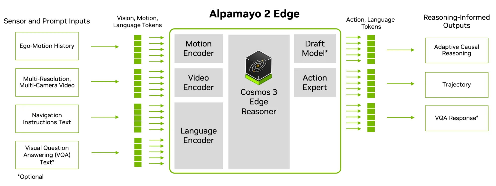
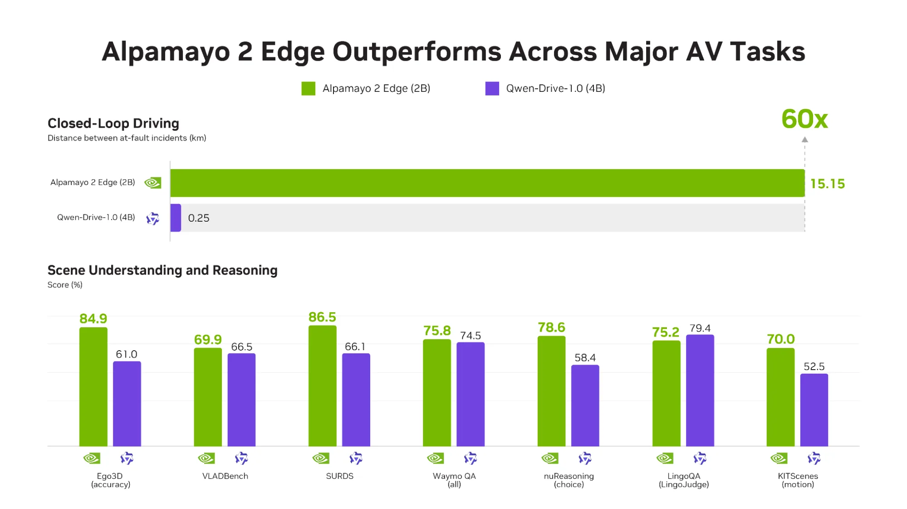
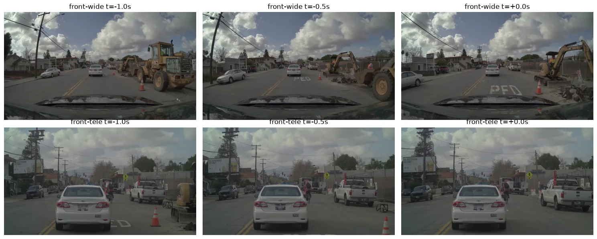
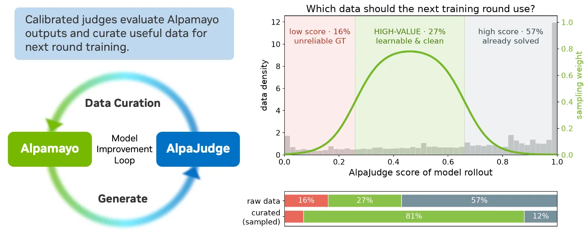
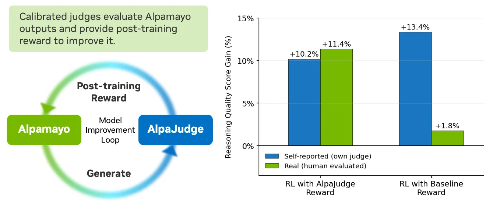

# NVIDIA Alpamayo 2 Edge · AlpaJudge — 온보드 컴퓨트·지연 한계 안에서 AV 추론 모델 구동하기

> **작성일**: 2026-11-12 · 기사 게재일 2026-11-10 · 상위 주제: [03-nvidia-alpamayo](../) 후속편  
> **대상 자료**: NVIDIA Technical Blog, *Running AV Reasoning Models Within Onboard Compute and Latency Limits* (Marco Pavone, Boris Ivanovic) [1]  
> **출처 표기 원칙**: 모든 사실 문장과 표 행에 `[번호]`를 달고, 말미 출처 목록에 URL을 수록했다. 등급은 📄 기술 블로그(기사 본문) · 🔍 공식 저장소·모델 카드(기사가 링크한 1차 자료). 기사 안의 파트너 인용 수치(PORT·Niulinx·Embedl)는 각 사의 자체 평가이며 NVIDIA가 독립 검증한 것은 아니므로 **"파트너 자체 평가"로 따로 표기**한다. 기사에 없는 내용은 쓰지 않았고, 기사가 링크한 저장소·모델 카드 본문은 이번 작성에서 직접 열어 보지 않았다(출처 미확인 항목은 본문에 명시).  
> **그림**: 기사 원본 도식 5장을 `images/`에 저장해 수록했다(저작권은 NVIDIA에 있으며 인용 목적). 그림 설명 문장은 기사 캡션을 번역한 것이다.

---

## 1. 핵심 요약

- **무엇을 발표했나**: 2B 파라미터 적응형 추론 VLA(vision-language-action) 모델 **Alpamayo 2 Edge**와, 추론 품질을 사람 기준으로 채점하는 평가·보상 모델 **AlpaJudge**를 소개했다. 둘 다 Hugging Face에 공개되어 있다 [1][2][3].
- **해결하려는 문제**: 큰 추론 모델은 능력의 토대가 되지만 차량 온보드 시스템에 넣으려면 모델 크기를 줄이고, 유용한 추론은 보존하고, 타깃 하드웨어(DRIVE AGX Thor)에서 성능을 검증하는 추가 작업이 필요하다 [1].
- **어떻게 풀었나**: Cosmos 3 Edge의 2B Nemotron 추론 백본 + 디퓨전 액션 전문가 구조, 필요할 때만 추론을 생성하는 적응형 추론, Alpamayo 2 Super의 CoC 오토라벨로 오프라인 디스틸레이션, AlpaGym 폐루프 RL, DFlash2 speculative decoding, TensorRT·TensorRT-Edge-LLM 양자화 레시피를 결합했다 [1].
- **결과**: DRIVE AGX Thor-X에서 픽셀→궤적 지연 160~190 ms. AlpaSim 폐루프에서 과실 사고 간 거리가 Qwen-Drive-1.0(4B) 대비 약 60배. 폐루프 RL만으로 폐루프 주행 성능 48.9% 향상 [1].
- **평가 체계**: AlpaJudge는 참조 답변 기반(RB)과 참조 없는 영상 기반(RF) 두 변형이며, ① 추론 트레이스 평가 ② 학습 데이터 선별 ③ RL 보상의 세 용도로 쓰인다 [1].

**핵심 숫자**

| 지표 | 값 | 비고 | 출처 |
|---|---|---|---|
| 모델 크기 | 2B 파라미터 | Cosmos 3 Edge Nemotron 백본 | [1] |
| 픽셀→궤적 지연 (Thor-X) | 160~190 ms | 추론 양에 따라 변동 | [1] |
| 폐루프 RL 효과 | +48.9% | RL 없는 최고 체크포인트 대비 | [1] |
| AlpaSim 과실 사고 간 거리 | 15.15 km vs 0.25 km | Alpamayo 2 Edge(2B) vs Qwen-Drive-1.0(4B), 약 60× | [1] |
| 오픈루프 minADE | 0.53 m vs 1.68 m | 낮을수록 좋음 | [1] |
| AlpaJudge 보상 효과 | +10.2% / +11.4% | 판정 모델 기준 / 사람 평가 기준, Alpamayo 2 Super 기반 pre-RL 모델 | [1] |
| 데이터 큐레이션 | 중간 점수대 27% → 81% | 점수 기반 리샘플링 | [1] |

---

## 2. 시사점

1. **"추론을 항상 하지 않는다"가 엣지 배포의 핵심 전환이다.** 적응형 추론으로 평상시에는 `<NOMINAL>` 토큰만 내보내 토큰 생성량 자체를 줄인다 [1]. 양자화·speculative decoding 같은 시스템 최적화보다 앞선, 모델 설계 수준의 지연 절감 전략이다. 지연이 160~190 ms라는 **범위**로 제시된 것은 추론 양에 따라 지연이 달라진다는 뜻이므로 [1], 안전 관점에서는 최악 사례(최대 추론) 기준의 지연 예산 설계가 필요하다. 이 마지막 문장은 기사의 진술이 아닌 작성자의 해석이다.
2. **Super → Edge의 티어 구조가 굳어졌다.** 큰 모델(Alpamayo 2 Super)은 오토라벨·교사 역할, 작은 모델(Edge)은 차량 탑재용으로 역할이 나뉜다 [1]. Niulinx는 Edge가 Super보다 제로샷 일반화 수치가 더 좋았다고 밝혔는데(minADE −13.6%) [1], 이는 "작은 모델 = 성능 손실"이라는 전제가 항상 성립하지 않음을 시사한다. 다만 파트너 자체 평가라 추가 검증이 필요하다.
3. **추론 품질을 정량화하는 판정 모델이 개발 루프의 중심에 들어왔다.** 궤적 지표만으로는 설명이 맞는지 알 수 없다는 문제를 AlpaJudge로 풀고, 같은 점수를 평가·데이터 큐레이션·RL 보상에 재사용한다 [1]. VLA 시대에는 판정 모델을 얼마나 사람 기준에 맞게 캘리브레이션하느냐가 경쟁력이 된다.
4. **데이터 큐레이션 원칙이 구체적으로 제시됐다.** 점수가 매우 낮은 샘플은 라벨 오류·실패 롤아웃·진짜 어려운 사례일 수 있어 일괄 삭제하면 희귀 실패까지 사라지고, 매우 높은 샘플은 이미 잘하는 쉬운 데이터라 학습 가치가 낮다. 중간 구간이 가장 유익하며, 큐레이션으로 그 비중을 27%에서 81%로 끌어올렸다 [1]. 자체 데이터셋을 가진 팀이 바로 적용할 수 있는 방법론이다.
5. **보상 해킹 방지 설계를 명시했다.** RL 보상에 추론 점수를 넣되 궤적 게이트를 유지하고 두 성분 점수를 따로 로깅해, 유창하지만 틀린 주행 설명이 높은 총보상을 받지 못하게 한다 [1]. LLM 기반 보상을 쓰는 다른 도메인에도 참고가 된다.
6. **NVIDIA 생태계 결합이 더 깊어진다.** 모델(Alpamayo), 시뮬레이터(AlpaGym·AlpaSim·NuRec), 판정 모델(AlpaJudge), 배포 스택(TensorRT Edge-LLM·DRIVE OS), 데이터셋(PhysicalAI-AV)이 한 묶음으로 제공된다 [1]. 파트너들이 "며칠 안에" 실차·실시간 구동까지 갔다는 인용은 진입 속도가 빠르다는 뜻이지만 [1], 스택 교체 비용도 함께 커진다는 점은 작성자의 해석이다.
7. **이 저장소 관점**: 상위 주제 [03-nvidia-alpamayo](../)의 직접 후속편이다. 기존 보고서가 다룬 Alpamayo 1·1.5·2 Super 비교와 SW/HW 요구사항에 비해, 이번 기사는 **엣지 배포(2B·Thor 실시간)**와 **추론 평가 모델(AlpaJudge)**이라는 두 축을 새로 더했다. [14-alpamayo-hardware-alternatives](../../14-alpamayo-hardware-alternatives/)가 다룬 "Thor 대안 하드웨어" 논의도 2B 모델이 등장하면서 전제가 달라졌다.

---

## 3. 내용 정리

### 3.1 Alpamayo 2 Edge 모델 구조



*그림 1. Alpamayo 2 Edge는 멀티 카메라 영상, 에고 모션 히스토리, 내비게이션 지시를 처리해 적응형 인과 추론과 주행 궤적을 생성하며, 선택적 시각 질의응답을 지원한다. 에고 모션 히스토리·멀티 해상도 카메라 영상·내비게이션 텍스트·선택적 시각 질문이 모션·비디오·언어 인코더로 들어가고, Cosmos 3 Edge Reasoner 백본·드래프트 모델·액션 전문가가 적응형 인과 추론, 주행 궤적, VQA 응답을 만든다 [1].*

| 구성 요소 | 내용 | 출처 |
|---|---|---|
| 백본 | NVIDIA Cosmos 3 Edge의 2B Nemotron 기반 추론 백본, 온보드 추론에 맞춘 크기 | [1][5] |
| 액션 출력 | 디퓨전 액션 전문가(diffusion action expert). 예제 스크립트 기본값은 `inference_step: 10` | [1] |
| 입력 | 멀티 해상도 서라운드 카메라 영상(시간 맥락 포함), 에고 모션 히스토리, 내비게이션 텍스트, 선택적 시각 질문 | [1] |
| 출력 | Chain-of-Causation(CoC) 추론 트레이스, 미래 주행 궤적, 선택적 VQA 응답 | [1] |
| 보조 모듈 | DFlash2 드래프트 모델(speculative decoding용) | [1][6] |

**적응형 추론**: 모델이 상황을 평범하다고 판단하면 추론 트레이스 대신 `<NOMINAL>` 특수 토큰을 출력해 불필요한 토큰 생성과 추론 연산을 줄인다 [1].

**학습·최적화 기법** (기사가 "새 기능"으로 나열한 7가지) [1]

- 2B 파라미터 Nemotron 기반 추론 백본.
- 적응형 추론으로 평상시 토큰 생성·연산 절감.
- 오프라인 디스틸레이션: Alpamayo 2 Super가 생성한 CoC 추론 오토라벨로 학습.
- AlpaGym에서의 폐루프 RL 포스트트레이닝: 시뮬레이션 안에서 자기 행동의 결과로부터 end-to-end 학습. RL 없는 최고 체크포인트 대비 폐루프 주행 성능 48.9% 향상 [1][4].
- 멀티 해상도 입력으로 서라운드 뷰 관측을 온라인에서 효율적으로 인코딩.
- DFlash2 speculative decoding으로 품질 손실 없이 온라인 추론 가속.
- NVIDIA TensorRT·TensorRT-Edge-LLM 기반 양자화·추론 가속 레시피.

**추론 스크립트 요지** [1][7]: `load_model("nvidia/Alpamayo2-Edge")`로 모델을 로드하고 PhysicalAI-AV 클립을 `prepare_model_inputs`로 준비한 뒤 `sample_trajectories_from_data`를 호출한다. 기사 예제의 샘플링 설정은 다음과 같다.

```python
settings = dict(
    seed=43,
    top_p=0.98,
    top_k=None,
    temperature=0.6,
    num_traj_sets=1,
    num_traj_samples=1,
    max_generation_length=256,
    diffusion_kwargs={"inference_step": 10},
)
```

### 3.2 벤치마크와 파트너 평가



*그림 2. Alpamayo 2 Edge(2B)와 Qwen-Drive-1.0(4B)의 폐루프 주행·오픈루프 주행·장면 이해 및 추론 벤치마크 비교. Alpamayo 2 Edge는 AlpaSim에서 과실 사고 간 거리 약 60배를 달성했다 [1].*

| 지표 | Alpamayo 2 Edge (2B) | Qwen-Drive-1.0 (4B) | 출처 |
|---|---|---|---|
| AlpaSim 폐루프, 과실 사고 간 거리 | 15.15 km | 0.25 km | [1] |
| 오픈루프 minADE (낮을수록 좋음) | 0.53 m | 1.68 m | [1] |
| Ego3D (accuracy) | 84.9 | 61.0 | [1] 그림 2 |
| VLADBench | 69.9 | 66.5 | [1] 그림 2 |
| SURDS | 86.5 | 66.1 | [1] 그림 2 |
| Waymo QA (all) | 75.8 | 74.5 | [1] 그림 2 |
| nuReasoning (choice) | 78.6 | 58.4 | [1] 그림 2 |
| LingoQA (LingoJudge) | 75.2 | **79.4** (Qwen 우세) | [1] 그림 2 |
| KITScenes (motion) | 70.0 | 52.5 | [1] 그림 2 |

장면 이해·추론 7개 벤치마크 점수는 기사 본문이 아닌 그림 2에 숫자로 적혀 있다. LingoQA 한 항목만 Qwen-Drive-1.0이 앞서며, 기사 캡션의 "거의 모든 항목에서 우세"는 이 예외를 가리킨다 [1]. 오픈루프 minADE 값은 그림 2의 대체 텍스트(alt text)에 적혀 있고 게시된 이미지에는 해당 패널이 없다 [1].

**파트너 코멘트** — 모두 각 사의 자체 평가이며 기사에 인용된 그대로다 [1].

| 파트너 (발언자) | 내용 |
|---|---|
| PORT (Matas Simonavicius, CTO) | 조기 접근 며칠 안에 자사 런던 주행 기록의 NuRec 재구성에서 폐루프 구동. 초기 시뮬레이션에서 Alpamayo 1.5 대비 차선 유지 성공 2배 이상, 차선 오프셋 복구 약 40% 더 많음, 같은 GPU에서 수작업 튠한 Alpamayo 1.5 서버보다 계획 속도 약 2배 |
| Niulinx (Luca Crotti, 공동창업자·모션 플래닝 리드) | 센서 구성이 크게 달라도 제로샷 평가에서 Alpamayo 2 Super 대비 minADE 13.6% 감소, 3초 횡방향 RMSE 46.1% 감소. 자체 주행 데이터 파인튜닝으로 Edge 베이스라인 대비 minADE 추가 44.2% 감소. 모델 수령 후 며칠 안에 실차 첫 테스트. 영상 1: 교통 경찰 수신호에 정차하고 횡단보도 보행자에 양보 |
| Embedl (Hans Salomonsson, CEO·공동창업자) | 48시간 안에 AGX Thor에서 10 Hz 실시간 계획 구동. 영상 2: PyTorch 구동 vs Embedl 최적화 구동의 계획 속도·지연·추론 출력 비교 |

### 3.3 DRIVE AGX Thor 배포 레시피

- Hugging Face 기본 가중치는 **BF16**이며, 지원되는 NVIDIA GPU 어디서나 PyTorch 모델로 바로 실행할 수 있다. DRIVE AGX Thor에서 실시간 구동하려면 추가 추론 최적화가 필요하다 [1][2].
- **Alpamayo Developer Hub**의 레시피 단계: Alpamayo 2 Edge 체크포인트와 DFlash2 드래프터 스테이징 → FP8 스케일 캘리브레이션 → ONNX 그래프 내보내기 → TensorRT Edge-LLM 플러그인으로 TensorRT 엔진 빌드 → 파이썬 하네스 실행 [1][8].
- 기준 측정 환경: **DRIVE AGX Thor-X, DRIVE OS 7.2.7.0, CUDA 13.4, TensorRT 11.3.1.9** [1].
- 결과: 최적화 모델의 픽셀→궤적 추론 지연 **160~190 ms**(추론 양에 따라 변동) [1].
- 레시피는 내보내기·빌드·캘리브레이션 출처, 보드 요구사항, 단계별 측정값을 문서화해 개발자가 자기 Thor 구성에서 지연과 품질 검사를 재현할 수 있게 한다. 품질 검사는 동일 입력과 시드된 액션 노이즈로 만든 BF16 PyTorch 참조 출력과 최적화 출력을 비교한다 [1].

실행 명령(기사 원문) [1]:

```bash
python -m alpamayo2edge_edgellm.runtime.run \
  --engines "$WORK/engines" \
  --model "$MODEL" \
  --reference "$INPUTS" \
  --dflash2 \
  --rolling \
  --warmup 1 \
  --repeat 5 \
  --output "$WORK/results.json"
```

### 3.4 AlpaJudge: 추론 품질 평가 모델

궤적 지표는 모델이 어떻게 계획·주행하는지를 말해 준다. 추론 평가는 "모델의 설명이 관련 장면 맥락을 짚어내고, 설명하는 결정을 뒷받침하는가"라는 다른 차원을 더한다. AlpaJudge는 Alpamayo 2 Edge(및 이전 모델) 개발에 쓰인 사람 기준 캘리브레이션 판정 모델이다 [1]. 체크포인트는 `nvidia/alpajudge` 아래 `reference-based/`와 `reference-free/` 두 하위 폴더로 제공되며 로더도 각각 다르다. 모델 로드에는 CUDA GPU와 가중치용 약 5 GB(활성화 제외)가 필요하다 [1][3].

| 변형 | 필요 입력 | 반환값 | 출처 |
|---|---|---|---|
| **AlpaJudge-RB** (reference-based) | 질문, 참조 답변, 후보 답변. 이미지 불필요 | 정렬 확률 1개 (0~1) | [1] |
| **AlpaJudge-RF** (reference-free) | 전방 광각 3프레임 + 전방 망원 3프레임, 에고 메타액션 과거·미래, 후보 근거(rationale) | 루브릭 확률 5개 + action·component·overall 점수 | [1] |

- RB는 장면을 독립적으로 검사하는 것이 아니라 **주어진 참조와의 일치도**를 측정한다. RF는 참조 근거가 필요 없지만 동기화된 시각 증거와 형식에 맞는 메타액션 맥락이 필요하다 [1].
- RF의 5개 루브릭: 행동/참조 일치(p_match), 행동 안전성(p_safe), 구성요소 접지(p_grounded), 구성요소 완전성(p_complete), 인과 일관성(p_causal) [1].
- 점수 공식 [1]:
    - action = p_match × (1 + p_safe) / 2
    - component = mean(p_grounded, p_complete, p_causal)
    - overall = 0.6 × action + 0.4 × component

### 3.5 워크플로 1: PhysicalAI-AV 샘플에 AlpaJudge 실행

예제 노트북은 PhysicalAI-AV 샘플에 묶인 데이터, 메타액션 맥락, 후보 근거, 참조 근거를 시각화하는 출발점이다. 같은 레코드를 정책이 생성한 CoC 트레이스로 다시 채점할 수 있다. 낮은 점수를 장면까지 추적할 수 있도록 출력에 클립 ID, 타임스탬프, 카메라 이름, 액션 맥락을 보존한다 [1][9].

- 오픈루프 평가에서는 후보 설명과 궤적을 기록된 어노테이션과 비교한다. 폐루프 평가에서는 각 정책 결정 시점의 설명을 그 롤아웃의 관측·액션 맥락으로 채점한다 [1].
- 높은 추론 점수는 근거가 판정 모델의 루브릭에 맞는다는 증거이고, 충돌·도로 이탈·근접 조우·궤적 지표는 주행 행동의 다른 측면을 설명한다. **함께 보고**해야 한다 [1].



*그림 3. 노트북에 사용된 클립의 시각화. 여러 시점의 멀티 카메라 프레임이 보인다 [1].*

**단계** [1]

1. **환경 설정과 노트북 열기**: AlpaJudge 저장소 루트에서 고정 환경을 설치하고 모델·PhysicalAI-AV 데이터셋 인증 후 노트북을 연다.
    ```bash
    uv sync --locked --dev
    hf auth login
    uv run jupyter lab examples/alpajudge_pai.ipynb
    ```
    노트북은 클립 `030c760c-ae38-49aa-9ad8-f5650a545d26`의 5.1 s 시점을 사용하고, 전방 광각·망원 프레임을 −1.0, −0.5, 0.0 s(오래된 것부터)에서 디코딩한다. 예제 근거와 메타액션 문자열은 수동 작성이고 카메라 프레임은 데이터셋이 제공한다. 다른 시점을 쓰려면 텍스트 필드를 모두 함께 교체한다.
2. **판정 체크포인트 2개 다운로드**: `nvidia/alpajudge`를 한 번 내려받아 `reference-based/`, `reference-free/` 하위 폴더를 선택한다. 재현 가능한 실행을 위해 `ALPAJUDGE_MODEL_REVISION`을 불변 리비전으로 설정한다.
3. **샘플 채점과 출력 확인**: 노트북의 고정된 공사 구간 샘플을 먼저 실행한다. 기록된 체크포인트·입력 기준 스모크 테스트 결과는 **RB 정렬 0.999, RF overall 0.842**. `load_reference_based` / `score_reference_based`, `load_reference_free` / `score_reference_free`가 핵심 호출이다.
4. **Alpamayo 2 Edge 자체 평가**: 선택한 클립에 Edge 추론 스크립트를 돌려 `output.json`의 `text.cot`에서 생성된 근거를 확인한다. 같은 클립·결정 시점으로 AlpaJudge-RF의 6프레임을 로드하고, 노트북의 수동 근거를 생성 문자열로 교체한다. 메타액션 과거·미래도 노트북의 공사 장면 예제를 복사하지 말고 이 결정에 맞게 제공한다. 전문가 참조 CoC가 있으면 RB에 `answer`로, Edge CoC를 `student`로 넘긴다.

### 3.6 워크플로 2: 가치 높은 학습 예제 선별



*그림 4. 점수 기반 리샘플링으로 잠재적으로 노이즈가 있거나 너무 쉬운 샘플을 다음 학습 라운드 전에 제거한다. 점수 히스토그램과 샘플링 곡선이 중간 점수의 학습 가능한 예제를 우선하며, 그 비중을 원시 데이터 27%에서 큐레이션 셋 81%로 올리고 저점·고점 예제 비중은 줄인다 [1].*

- AlpaJudge 점수가 데이터 선별에 유용한 이유는 최고점과 최저점 예제가 서로 다른 용도를 갖기 때문이다 [1].
- **매우 낮은 RB 점수**: 라벨 불일치, 실패한 롤아웃, 또는 진짜 어려운 사례를 가리킬 수 있다. 버리기 전에 검토해야 한다. 저점 클립을 일괄 제거하면 정책이 배워야 할 희귀 실패도 함께 사라진다 [1].
- **매우 높은 점수**: 현재 모델이 이미 일관되게 설명하는, 더 배울 것이 적은 장면을 식별한다 [1].
- **중간 구간**: 추가 학습에 매우 유익한 데이터가 많다 [1].
- **자체 데이터셋 적용 절차** [1]: 클립별 후보 CoC 롤아웃과 고정 AlpaJudge 체크포인트로 시작 → 각 후보를 쌍이 되는 참조와 비교해 채점(RB 사용 시) → 점수·클립 ID·시나리오 메타데이터 기록 → 저점·안전 중요 예제 수동 검토 → 개발 분할에서 선별 임계값 설정 → 보존 셋을 장면 유형·기동별로 층화 → 홀드아웃 평가 분할은 건드리지 않음 → 유익한 클립을 리샘플링해 추가 학습 → 새 체크포인트를 동일 베이스라인 셋과 비교.

### 3.7 워크플로 3: 추론 점수를 포스트트레이닝 보상으로 사용



*그림 5. AlpaJudge 보상과 베이스라인 보상의 판정 모델 채점·사람 평가 추론 품질 향상. Alpamayo 2 Super 기반 pre-RL 모델에서 측정했으며, AlpaJudge 보상으로 각각 10.2%, 11.4% 향상 [1].*

- 공개 Alpamayo RL 레시피는 오픈루프 GRPO 학습에 추론 보상을 더하는 구체적 패턴을 제공한다. 정책 롤아웃 그룹을 생성하고, 각 CoC와 궤적을 디코딩하고, 궤적 오차와 승차감을 계산한 뒤, 플러그형 추론 채점기를 호출해 항들을 하나의 스칼라 보상으로 합친다 [1][10].
- 각 샘플에 참조 추론 트레이스가 있으면 **AlpaJudge-RB가 그 채점기**가 될 수 있다. 고정 주행 질문, 참조를 `answer`, 샘플 CoC를 `student`로 넘기고 반환된 정렬 확률을 추론 신호로 쓴다 [1].
- 구현: 레시피의 `BaseReasoningGrader.score(predictions, references) -> Tensor[N]` 계약을 텍스트 쌍을 `score_reference_based`로 배치 처리하는 어댑터로 구현하고, `GRADER_REGISTRY`에 등록한 뒤 추론 보상 설정을 해당 체크포인트로 지정한다 [1].
- 보상 함수는 **궤적 게이트를 유지하고 두 성분 점수를 모두 로깅**해, 유창하지만 틀린 주행 설명이 높은 총보상을 받을 가능성을 낮춘다 [1].

### 3.8 시작하기와 다음 단계

- 세 워크플로는 반복 가능한 개발 루프를 이룬다: 엣지 모델 실행 → 궤적·안전 지표 옆에 추론 점수 기록 → 유익한 클립 선별 → 다음 후보를 초기 베이스라인과 비교. RL로 정책을 학습하는 팀은 위 어댑터로 AlpaJudge를 추론 보상으로 쓸 수 있다 [1].
- 다음 단계(기사 제시) [1]: Hugging Face의 Alpamayo 2 Edge [2]·AlpaJudge [3] 탐색, Alpamayo 개발자 포럼 [11], Alpamayo Open Platform [12], ASPIRE 연구실의 관련 연구 [13].
- 기사가 연결한 관련 글 [1]: Alpamayo 2 Super로 궤적·추론 트레이스·오토라벨 생성, Alpamayo 폐루프 포스트트레이닝, Cosmos 3 Edge 온디바이스 로봇 제어 포스트트레이닝, TensorRT Edge-LLM의 Jetson AGX Thor MLPerf Edge Agentic 벤치마크 6.4배 결과.

---

## 4. 미확인·유의 사항

- 파트너 3사(PORT·Niulinx·Embedl)의 수치는 기사에 인용된 자체 평가로, 평가 조건·데이터셋이 공개되지 않았다 [1].
- 장면 이해·추론 벤치마크 7종의 개별 점수는 기사 본문에 없고 그림 2 이미지 안의 숫자를 옮긴 것이다. 각 벤치마크의 평가 조건은 기사에 설명이 없다 [1].
- 기사가 링크한 Hugging Face 모델 카드·GitHub 저장소(Alpamayo2-Edge, alpajudge, alpamayo-recipes, dflash) 본문은 이번 작성에서 직접 열어 보지 않았다. 라이선스, 정확한 하드웨어 요구사항, 레시피 세부는 해당 1차 자료에서 확인이 필요하다(출처 미확인).
- 기사 상단의 "AI-Generated Summary"(NVIDIA Nemotron 생성)는 본문과 내용이 일치해 보조 참고로만 썼다 [1].

## 출처

1. 📄 NVIDIA Technical Blog — Running AV Reasoning Models Within Onboard Compute and Latency Limits (Marco Pavone, Boris Ivanovic) — 2026-11-10 — https://developer.nvidia.com/blog/running-av-reasoning-models-within-onboard-compute-and-latency-limits/
2. 🔍 Hugging Face — nvidia/Alpamayo2-Edge 모델 카드 (기사 링크, 미열람) — https://huggingface.co/nvidia/Alpamayo2-Edge
3. 🔍 Hugging Face — nvidia/alpajudge 모델 카드 (기사 링크, 미열람) — https://huggingface.co/nvidia/alpajudge
4. 🔍 GitHub NVlabs/alpagym — AlpaGym 폐루프 RL 환경 (기사 링크, 미열람) — https://github.com/NVlabs/alpagym
5. 🔍 NVIDIA — Cosmos (Cosmos 3 Edge 소개 페이지, 기사 링크, 미열람) — https://www.nvidia.com/en-us/ai/cosmos/
6. 🔍 GitHub z-lab/dflash — DFlash2 speculative decoding (기사 링크, 미열람) — https://github.com/z-lab/dflash
7. 🔍 GitHub NVlabs/alpamayo2-edge — inference.py 추론 스크립트 (기사 링크, 미열람) — https://github.com/NVlabs/alpamayo2-edge/tree/main/src/alpamayo2_edge/inference.py
8. 🔍 GitHub NVlabs/alpamayo-recipes — Alpamayo Developer Hub, Thor 배포 레시피 (기사 링크, 미열람) — https://github.com/NVlabs/alpamayo-recipes
9. 🔍 GitHub NVlabs/alpajudge — examples/alpajudge_pai.ipynb 예제 노트북 (기사 링크, 미열람) — https://github.com/NVlabs/alpajudge/blob/main/examples/alpajudge_pai.ipynb
10. 🔍 GitHub NVlabs/alpamayo-recipes — alpamayo1_x_rl RL 레시피 README (기사 링크, 미열람) — https://github.com/NVlabs/alpamayo-recipes/blob/main/recipes/alpamayo1_x_rl/README.md
11. 🔍 NVIDIA Developer Forums — Alpamayo 포럼 (기사 링크, 미열람) — https://forums.developer.nvidia.com/c/autonomous-vehicles/alpamayo/766
12. 🔍 NVIDIA — Alpamayo Open Platform (기사 링크, 미열람) — https://www.nvidia.com/en-us/solutions/autonomous-vehicles/alpamayo/
13. 🔍 NVIDIA Research — ASPIRE 연구실 (기사 링크, 미열람) — https://research.nvidia.com/labs/aspire/
