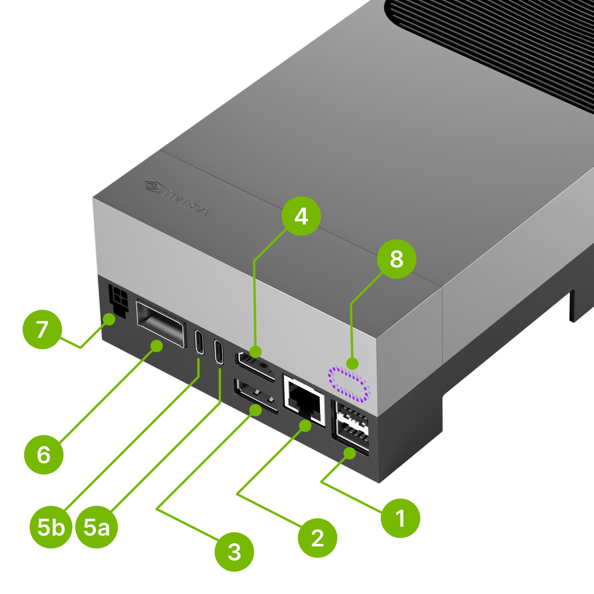
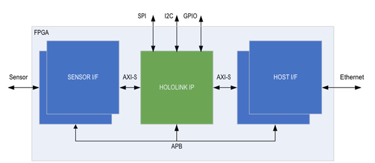
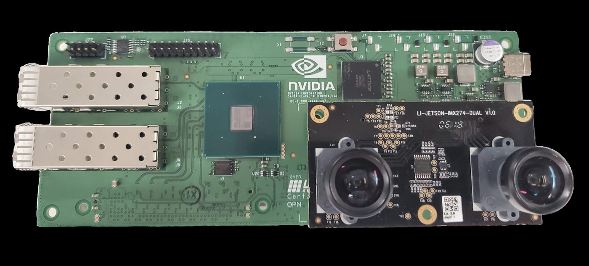
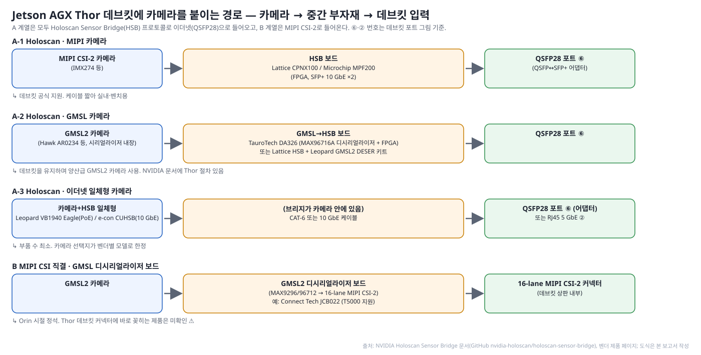
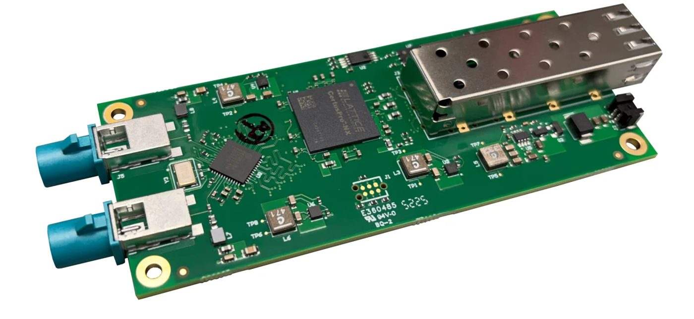
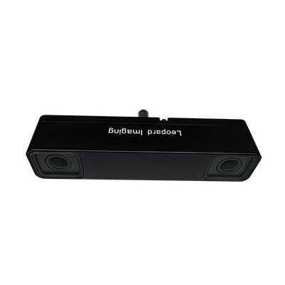
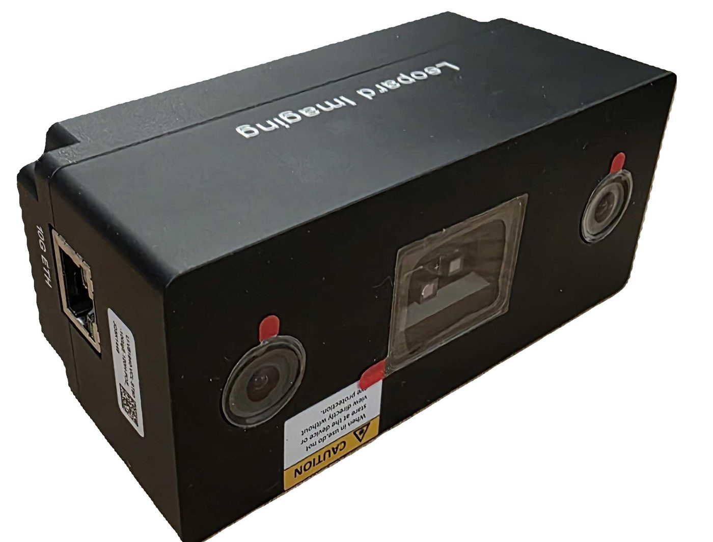

# Jetson AGX Thor로 자율주행 연구하기 — 데브킷 사양, 연구 사례와 부자재, 카메라 연결 방법

> **작성일**: 2026-10-15 · **상태**: 초판 · 16번 주제의 후속편(Jetson AGX Thor 전용)
> **전제**: Jetson AGX Thor Developer Kit(T5000)을 구매해 자율주행 연구에 쓴다. 로봇·산업 장비 사례는 다루지 않는다.
> **표기**: 🔍 공식(NVIDIA·벤더 문서) / 📄 논문 / 📰 언론·2차 / 💬 포럼 / 🏷️ 벤더·리셀러 제품 페이지 / ⚠️ 미확인·충돌. 출처 ID는 [reference/references.md](reference/references.md). 저장소 기존 문서는 참고하지 않았다. 조사 환경 제약으로 GitHub·raw 외 페이지는 검색 발췌로 확인했으며, 그림은 Apache-2.0 공개 저장소(NVIDIA Holoscan Sensor Bridge 문서)에서 가져오거나 직접 그렸다.

---

## 요약

- **데브킷은 128 GB 메모리와 FP4/FP8이 강점이지만 메모리 대역폭(~270 GB/s)이 병목**이다. VLA·LLM류는 Thor에서도 메모리 바운드이며, INT8은 FP16보다 느릴 수 있다 [T9][T7].
- **주행 VLA(Alpamayo 10B)는 Thor에서 아직 실시간이 아니다.** FlashDrive 최적화 후에도 약 0.94 s/윈도우(≈1 Hz)로, 워크스테이션 GPU(151 ms)보다 6배 느리다 [T8]. 소형 VLA(π0 2.7B)는 분석 모델 기준 52.6 ms(19 Hz)로 실시간 가능 [T9]. **Qwen-Drive-1.0(4B)은 Thor 수치가 아직 없어 측정 자체가 기여**다 [T37].
- **데브킷에는 GMSL2 커넥터도, 카메라용 CSI 커넥터도 없다.** 카메라는 QSFP28 포트로 들어오는 **Holoscan Sensor Bridge(HSB)** 가 NVIDIA의 공식 경로이고, GMSL2 카메라를 쓰려면 HSB 앞단에 디시리얼라이저(TauroTech DA326, Leopard 키트)를 두면 된다. GMSL2를 바로 꽂는 보드(8채널)는 서드파티 캐리어·박스다 [T23][T26][T19][T18].
- **차량 산업의 Thor는 Jetson이 아니라 DRIVE AGX Thor**(GMSL2 16채널 내장, DriveOS)다. Jetson AGX Thor를 실제 도로 차량에 올린 공개 논문은 아직 없고, Thor 기반 "GMSL2 8채널 + CAN FD 박스" 제품군이 차량용 진입점이다 [T33][T18][T21].

---

## 1. Jetson AGX Thor 데브킷 사양 요약

### 1-1. 컴퓨트·메모리

| 항목 | 사양 | 출처 |
|---|---|---|
| 모듈 | Jetson T5000: Blackwell GPU 2,560 CUDA / 96 Tensor 코어, 14× Arm Neoverse-V3AE | T1 🔍 |
| AI 연산 | 최대 2,070 FP4 TFLOPS(희소). 논문 기준 FP16 400 TFLOPS, INT8 800 TOPS | T1 T9 🔍📄 |
| 메모리 | **128 GB LPDDR5X, 273 GB/s** | T1 T11 🔍📄 |
| 전력 | 40–130 W 설정 가능 | T1 🔍 |
| 정밀도 특성 | Blackwell은 FP8/NVFP4에 최적화. **INT8은 FP16 대비 이득 없음 또는 역전**(MiDaS FP16 5.8 ms vs INT8 10.3 ms) | T7 💬 |

### 1-2. 입출력 (카메라·네트워크·CAN·전원)

*그림 1. Jetson AGX Thor 데브킷 포트. ① USB 3.2 ×2 ② RJ45 5 GbE ③ DP/HDMI ④ HDMI ⑤a/b USB-C ⑥ **QSFP28(4×25 GbE, HSB 카메라 입력)** ⑦ Micro-Fit DC ⑧ 전원 버튼. 출처: NVIDIA Holoscan Sensor Bridge 문서 [T26].*

| 항목 | 사양 | 비고 | 출처 |
|---|---|---|---|
| 카메라 입력 | **QSFP28 ⑥ → Holoscan Sensor Bridge 카메라(최대 20대)** | 데브킷의 유일한 고속 카메라 입력 | T1 T26 🔍 |
| MIPI CSI-2 | 모듈은 16레인(최대 6카메라)을 갖지만 **데브킷 캐리어에는 CSI 커넥터가 없다**(Stereolabs 지원문서). 제품 페이지의 "CSI 6대"는 모듈 사양 | 캐리어 교체 시에만 사용 ⚠️ | T1 T23 🔍🏷️ |
| 네트워크 | QSFP28 4×25 GbE(⑥), RJ45 5 GbE(②), Wi-Fi 6E(M.2 E) | LiDAR·GNSS는 RJ45 또는 QSFP 브레이크아웃 | T1 🔍 |
| 저장·확장 | M.2 M(NVMe 1 TB 동봉), M.2 E. **M.2 B-key(LTE/5G) 없음** | 5G는 캐리어 필요 | T1 🔍 |
| CAN | 2×13 헤더(J47)에 CAN 컨트롤러 2채널, CAN FD. **외부 트랜시버(SN65HVD230 등) 필요** | 125k–1 Mbps | T2 T24 🔍 |
| 전원 | 240 W USB-C PD(Delta ADP-240LB) 동봉. 대체 PSU는 28 V 5 A 연속·7.5 A 피크. 차량 12 V→28 V PD 어댑터는 확인된 제품 없음 ⚠️ | — | T3 💬 |
| 기구 | 마운트 홀 없음. 커뮤니티 STL 인클로저 | — | T32 💬 |

### 1-3. 소프트웨어·가격

- **JetPack 7.0**(CUDA 13, TensorRT 10.13, HSB 통합) → **7.1**(TensorRT-Edge-LLM, Thor HSB 정식) → **7.2**(CUDA 13.2, TRT 10.16, MIG 프리뷰, SIPL 카메라 프레임워크) [T4][T31] 🔍.
- ROS 2 Jazzy(Isaac ROS 4.x), Holoscan SDK 4.x [T4] 🔍.
- 가격 **US$3,499(2025-08) → US$5,499(2026-07)**. T4000 모듈(64 GB, 1,200 TFLOPS) US$1,999 [T5][T6] 📰.
- 주의: **DRIVE AGX Thor와 별개 제품**(DriveOS·CUDA 버전·GMSL 내장 여부·구매 경로가 다름) [T36] 💬.

---

## 2. 연구 사례와 부자재

### 2-1. 주행 VLA 추론 — Thor에서 얼마나 빠른가

**FlashDrive** (Z Lab, arXiv 2608.12932, 2026-08) [T8] 📄
- 대상: 주행 VLA **Alpamayo 1.5-10B / 1-10B** (카메라 4대 × 4프레임 입력)
- 방법: KV 캐시 윈도우 재사용 · 블록 디퓨전 투기 추론(DFlash) · W4A8 양자화 · 디노이징 스텝 재사용 · CUDA Graph
- 결과: RTX PRO 6000 717→151 ms(4.7×) · **Jetson Thor 3,770→944 ms(4.0×)** ⚠️발췌
- 시사점: 10B 추론형 VLA는 Thor에서 **최적화 후에도 약 1 Hz**. 실차 10 Hz에는 더 작은 모델이 필요
- 부자재: 없음(오프라인 클립 재생)

**Alpamayo 연구 계보 — 어떤 하드웨어를 썼나** [T45][T42][T40][T41][T43][T44]
- 공식 요구: Alpamayo 1·1.5 모두 **≥24 GB VRAM**. 테스트 GPU는 RTX 3090 / A100 / H100. 패키지는 BF16 20.65 GB, FP8 9.94 GB, W4A16 6.9 GB(NIM: 양자화 ≥20 GB, BF16 ≥30 GB, FP8는 Ada 이상) [T45][T42] 🔍 ✅
- Alpamayo 2 Super(34B, 2026-05): **1× H100 80 GB만 검증** [T42] 🔍
- 논문(NVIDIA, 2025-11): "실차 도로 테스트 99 ms" 주장, 차량 컴퓨트는 미기재 ⚠️; 2차 보도는 RTX PRO 6000 [T45] 📄📰

| 연구 | 무엇을 했나 | 사용 하드웨어 | 결과 | 출처 |
|---|---|---|---|---|
| FlashDrive(Z Lab) | 추론 가속(캐시·투기 추론·W4A8) | **Jetson Thor** + RTX 3090/4090/5090 + RTX PRO 6000 | Thor 3,770→944 ms, PRO 6000 717→151 ms | T8 📄 |
| 지연 분석·궤적 생성 최적화(Jeon et al., RTCSA 2026) | 다중 추론→단일 추론, 디퓨전 메모리 복사 제거 | **DGX Spark**(GB10, 128 GB 통합 메모리) | 지연 **−69.2%**, 궤적 다양성 유지; 카메라 4대×4프레임 | T40 📄 |
| OOM-Free Alpamayo(국민대) | 레이어 단위 CPU↔GPU 스와핑 + 전송·연산 중첩 | **RTX 5070 Ti 16 GB**(모델은 ~21.5 GB 필요) | Accelerate 오프로딩 대비 **3.55×**, BF16 유지 | T41 📄 |
| TensorRT-Edge-LLM VLA 예제 + 포럼 | FP16 엔진 빌드·추론 | **DRIVE AGX Thor / Jetson Thor** | 지연 미공개, DRIVE Thor FP16 엔진 OOM(15.17 GB) | T13 🔍💬 |
| Stanford CS224R PiDrive(학생 보고서) | 전방 카메라 1대 변형으로 경량화 | **Jetson AGX Thor** | 원본 4카메라 구성 **0.5 Hz** ⚠️발췌 | T44 📄 |
| TIER IV(GTC 2026) | Alpamayo 1을 Autoware에 조기 통합, Co-MLOps 데이터 플랫폼 | 실차는 **DRIVE AGX Thor ×2(Hyperion)** 버스; Alpamayo가 그 차량에서 도는지는 미확인 ⚠️ | — | T43 📰 |

- 정리: Alpamayo 연구 하드웨어는 세 층이다. ① **24 GB+ 워크스테이션 GPU**(3090/4090/A100/H100/PRO 6000) — 공식 요구이자 대부분의 연구, ② **128 GB 통합 메모리 엣지급**(DGX Spark, Jetson Thor) — 지연 분석·엣지 배포, ③ **16 GB 소비자 GPU** — 메모리 스와핑 연구. 실차 사례는 DRIVE AGX Thor(TIER IV)뿐이고 Jetson Thor 실차는 없다
- Thor 시사점: 128 GB라 메모리는 넉넉하지만 대역폭 때문에 **FlashDrive 최적화 후 ~1 Hz, 학생 측정 0.5 Hz**. DGX Spark(같은 273 GB/s급)에서 나온 −69% 기법은 Thor에 그대로 적용해 볼 가치가 있다

**Qwen-Drive-1.0** (Alibaba Qwen × HUST, arXiv 2609.00111, 2026-08/09) [T37][T38] 📄 ✅
- 구조: **Qwen3.5-4B** VLM을 그대로 두고 **BEV 인식 헤드**(3D 검출·점유·맵 분할) + **플래닝 전문가**(궤적 5 s @10 Hz, 6샘플) 부착. 멀티뷰 카메라 링 입력
- 수치(README): NAVSIM PDMS **90.7**(RL) · Waymo E2E RFS 7.91 · NVIDIA PhysicalAI minADE 0.34 m · 같은 프로토콜에서 Alpamayo-1.5-10B보다 우위 주장
- 배포 상태: **24 GB+ GPU 권장**, bf16 + FlashAttention-2, 가중치 9.1 + 2.1 + 0.5 GB. **Thor·Jetson·양자화 수치는 공식·논문·후속 연구 어디에도 없음** ⚠️
- 논문의 배포 논리: "콕핏과 주행이 한 컴퓨트를 공유하는 추세 → 범용 VLM 능력을 유지한 한 모델로 두 도메인 커버". Alibaba는 인캐빈용 Qwen-Omni를 **DRIVE AGX Thor**에 적응 중(2026 베이징 모터쇼, Qwen-Drive 자체는 아님) [T38] 📰
- 시사점: 4B(bf16 ≈12 GB)라 Thor 128 GB에 넉넉히 들어가고 TensorRT-Edge-LLM이 Qwen 계열을 지원하므로, **Thor 지연 측정 자체가 공개된 적 없는 첫 결과**가 된다. 참고로 Jetson Orin에서 Qwen2.5-7B를 Q5_K_M 양자화하면 FP16 대비 처리량 ~10.5× [T39] 📄
- 부자재: 없음(데이터셋 클립). 주의: 실사용 리뷰에서 추론 결과의 일관성 문제 보고 ⚠️

**TensorRT-Edge-LLM Alpamayo 예제** (NVIDIA) [T13] 🔍
- NVIDIA 공식 엣지 런타임의 VLA 예제. **FP16 내보내기만 지원**, Thor에서 엔진 빌드
- Thor 지연 수치는 문서에 없음 ⚠️. 포럼에 FP16 엔진 15.17 GB 할당 실패(OOM) 보고 💬
- 후속 논문(미열람): Alpamayo 지연 분석(arXiv 2605.08975), 메모리 스와핑 OOM 회피(arXiv 2605.11678) [T16]

### 2-2. Thor 하드웨어 특성 — 왜 메모리가 병목인가

**VLA-Perf** (NVlabs, arXiv 2602.18397, 2026-02) [T9] 📄 ✅
- 방법: 연산량 + 메모리 접근량을 함께 보는 **루프라인 분석 모델**(측정이 아닌 예측)
- 결과(논문 표 원본): π0(2.7B) E2E **Thor 52.6 ms(19 Hz)** · Orin 64 GB 93.8 ms(10.7 Hz) · RTX 4090 31.1 ms
- Thor는 비전 인코더·VLM·액션 전문가 **세 단계 모두 메모리 바운드**(다른 GPU는 비전·VLM이 연산 바운드)
- 검증: RTX 4090 실측 대비 예측 정확도 73–83%(실제가 더 느림)
- 시사점: Thor에서는 연산량보다 **바이트 수(양자화·KV 캐시 재사용)** 를 줄여야 빨라진다

**Characterizing VLA: Action Generation Bottleneck** (Google/Purdue, arXiv 2603.02271) [T10] 📄
- 7B급 VLA를 **Orin 64 GB vs Thor 128 GB**에서 단계별 프로파일링
- E2E 지연의 **최대 75%가 메모리 바운드 액션 생성** 단계
- Thor는 Orin 대비 연산 5배지만 **E2E는 1.4배**만 개선(절대 ms 미공개 ⚠️)

**Characterizing VLA across XPUs** (SJTU, arXiv 2604.24447, ICML 2026) [T11] 📄
- π0을 RTX 4090·Orin·Thor·NPU에서 Nsight 트레이스 + 루프라인 분석
- 공통 패턴: **연산 바운드 VLM 백본(SM >90%) → 메모리 바운드 액션 전문가(SM 20–40%)**
- DP-Cache(디퓨전 중복 제거)로 102→79 ms(1.29×), 성공률 유지

**GTR 밀집 예측 백본** (arXiv 2609.26590, DRIVE AGX Thor) [T14] 📄
- 세그멘테이션·깊이 백본을 같은 Thor SoC에서 루프라인 분석 → **대역폭 지붕 근처(메모리 바운드)**
- 커널 융합으로 중간 메모리 트래픽 제거, DRAM 지붕 대비 89–141% 효율(태스크별 ms 미확인 ⚠️)

**Thor 양자화 주의** [T7] 💬
- Thor에서 **INT8이 FP16보다 느린** 사례 다수(MiDaS FP16 5.8 ms vs INT8 10.3 ms, RT-DETR)
- Orin용 INT8 엔진을 그대로 옮기면 손해. FP8/FP4로 다시 양자화

### 2-3. 멀티카메라 BEV 처리 — RidgeRun 벤치 [T12] 🏷️
- 내용: GStreamer 서라운드 뷰(BEV) 스티칭을 Thor·Orin·Orin NX에서 측정(4·6 입력, HD~4K)
- Thor 출력 FPS: HD 4입력 ≈328 · HD 6입력 ≈212 · 4K 4입력 ≈91.5 · 4K 6입력 ≈65.6
- Thor 처리 지연(jetson_clocks on/off): 1080p 4입력 5.9/10.4 ms · 4K 6입력 28.1/37.2 ms
- 시사점: 차량 서라운드 뷰급(6카메라 1080p)은 **10 ms 안쪽**이라 BEV 인식 앞단에 여유. Orin 수치·카메라 모델은 미확인 ⚠️

### 2-4. 부자재가 드러난 사례 (차량·플랫폼)

| 사례 | 누가·언제 | 무엇을 | 함께 쓴 부자재 | 출처 |
|---|---|---|---|---|
| **텔레리안 AVS300**(한국) | 2026-05 보도 | Jetson AGX Thor 러기드 엣지 AI 플랫폼, HSB 기반 저지연 센서 통합 플랫폼 개발 | **GMSL2 8채널 직결**(데브킷 미지원 기능), 프레임 싱크·PPS 하드웨어 시간동기 → 스테레오·3D 매핑·LiDAR-카메라 융합. 카메라·LiDAR 모델 미기재 | T17 📰 |
| **Advantech × SENSING** | 2025-12 | Thor 박스 MIC-742-AT에 GMSL 카메라 통합(SerDes·디바이스 트리·BSP 검증) | SENSING GMSL2 카메라, 박스에 **8× GMSL2 + 4× CAN FD** | T18 🔍 |
| **Leopard Imaging** | 2025-11 / 2026-07 | 데브킷용 GMSL2 디시리얼라이저 키트와 Thor 박스 | LI-GMSL2-DESER-HOLOSCAN(MAX9296, FAKRA 1채널, US$388), LI-THOR-BOX-GM2B(8× GMSL2, US$8,500); 카메라 LI-VENUS-ISX031·LI-IMX728·AR0234 스테레오 | T19 🏷️ |
| **Connect Tech** | 2025-08 | T5000 캐리어 Gauntlet + 카메라 브레이크아웃 | GMSL3/GMSL2/FPD-Link III/SDI 브레이크아웃, **4× CAN 2.0b**; JCB022(MAX9296A ×4, 8× GMSL2, Orin·Thor T5000) | T20 🏷️📰 |
| **Seeed / Forecr / Firefly / Syslogic** | 2025–26 | Thor 캐리어·박스 | J601: 8× GMSL2·CAN FD·M.2 B(5G)·19–48 V / DSBOX-THRMAX: 최대 8× GMSL2 / EC-ThorT5000: 8× GMSL2·CAN / RML A5AGX: 러기드, 멀티카메라+LiDAR 융합 | T21 🏷️📰 |
| **e-con Systems** | 2025-08 | Thor용 카메라 라인업(USB·GigE·10G Holoscan) | e-CAM85_CUHSB(IMX715, US$469) 등 10G Holoscan 카메라, ISX031 HDR·IMX900 GS·AR0234 | T22 🏷️ |
| **Ouster** | 2026-05 | REV8 LiDAR 드라이버를 Orin·Thor에 최적화 | 이더넷 LiDAR(REV8) | T25 🔍 |
| **Stereolabs** | 2025–26 | ZED 카메라 Thor 지원 | **데브킷은 USB3 ZED만**(CSI 포트 없음), GMSL2(ZED Link)는 파트너 캐리어 필요 | T23 🏷️ |

- 실제 도로 차량에 Jetson AGX Thor를 올려 카메라·LiDAR·CAN·전원을 모두 공개한 사례: **없음** ⚠️ (Autoware·TIER IV·대학 레이싱팀도 언급 없음)
- 부자재 패턴: 차량용은 **GMSL2 8채널 + CAN FD + 넓은 DC 입력 캐리어/박스**, 데브킷은 **HSB로 카메라를 받는 벤치·검증 단계용**

---

## 3. 데브킷에 카메라 붙이는 방법

### 3-1. Holoscan Sensor Bridge(HSB)란

- **무엇**: NVIDIA가 만든 오픈소스(Apache-2.0) **"센서 → GPU 이더넷 브리지"** [T26] 🔍 ✅
  - FPGA가 센서(MIPI 카메라 등) 데이터를 받아 UDP/이더넷 패킷으로 전송
  - 호스트 NIC가 CPU를 거치지 않고 GPU 메모리에 직접 기록
  - FPGA IP 소스 + 호스트 소프트웨어(Holoscan 오퍼레이터)를 NVIDIA가 공개
- **왜 이더넷인가**
  - MIPI/GMSL은 짧은 배선·전용 디시리얼라이저가 필요, 이더넷은 긴 케이블·스위치·PTP 시간동기 가능
  - NVIDIA 공식 수치: 4K60 glass-to-glass **17 ms**, Thor CoE 사용 시 CPU 점유 **≈1%**, PTP 동기 1 µs 이내 [T27] 🔍
- **Thor에서의 동작**
  - 데브킷 QSFP28(MGBE)에 연결 → JetPack 7.1부터 **CoE(Camera over Ethernet) 하드웨어 가속**(SIPL/FuSa API)
  - JetPack 7.0은 CoE 카메라만, 7.2에서 정식 지원 + ISP 경로 [T31] 🔍
- **보드 제조사**
  - 레퍼런스: **Lattice CertusPro-NX**(IMX274, SFP+ ×2), **Microchip PolarFire MPF200**(IMX477)
  - 상용: e-con·Advantech·SENSING·TauroTech·Leopard [T26][T28][T29] 🔍🏷️

*그림 2. HSB IP 구조 — 센서 인터페이스(MIPI)에서 받은 스트림을 FPGA가 UDP로 캡슐화해 이더넷으로 송출. 출처: NVIDIA HSB 문서 [T26].*

*그림 3. Lattice CertusPro-NX HSB 레퍼런스 보드에 IMX274 듀얼 카메라를 장착한 모습(SFP+ 10 GbE 2포트, USB-C 전원). 출처: NVIDIA HSB 문서 [T26].*

### 3-2. 경로 한눈에 보기 — 카메라 → 중간 부자재 → 데브킷 입력

*그림 4. 데브킷 기준 카메라 연결 경로. A 계열은 모두 HSB(이더넷), B는 MIPI CSI(데브킷에는 커넥터 없음). 본 보고서 작성.*

| 경로 | 카메라 | → 중간 부자재 | → 데브킷 입력 | 특징·확인 상태 | 출처 |
|---|---|---|---|---|---|
| **A-1 HSB + MIPI 카메라** | MIPI CSI-2 모듈(IMX274, IMX477) | Lattice CPNX100(US$350) 또는 Microchip MPF200 HSB 보드 | QSFP28 ⑥(QSFP↔SFP+ 어댑터) | NVIDIA 문서의 데브킷 공식 절차. 케이블이 짧아 벤치·실내용 | T26 T28 T29 |
| **A-2 HSB + GMSL2 카메라** | GMSL2 카메라(Hawk AR0234 스테레오, ISX031, IMX728 등; 시리얼라이저 내장, 동축 10 m급) | **TauroTech DA326**(MAX96716A 디시리얼라이저 + FPGA, NVIDIA 문서에 Thor 절차 있음) 또는 **Lattice HSB + Leopard GMSL2 DESER 키트**(MAX9296, 1채널, US$388) | QSFP28 ⑥ | **데브킷을 유지하며 양산급 GMSL2를 쓰는 길**. 키트당 채널이 적어 4대 이상이면 보드가 늘어남 | T26 T19 |
| **A-3 HSB 일체형 이더넷 카메라** | 카메라 안에 브리지가 든 제품: Leopard VB1940 Eagle(PoE, NVIDIA 레퍼런스), e-con CUHSB(10 GbE, 자체 ISP) | 케이블만(CAT-6 또는 10 GbE) | QSFP28 ⑥(어댑터) 또는 RJ45 ② | 부품 수 최소. 카메라가 벤더 모델로 한정 | T26 T22 |
| **B MIPI CSI 직결** | GMSL2 카메라 | GMSL2 디시리얼라이저 보드(MAX9296/96712 → CSI; Connect Tech JCB022, NVIDIA 레퍼런스 IMX390+MAX9296) | 모듈 16레인 CSI — **데브킷 캐리어에는 커넥터 없음** | Orin 시절 정석이지만 **데브킷에서는 불가**, 서드파티 캐리어(Gauntlet·J601 등)에서만 가능 ⚠️ | T23 T24 T20 |

*그림 5. A-2 경로의 핵심 부품 — TauroTech DA326. 왼쪽 FAKRA 커넥터 2개로 GMSL 카메라를 받고(MAX96716A 디시리얼라이저), Lattice CertusPro-NX FPGA가 오른쪽 SFP+로 송출. 출처: NVIDIA HSB 문서 [T26].*

 
*그림 6(좌). DA326용 Hawk 모듈 — AR0234 센서 2개 + MAX9295D 시리얼라이저. 그림 7(우). A-3 경로의 Leopard VB1940 Eagle — 브리지 내장 PoE 카메라, CAT-6 한 가닥으로 데브킷에 연결. 출처: NVIDIA HSB 문서 [T26].*

### 3-3. HSB와 GMSL — 특성과 추세

| 구분 | GMSL2 (Orin 세계의 정석) | Holoscan Sensor Bridge (Thor의 공식 경로) |
|---|---|---|
| 물리 계층 | 동축/STP 한 가닥, 전원 동시 공급(PoC), 10 m급 | 이더넷 10/25 GbE(SFP+/QSFP), PTP 시간동기 |
| 보드 쪽 요구 | 디시리얼라이저(MAX9296/96712) + CSI 커넥터 → **캐리어가 필요** | FPGA 브리지 보드(또는 일체형 카메라) + QSFP 포트 → **데브킷 그대로** |
| 데이터 경로 | CSI → ISP(Argus/SIPL) | UDP → NIC → GPU 메모리(Thor는 CoE 가속, CPU ≈1%) |
| 생태계 | 양산 차량 카메라 대부분이 GMSL2. 벤더·모델 선택 폭이 가장 넓음 | 2025–26에 급성장: e-con 10G 카메라(2025-05 시연), Leopard GMSL2 DESER 키트(2025-11), Advantech MIC-FG-HSB, Microchip Rev 2.0(2026-08), 텔레리안 HSB 플랫폼(2026-05) |
| 지연 | 짧음(보드 내부) | NVIDIA 17 ms glass-to-glass; Lattice 블로그 실측 Thor ≈40 ms vs Orin ≈60 ms(1080p@142fps) |
| 출처 | T24 T23 | T26 T27 T30 T19 T29 |

- **추세**
  - Orin까지: "캐리어 + GMSL2"가 표준
  - Thor부터: NVIDIA가 **데브킷 카메라 입력을 HSB로 통일**
  - 양산 카메라는 여전히 GMSL2 → 벤더는 **GMSL2→HSB 변환 보드**(DA326·Leopard 키트·Advantech MIC-FG-HSB)와 **GMSL2 내장 Thor 캐리어** 두 갈래로 대응 [T19][T30][T18] 🏷️
- **연구용 권장**
  - 벤치: **A-2**(DA326 또는 Lattice + Leopard 키트)로 GMSL2 카메라 2~4대
  - 카메라 6대 이상·차량 탑재: GMSL2 8채널 캐리어(Seeed J601·Connect Tech·Advantech)로 이전

### 3-4. 카메라 외 부자재 체크리스트 (데브킷 기준)

| 항목 | 구성 | 비고 | 출처 |
|---|---|---|---|
| CAN | J47 헤더 + CAN 트랜시버 보드(SN65HVD230) | CAN FD 지원, 종단 점퍼 | T2 🔍 |
| LiDAR | 이더넷 LiDAR(Ouster REV8 등) → RJ45 5 GbE 또는 QSFP 브레이크아웃 | Thor 드라이버 튜닝 발표 있음 | T25 🔍 |
| 5G/LTE | 데브킷 B-key 없음 → USB 모뎀 또는 B-key 있는 캐리어(J601) | JetPack 7 검증 미확인 ⚠️ | T21 T32 🏷️ |
| 전원 | 벤치: 동봉 240 W PD. 차량: 12 V→28 V/5 A PD 어댑터 미확인 → 캐리어 DC 직입력(19–48 V) 권장 ⚠️ | — | T3 T21 💬🏷️ |
| 기구·냉각 | 마운트 홀 없음, 커뮤니티 STL, 캐리어 전용 히트싱크·팬 | — | T32 💬 |

---

## 4. 참고 — 차량 산업의 Thor: DRIVE AGX Thor

- **완성차·L4는 DRIVE AGX Thor를 쓴다** [T33][T34] 📰🔍
  - TIER IV × Isuzu L4 버스(DRIVE AGX Thor + Hyperion 센서)
  - Li Auto i8(Thor-U 700 TOPS로 VLA), Zeekr 9X(Thor-U)
  - NVIDIA Hyperion 10: DRIVE AGX Thor 2개, 카메라 14·레이더 9·LiDAR 1
- **DRIVE AGX Thor DevKit** [T33] 🔍
  - 64 GB, **16× GMSL2 + 2× GMSL3 내장**, 자동차 이더넷(100M/1G/10G), 350 W
  - SKU 10(벤치) / SKU 12(차량 탑재), DriveOS 7, ASIL-D
  - 가격 비공개, NVIDIA DRIVE 개발자 프로그램 승인 필요
- **Jetson AGX Thor와의 차이** [T36] 💬
  - 메모리 128 vs 64 GB · 카메라 HSB vs GMSL 내장 · SW JetPack/CUDA 13 vs DriveOS · 구매 경로
  - 같은 Thor 실리콘 → 모델·양자화·지연 결과는 이전 가능, **카메라 배선은 재설계**
- Autoware 레퍼런스 HW에 Jetson T5000 기반 MIIVII APEX THOR(128 GB, GMSL, CAN, 9–36 V) 등재 → Jetson Thor로 Autoware 차량 컴퓨터를 꾸미는 길도 열려 있음 [T35] 🔍

## 미확인·주의

- FlashDrive의 Thor 수치(3,770→944 ms)는 프로젝트 페이지 발췌이고 논문 표 원문은 열람하지 못했다 ⚠️. VLA-Perf의 Thor 수치는 측정이 아니라 **분석 모델 예측**이며 실측은 더 느리다(4090에서 예측의 73–83%).
- 데브킷 CSI 커넥터 유무는 NVIDIA 제품 페이지("CSI 6대")와 Stereolabs 문서("캐리어에 CSI 없음")가 충돌한다 ⚠️. 모듈 사양과 데브킷 캐리어 사양의 차이로 해석했다.
- Leopard·Microchip의 Thor 지원은 벤더 표기가 "설계상 호환"·"드라이버 보장 없음"인 항목이 있어 구매 전 확인이 필요하다 ⚠️ [T29].
- 가격은 2025–26에 크게 변동했다(데브킷 +57%).
