# Autoware 재단 스택 지도 — Autoware 2.0 시대의 저장소 157개와 두 트랙

> **작성일**: 2026-10-30 (2판 — 최근 소식 추가, 글머리 형식으로 재구성, 주행 모델 × 컴퓨트 장 추가, 미확인 내용 삭제)
> **조사 범위**: GitHub `autowarefoundation` 조직의 저장소 157개, Autoware 공식 문서 원본, 워킹그룹(WG) 회의록·이슈(2026-01 ~ 2026-10).
> **출처 표기 원칙**: 모든 사실 문장·표 행에 `[번호]`로 출처를 달고, 말미 출처 목록에 등급과 URL을 수록했다. 등급은 💻 저장소 원본(raw 파일·clone 직접 확인) · 🔍 1차 페이지(GitHub 릴리스·이슈·토론 직접 열람). 원문으로 확인하지 못한 내용은 싣지 않았다(10장).
> **표기 약속**: "계획·목표"와 "릴리스·실행"을 구분한다. 캡션에 "자체 작성"이라고 적은 그림은 **자체 도식**이고, 나머지는 Autoware 문서·저장소의 **원본 그림**이며 캡션에 원본 경로를 적었다.

---

## 최근 소식 — Autoware 2.0.0 공개 (2026-10-29)

- **무엇이 나왔나**: Autoware 2.0.0이 2026-10-29 GitHub 릴리스로 공개됐다. 릴리스 노트의 한 줄 요약은 "규칙 기반 스택 옆에 AI 플래너를 추가하고, 재단 모델을 Hugging Face로 옮기고, Autoware Index와 Reference Design을 도입"이다 [54].
- **AI 플래너 선택**: 런치 인자 `planning_setting`으로 규칙 기반(기본값)과 Diffusion Planner 중 하나를 고른다 [1][54].
- **아직 아닌 것**: 후보 궤적을 검사·선택하는 Selector 패키지는 들어 있지만 2.0.0에서 기동하지 않는다 [1].
- **문서**: 같은 날 공식 문서의 Architecture 2.0 페이지에서 "Under Construction" 표시가 빠지고 "2.0.0이 오늘 하는 일" 절이 추가됐다 [16].
- **버전 체계 변경**: 2.0.0부터 Autoware 버전이 `autoware_core` 버전과 분리됐다. Autoware 2.0.0은 `autoware_core` 1.10.0을 쓴다 [9].
- **업그레이드 주의**: 1.9.0 이전에 받은 AI 모델 파일은 2.0.0에서 동작하지 않아 다시 받아야 한다. `setup-dev-env.sh`가 제거됐다 [54].

---

## 0. 한눈에 보기

**세 줄 요약**

1. **AWF 저장소는 "로보택시·L4 트랙"과 "ADAS·개인차량(POV) 트랙" 두 줄기로 정리된다.**
    - 로보택시·L4: `autoware` 본체(Core·Universe·Launch)와 학습 플래너·E2E 모델(Diffusion Planner, `auto_e2e`, `autoware_latent_drive`, `autoware_oneplanner`) [1][23][32][34][35].
    - ADAS·POV: `vision_pilot`과 부품 모델(`auto_steer`·`auto_speed`·`auto_drive`, AutoSeg 계열) [27][29][30][31].
    - 두 트랙은 주체 WG, 센서, 연산 규모, 릴리스가 다른 별개 코드베이스다 [27][32][33][61].
2. **Autoware 2.0.0은 "E2E 완성판"이 아니라 "생성기를 바꿔 끼울 수 있게 한 첫 릴리스"다.**
    - 생성기 2개 중 하나를 런치 시점에 고르고, Selector는 아직 기동하지 않는다 [1].
3. **배포·안전 층이 따로 자라고 있다.**
    - Open AD Kit은 Autoware·Vision Pilot·Safety Island를 "버전 고정 + 실행 증거 서명" 릴리스로 내보내는 계층으로 재편 중이다 [56].
    - Renesas R-Car X5H 한 칩에서 AutoSD(Cortex-A720AE)와 FreeRTOS(Cortex-R52)를 함께 돌리는 작업이 2026-09 완료됐다 [74].

**핵심 숫자**

| 지표 | 값 | 출처 |
|---|---|---|
| AWF GitHub 저장소 | 157개 (아카이브 27 · 포크 24 포함) | [53] |
| 2026년에 갱신된 비아카이브 저장소 | 86개 | [53] |
| Autoware 최신 릴리스 | 2.0.0 (2026-10-29), core 1.10.0 · universe 0.53.1 · launch 0.53.0 | [23][54] |
| 2.0.0에서 고를 수 있는 궤적 생성기 | 2개 (`rule_based` 기본, `diffusion_planner`) | [1] |
| Vision Pilot 최신 릴리스 | 1.2 (2026-08-10) | [71] |
| Vision Pilot 연산 목표 | 3–5 INT8 TOPS급 칩에서 전체 파이프라인 10 FPS 이상 | [71] |
| AutoE2E 모델 규모 | 79.9M 파라미터, 카메라 6대, 6.4 s 궤적, 10 Hz | [32] |
| Open AD Kit v2.0 목표 | 2026-10 말 (10-15 WG 회의에서 "리스크") | [56][68] |

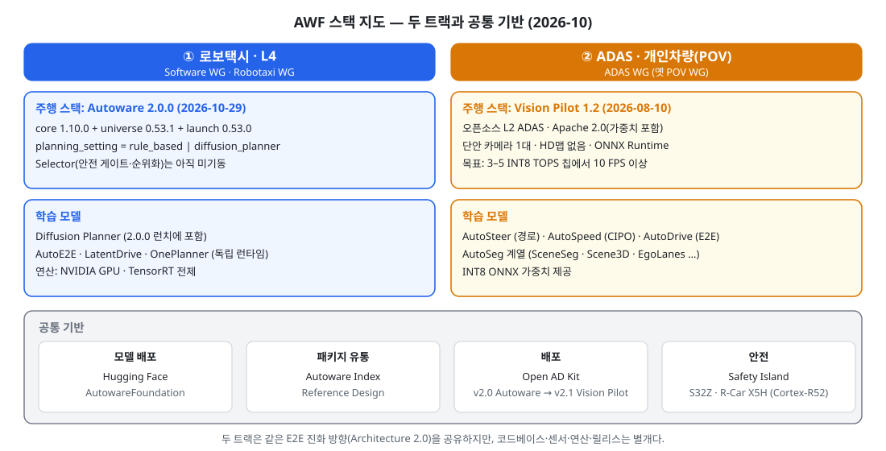

*그림 1. AWF 스택 지도 — 두 트랙과 공통 기반 · 자체 작성 · 근거 [1][23][26][27][32][36][38][56]*

---

## 읽기 전에 — 주요 용어

| 용어 | 뜻 |
|---|---|
| AWF | Autoware Foundation. Autoware 오픈소스 프로젝트를 운영하는 재단 |
| Core / Universe | Core는 재단이 엄격한 테스트로 유지하는 안정 패키지, Universe는 커뮤니티가 기여하는 확장 패키지 [6] |
| Generator / Selector | Architecture 2.0의 두 부품. 궤적 후보를 내는 모든 모듈이 Generator, 후보를 안전 검사·순위화해 하나를 고르는 것이 Selector [4] |
| E2E | End-to-End. 센서 입력에서 주행 궤적까지를 학습 모델로 잇는 방식 |
| POV | Privately Owned Vehicle, 개인 소유 차량 |
| Autoware Index | 커뮤니티 패키지 등록·검증 레지스트리 [38] |
| Reference Design | "배포 프로파일 + 레퍼런스 소프트웨어 스택"으로 재현 가능하게 문서화한 시스템 [11] |
| Open AD Kit | Autoware 생태계의 배포 계층. SOAFEE 블루프린트 [26] |
| Safety Island | 안전급 프로세서에서 궤적 추종 제어를 돌리는 애플리케이션 [36] |
| TRL | Technology Readiness Level, 기술 성숙도 단계 |
| SEooC | Safety Element out of Context. 특정 차량 맥락 없이 개발하는 ISO 26262 안전 요소 |
| CIPO | Closest In-Path Object, 자차 경로 위 가장 가까운 객체 |

---

## 1. 두 트랙 구조 — 공식 자료로 본 근거

> **요점**
> - 공식 다년 로드맵은 E2E 기술 계단 하나와, 차종(ODD)별 양산 성숙도 계단을 따로 둔다. POV가 가장 먼저, 로보택시가 가장 늦다.
> - Architecture 2.0 문서는 E2E를 4단계로 정의하고, 단계마다 HD맵 옵션과 2D맵 옵션을 둔다.
> - 트랙을 가르는 것은 E2E 로드맵이 아니라 워킹그룹과 차종이다.

### 1.1 두 트랙 비교 — 핵심만

| 항목 | ① 로보택시·L4 | ② ADAS·POV |
|---|---|---|
| 대표 스택 | Autoware 2.0.0 (ROS 2 Humble·Jazzy) [54] | Vision Pilot 1.2 (C++, ONNX Runtime) [27][71] |
| 주체 | Software WG, Robotaxi WG(`auto_e2e`) [33][50] | ADAS WG(2026-06까지 "Privately Owned Vehicle WG") [60][61] |
| 센서·맵 | LiDAR·카메라·레이더 융합, 지도 기반 NDT 위치추정 [13] | 단안 전방 카메라 1대, HD맵 없음 [27] |
| 연산 | NVIDIA GPU(TensorRT) 전제 모델 다수 [1][34][35] | 3–5 INT8 TOPS급 양산 칩 목표 [71] |
| 배포 | Open AD Kit v2.0 [56] | Open AD Kit v2.1 (R-Car X5H와 함께) [56] |

### 1.2 다년 로드맵 — 기술 계단과 차종별 계단

공식 문서 "Autoware Multi-Year Roadmap"의 기술 목표 두 개다 [10].

- **Objective 1 — AI-first 기술 도입**
    - Year 1: LiDAR·비전·레이더 컴포넌트형 AI 인식 도입, AI 기반 플래너 초판.
    - Year 2: 센서에서 궤적을 직접 계산하는 단일 신경망 E2E 스택 초판.
    - Year 3: E2E를 주 모드로, 컴포넌트형 AI 스택을 병렬 안전층으로 두는 하이브리드 AI 스택.
- **Objective 2 — 양산 가능(Production-Capable) Autoware, Open AD Kit와 결합**
    - Year 1: 저속 자율주행(LSA)·개인차량(POV, "Highway Autonomous Pilot") TRL-6.
    - Year 2: LSA·POV TRL-7, Robobus·오프로드 TRL-6.
    - Year 3: LSA·POV TRL-8, Robobus·오프로드 TRL-7, Robotaxi TRL-6.
- **Objective 3 — 실차 배치의 앵커 기업 후보**
    - POV: AMD, DeepenAI, AutoCore.ai. LSA: Eve Autonomy, Whale Dynamic, Robeff.
    - Robobus: ADASTEC. 오프로드: DriveBlocks. Robotaxi: TIER IV.
- 로드맵 문서에는 Year 1이 몇 년인지 적혀 있지 않다 [10].

### 1.3 Architecture 2.0의 E2E 4단계

- **목표**: Autoware 1.0(전통 로보틱스 스택)에서 Autoware 2.0(데이터 중심 AI 스택)으로 진화해 SAE Level 4+를 달성 [2][3].
- **맵 옵션**: 단계마다 옵션 A(HD맵)와 옵션 B(2D 내비 맵)를 둔다 [3].
    - 옵션 B의 장점: HD맵 구축·유지 없이 2D맵이 있는 곳이면 동작.
    - 옵션 A의 장점: HD맵이 정적 환경 정보를 주어 강건성이 높다.
- **일정**: 로드맵 폴더의 `development-roadmap.md` 본문은 "TBD"이고, 2.0 문서 PR이 TBD 로드맵 페이지 4개를 숨겼다. 날짜가 박힌 공식 개발 일정표는 없다 [5][16].

| 단계 | 공식 정의 [3] | 공식 문서에 명시된 구현 |
|---|---|---|
| Step 1 Learned Planner | 위치·3D 객체·신호등 등 "로컬 월드 표현"을 받아 궤적을 내는 학습 플래너 | Diffusion Planner — 2.0 문서가 "a learned planner"로 명시, 2.0.0에서 선택 가능 [1] |
| Step 2 Component-based E2E | 학습 인식 + 학습 플래너. 둘 사이 인터페이스가 남아 내부를 들여다볼 수 있음 | 명시 없음 |
| Step 3 Learned Driving | 명시적 인식·계획 모듈 없는 단일 신경망. CNN형 또는 VLA형 | 명시 없음 |
| Step 4 Learned Hybrid | E2E 주행 모델 + 별도 Safety Perception(LiDAR·레이더 가능) + Safety Guardian. "업계가 개발 중" | 명시 없음 |

- **각 저장소의 자기 규정(README 표현)** — 단계 대응은 공식 문서에 없으므로 원문 표현만 옮긴다.
    - AutoE2E: "camera-first End-to-End driving model" [32]
    - LatentDrive: "camera-only end-to-end planner" [34]
    - OnePlanner: "end-to-end planning models" [35]
    - Vision Pilot: "Hybrid End-to-End AI Architecture" — 안전용 인식 모델과 성능용 E2E 모델을 병렬로 처리 [27]

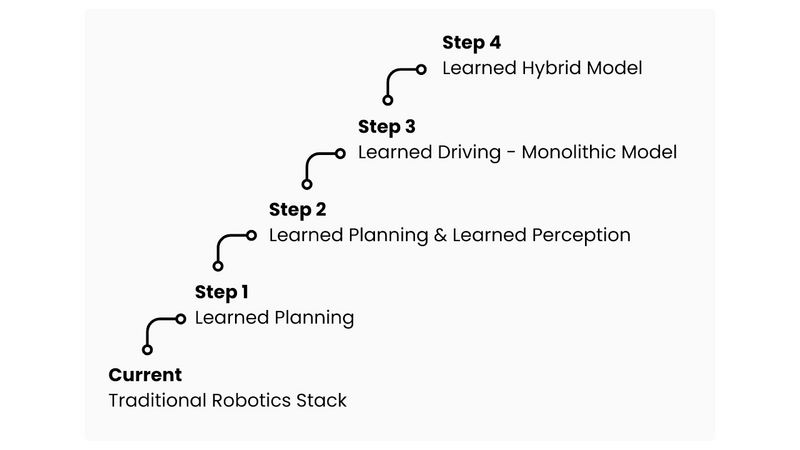

*그림 2. 단계적 기술 진화(Stepwise technology evolution) · 원본: autoware-documentation `design/autoware-architecture-v2/roadmap/media/detailed_architecture_figure1.png` [4]*

*그림 3. Step 4 학습 하이브리드, 2D맵 옵션(Figure 9) · 원본: 같은 폴더 `architecture_figure09.png` [3]*

### 1.4 가설 점검 — "E2E 로드맵이 자율주행·ADAS 트랙으로 나뉘고 Vision Pilot은 ADAS 쪽"

| 가설 | 판정 | 근거 |
|---|---|---|
| E2E로 전환하는 공식 로드맵이 있다 | 맞음 | Architecture 2.0 E2E 4단계, 다년 로드맵 Objective 1 [3][10] |
| 자율주행 트랙과 ADAS 트랙으로 나뉜다 | 맞음, 단 나누는 기준은 WG·차종 | E2E 4단계는 공통이고, 양산 계단은 차종별로 다르다. `auto_e2e`는 Robotaxi WG, Vision Pilot은 ADAS WG [10][33][61] |
| Vision Pilot은 ADAS 트랙에 들어간다 | 맞음 | Vision Pilot은 "open-source L2 ADAS" [27]. POV 레퍼런스 디자인이 Vision Pilot을 Phase 1로 정의 [17] |
| 두 트랙은 완전히 분리돼 있다 | 아님 | `auto_e2e`는 로보택시(LiDAR·레이더 안전층과 융합)와 L2++ ADAS(카메라만) 두 용도를 명시 [32]. 2026-06-08 회의는 로보택시 E2E 연구를 Vision Pilot에 재사용하는 방안과 그 역을 논의 [60] |

---

## 2. 로보택시·L4 트랙 — Autoware 2.0 본체와 학습 모델

> **요점**
> - Autoware 2.0.0 = 메타 저장소 `autoware`가 하위 저장소 버전을 고정한 묶음이다.
> - Generator-Selector 구조에서 생성기는 바꿔 끼울 수 있고, Selector는 아직 꺼져 있다.
> - Universe는 줄이고 Index로 분산하는 방향이 공식 제안으로 나왔다.
> - 재단이 직접 만든 E2E 모델 3종(AutoE2E·LatentDrive·OnePlanner)은 Autoware 2.0.0 런치에 포함되지 않은 독립 런타임이다.

### 2.1 Autoware 2.0.0의 구성

- **메타 저장소**: `autoware`는 소스 코드 없이 `repositories/autoware.repos`로 하위 저장소 버전을 고정한다 [8][23].
- **2.0.0 고정판 — core 그룹** [23]
    - `autoware_core` 1.10.0, `autoware_msgs` 1.13.0, `autoware_adapi_msgs` 1.9.2, `autoware_internal_msgs` 1.16.0
    - `autoware_utils` 1.11.0, `autoware_cmake` 1.4.0, `autoware_lanelet2_extension` 1.3.0, `autoware_rviz_plugins` 0.6.0
    - `agnocast` 2.4.1(소스 빌드), `autoware_simple_planning_simulator` 1.1.0, `autoware_system_designer` v0.4.2
- **2.0.0 고정판 — universe·launcher·센서** [23]
    - `autoware_universe` 0.53.1, `cuda_blackboard` 0.4.0, `bevdet_vendor` 0.2.1, `managed_transform_buffer` 0.3.0
    - `autoware_launch` 0.53.0, tier4 `nebula` v1.2.0
- **별도 매니페스트**: 도구는 `tools.repos`(autoware_tools 0.8.0), 시뮬레이터는 `simulator.repos`(tier4 scenario_simulator_v2 22.0.0) [23].
- **설치 요건**: amd64·arm64, 8코어, 16 GB RAM. NVIDIA GPU(4 GB)는 선택이지만 LiDAR·카메라 객체 검출과 신호등 인식에는 필수 [15].
- **Docker 이미지**: ROS 2 Humble·Jazzy, amd64·arm64 [54].

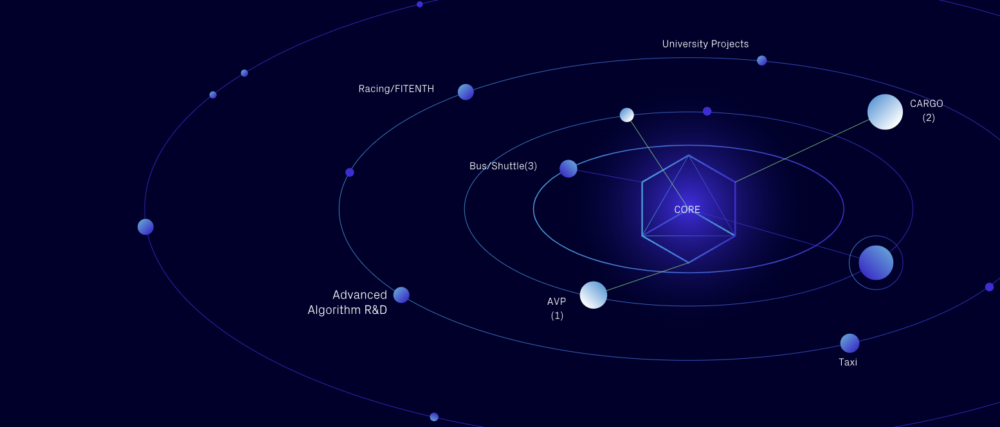

*그림 4. Autoware Core/Universe 생태계 · 원본: autoware-documentation `design/autoware-concepts/images/autoware_ecosystem.png` [6]*

### 2.2 릴리스 타임라인

| 릴리스 | 날짜 | 내용 | 출처 |
|---|---|---|---|
| 1.5.0 | 2025-11-20 | 1.x 체계 첫 태그(1.0~1.4 태그 없음). 2.0.0 전까지 Autoware 버전 = core 버전 | [9][72] |
| 1.8.0 | 2026-05-04 | 월간 릴리스 | [55] |
| 1.9.0 | 2026-07-16 | core 1.9.0, universe 0.52.0, agnocast 2.3.5 | [23][55] |
| **2.0.0** | **2026-10-29** | Generator-Selector 공식화, 모델 Hugging Face 이관, Autoware Index, Reference Design | [54] |

- 릴리스는 "대략 월간"이 원칙이다 [9].

### 2.3 Generator-Selector — 2.0.0에서 실제로 도는 것

- **개념**: 1.0의 고정 파이프라인(Sensing → Perception → Localization → Planning)에서 "파이프라인의 앞 절반을 추상화"했다 [1].
    - Generator: 규칙 기반·최적화 플래너, 원시 센서를 쓰는 E2E 모델, 학습·샘플링 플래너 무엇이든. 여러 개가 병렬로 돌 수 있다 [1].
    - Selector: 안전 검사(규칙 준수·주행가능영역)와 순위화·선택. 플러그인으로 구현해 사용자별 안전 정책을 넣는다 [1][4].
    - Generator 예시로 공식 문서가 든 것: 기존 Autoware 스택, **AWF 회원사의 사내 독점 AI 모델**, 오픈소스 Autoware E2E 모델 [4].

| 역할 | 패키지(`autoware_universe` 0.53.1) | 2.0.0 상태 [1] |
|---|---|---|
| Generator | `autoware_diffusion_planner` | `planning_setting:=diffusion_planner`일 때 실행. TensorRT·NVIDIA GPU 필요 |
| 후처리 | `autoware_trajectory_modifier` | 후보 중 첫 번째를 planning validator로 전달 |
| Selector 노드 | `autoware_trajectory_selector` | 미기동(런치 파일에 자리만 있음) |
| Safety gate | `autoware_trajectory_validator` | 미기동, selector 내부 라이브러리 |
| Ranking | `autoware_trajectory_ranker` | 미기동, selector가 쓰는 라이브러리 |
| 메시지 | `autoware_internal_planning_msgs` 1.16.0 | `CandidateTrajectories` · `CandidateTrajectory` · `GeneratorInfo` |

- **모델 배포**: Diffusion Planner 등 AI 모델은 Hugging Face `AutowareFoundation`에 버전 태그로 올라가고, Ansible `artifacts` 역할이 고정 버전을 받는다. 2.0.0은 Diffusion Planner v5.0을 쓴다 [1].

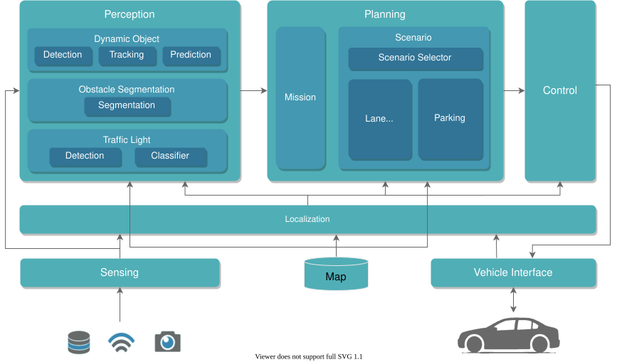

*그림 5. Architecture 1.0 개요 · 원본: autoware-documentation `design/autoware-architecture-v1/image/autoware-architecture-overview.drawio.svg` [14]*

*그림 6. Architecture 2.0 Generator-Selector 개념도 · 원본: autoware-documentation `design/autoware-architecture-v2/images/generator-selector-simple.svg` [1]*

*그림 7. Generator-Selector 프레임워크(Figure 2) · 원본: 같은 문서 roadmap `media/detailed_architecture_figure2.png` [4]*

### 2.4 Universe 축소와 Autoware Index

- **3층 구조 제안(2026-05-02, 열린 상태)**: Core(재단 큐레이션·버전 고정) / Universe("legacy, shrinking") / Index(레지스트리·CI·사이트·CLI) [70].
- **Index의 동작** [12][38]
    - 저장소 하나·ref 하나·패키지 목록을 `distributions/<distro>.yaml`에 PR로 등록한다.
    - CI가 최신 Autoware 릴리스에 대해 빌드·테스트하고 결과를 이력으로 쌓는다. `branch` ref는 매일 재검증, `tag`·`sha`는 고정.
    - `aw-index-cli compose`로 `autoware-index.repos`를 만들어 `vcs import`한다.
- **Index로 간 패키지** [54][66]
    - `autoware_livox_tag_filter` — Universe에서 제거되고 Index로 이동(2.0.0).
    - `autoware_image_diagnostics` — 2026-10 이동.
    - `autoware_pose2twist` · `autoware_bluetooth_monitor` · `autoware_component_monitor` — Index에 등록, universe 0.53.1에는 아직 포함(중복 추가 금지).
- **CUDA 패키지 재구조화** [65]
    - Universe 241개 패키지 중 CUDA/TensorRT 관련 약 27개. 공통 패키지(`cuda_utils`·`tensorrt_common`·`cuda_dependency_meta`)와 `cuda_blackboard`를 `autoware_cuda`(core 그룹)로 옮기고, 나머지 CUDA 패키지는 Index의 개별 패키지로 보낸다.
    - TIER IV 측 반대 의견과 일정 조율로 2026-09 말까지 연기됐다가 10-05 재개, 전환 목표일은 10-15.
- **Reference Design**: Index 항목에 리뷰어가 `reference_design: true`를 붙인다. 첫 사례가 Vision Pilot이고 `aw-index-cli compose --reference-design`이 `vision_pilot`을 돌려준다 [11][16][38].

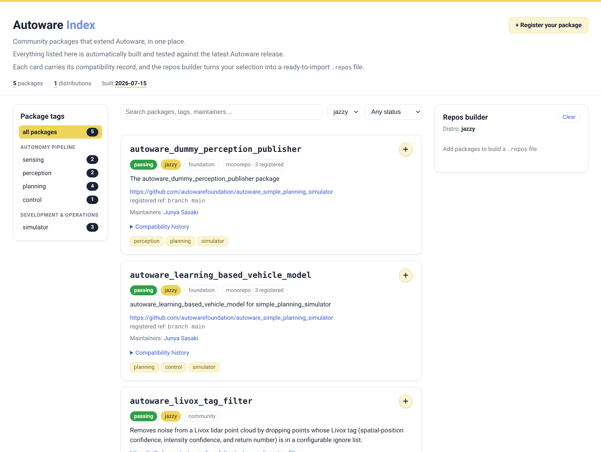

*그림 8. Autoware Index 브라우즈 사이트 · 원본: autoware-documentation `installation/autoware/images/autoware-index/browse-site.png` [12]*

### 2.5 재단이 만드는 학습 모델 — AutoE2E · LatentDrive · OnePlanner

| 항목 | AutoE2E (`auto_e2e`) [32] | LatentDrive (`autoware_latent_drive`) [34] | OnePlanner (`autoware_oneplanner`) [35] |
|---|---|---|---|
| 입력 | 서라운드 카메라 6대 (+맵 래스터 선택) | 전방(또는 전방 3대) 카메라 최근 2 s 영상, 경로점 6개, 자차 속도·가속도 | LiDAR 포인트클라우드(BEVFusion-L 백본), 벡터맵·경로·신호등, 자차 상태 |
| 구조 | 카메라→BEV 격자→GRU 플래너. Reactive 모델 완성, World Action·Reasoning 모델은 개발 중 | V-JEPA ViT-L 잠재 월드모델 + 계획 헤드(객체 검출·추적 없음) | BEV 특징 시계열 + 맵 컨텍스트 학습 플래너 |
| 출력 | 6.4 s 가속도·곡률, 10 Hz | 4 s 궤적 40점, 10 Hz | 6 s 궤적, LiDAR 주기 |
| 런타임 | PyTorch (CPU·CUDA) | ROS 비의존 C++ 라이브러리 + TensorRT + rosbag 재생 ROS 2 노드 | Autoware Core 1.x 위 ROS 2 노드, TensorRT 10 |
| 가중치 | HF `AutowareFoundation/auto_e2e` | HF `AutowareFoundation/latent_drive` v1.0 | HF `AutowareFoundation/oneplanner` v1.0 |
| 상태 표기 | Robotaxi WG 개발 [33] | "연구 모델, 공도 제어 금지" | "차에 쓰려면 Autoware 궤적 검증 뒤에 배선" |

- **AutoE2E의 두 용도**: README는 "LiDAR·레이더 안전층과 융합해 무인 로보택시로, 또는 카메라만으로 L2++ 핸즈프리 ADAS로"라고 적는다 [32].
- **외부 모델 노드**: `alpamayo-autoware`(포크)는 NVIDIA Alpamayo를 Autoware ROS 2 노드로 돌린다. 카메라 4대 입력, 궤적과 추론 텍스트 출력, 24 GB 이상 VRAM 권장 [47].

*그림 9. AutoE2E 아키텍처(World Action · Reasoning · Reactive) · 원본: auto_e2e `Media/readme/architecture.svg` [32]*

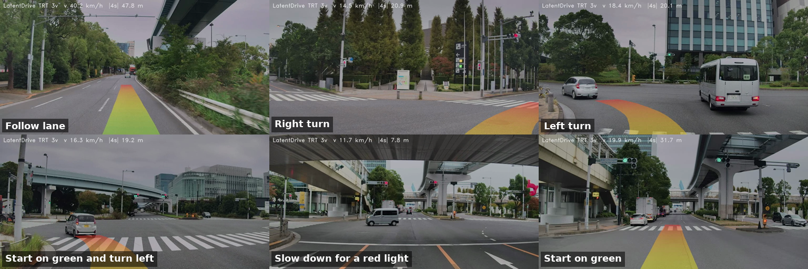

*그림 10. LatentDrive 개루프 재생 6장면(리본이 4 s 계획) · 원본: autoware_latent_drive `docs/latent_drive_scenes.png` [34]*

*그림 11. OnePlanner 개루프 재생 6장면 · 원본: autoware_oneplanner `media/oneplanner_scenes.png` [35]*

---

## 3. ADAS·POV 트랙 — Vision Pilot

> **요점**
> - Vision Pilot은 "양산 가능·안전 인증 가능"을 표방하는 오픈소스 L2 ADAS다. 카메라 1대, HD맵 없음, 모델 가중치까지 Apache 2.0.
> - 모델 3종(AutoSteer·AutoSpeed·AutoDrive)을 인식축과 E2E축으로 병렬 처리한다.
> - 2026-01부터 8월까지 5번 릴리스했고, 지금은 1.3과 안전 인증 작업을 진행 중이다.
> - POV 레퍼런스 디자인은 Vision Pilot을 4단계 중 Phase 1로 둔다.

### 3.1 무엇인가

- **정의**: "productionizable and safety certifiable implementation of an open-source L2 ADAS system" [27].
- **대상**: OEM·Tier-1의 양산 승용차 통합. 버스·트럭에도 적용 가능 [27].
- **기능**: ACC · FCW · AEB · LKAS · LDW · ISA · 단일차로 핸즈프리 고속도로 오토파일럿 [27].
- **센서**: 전방 단안 카메라 1대(수평 화각 52–55°, 1–2 MP). HD맵 불필요 [27].
- **라이선스**: Apache 2.0, AI 모델 가중치 포함 [27].
- **배포 형태**: 미들웨어 없이 실행, ROS 2 통합 인터페이스 제공 [71]. 소스 빌드·Debian 패키지·Docker(GPU/CPU) [27].
- **저장소 이름**: `autoware.privately-owned-vehicles`와 `autoware_vision_pilot` 주소가 현재 `vision_pilot` 저장소로 연결된다 [53].

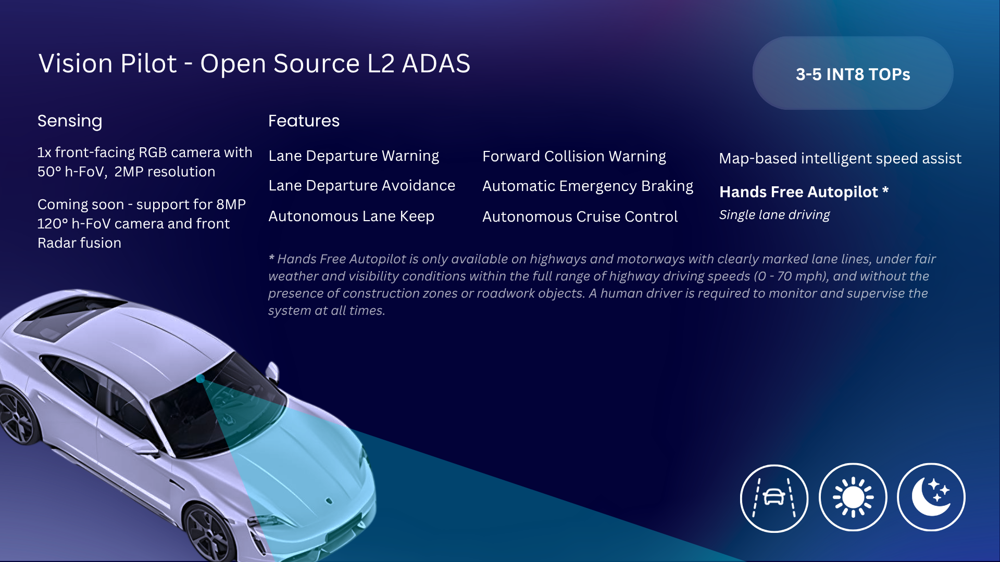

*그림 12. Vision Pilot 1.0 개요 · 원본: vision_pilot `Media/VisionPilot_1.0.png` [27]*

### 3.2 구조와 모델 3종

- **하이브리드 E2E**: 인식 AI 모델(안전)과 E2E AI 모델(성능)이 데이터를 병렬로 처리한다 [27].
- **런타임 모듈**: `engine`(ONNX Runtime), `models`, `sensing`, `safety_guardian`(fusion·planning), `middleware_interfaces/ros2_interface`, `visualization`, `logging`, `config` [27].
- **제어·계획**: 호모그래피로 픽셀→도로 좌표, 칼만 필터 CIPO 추적, RSS 영감 속도 계획, PID 종방향(0.9) [71]. 1.1부터 공간 영역 MPC [71].

| 모델 | 저장소 | 역할 | 공개 수치 |
|---|---|---|---|
| AutoSteer 2.0 | `auto_steer` [29] | 카메라 프레임→자차 미래 경로 웨이포인트. 차선 검출 없이 전체 프레임 처리 | 1024×512 입력, 검증 mAP@50 0.969 (INT8 0.966) |
| AutoSpeed 2.0 | `auto_speed` [30] | 경로 내 객체(CIPO) 검출 → ACC·FCW·AEB | YOLOv11 변형, mAP@50 0.74 (INT8 0.73) |
| AutoDrive | `auto_drive` [31] | 연속 2프레임→CIPO 거리·도로 곡률·CIPO 존재 확률 | 곡률 오차 핸들각 4°, 존재 정확도 88%, 거리 5–40 m 90% · 100–150 m 72% |

- **세 모델 모두** ONNX FP32와 INT8 가중치를 제공한다 [29][30][31].

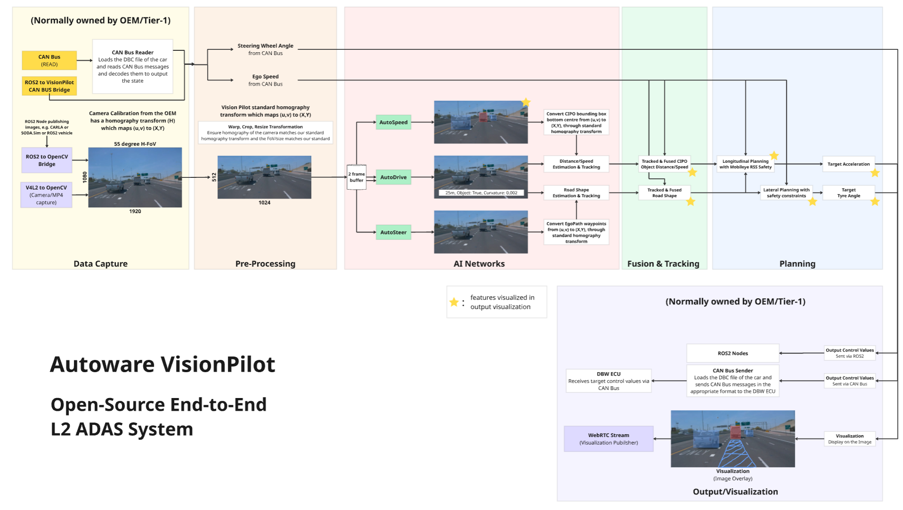

*그림 13. Vision Pilot "Hybrid End-to-End AI Architecture" · 원본: vision_pilot `Media/VisionPilot_architecture.png` [27]*

### 3.3 릴리스 이력과 다음 단계

| 버전 | 날짜 | 내용 | 출처 |
|---|---|---|---|
| 0.5 | 2026-01-22 | EgoLanes + AutoSteer 조향만. OEM 사설 트랙 실차 시험에서 인간 조향 대비 90% 이상 일치 | [71] |
| 0.9 | 2026-03-02 | AutoSpeed + ObjectFinder 종방향 인식·추적, RSS 영감 속도 계획, PID | [71] |
| 1.0 | 2026-07-06 | 모델 3종, 교차 모달 융합 + 궤적 계획. 당초 목표 6월 말 | [57][60][71] |
| 1.1 | 2026-07-27 | 공간 영역 MPC, 융합·추적 개선, Docker, CARLA 0.9.16 | [71] |
| 1.2 | 2026-08-10 | CARLA 통합·횡방향 추적 개선, 3D 점유 시각화, Rerun 로깅 | [71] |
| 1.3 (진행 중) | — | CARLA 브리지, 점유 BEV 창, 융합·추적 개선, 코드 규정 준수 | [64] |

- **다음 릴리스로 미룬 항목**: 고해상도 카메라(8 MP·120°), 카메라 + 자동차 레이더 융합("Stopped for now") [64].
- **안전 인증**
    - 2026-10-26 ADAS WG: "안전 인증 마무리에 집중" [64].
    - SEooC 문서(초안): Vision Pilot 일부 컴포넌트(계획·차량 제어·Safety Guardian)로 ISO 26262 Part 6(+Part 8 지원 프로세스) 준수 소프트웨어 SEooC를 목표. 차량 수준 안전 활동은 OEM·Tier-1 몫 [28].
    - README 로드맵: ISO 26262 · ISO 8800 안전 검증, 레이더 융합, 8 MP 120° 카메라 [27].
- **다른 차종으로의 확장**: 2026-10-22 Trucks WG 회의는 Vision Pilot v1.2 릴리스와 트럭 모델 작업 진행을 기록했고, Inceptio가 CARLA 0.9.16 + Vision Pilot v1.2로 시뮬레이션했다 [69].

### 3.4 POV 레퍼런스 디자인의 4단계

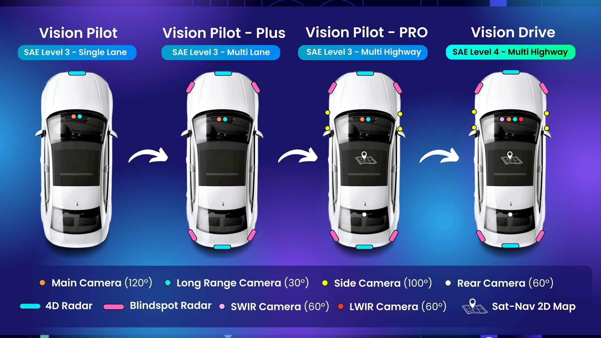

*그림 14. POV 레퍼런스 디자인 로드맵 4단계와 센서 배치 · 원본: autoware.pov-reference-design-docs `docs/system-configuration/images/Roadmap.jpg` [18]*

| Phase | 이름 | 목표 레벨 · ODD [17][19] | 요구 연산 [18] |
|---|---|---|---|
| 1 | Vision Pilot | L2+/2++, 단일차로 고속도로(0–70 mph), 운전자 상시 감독 | 50–80 TOPS |
| 2 | Vision Pilot Plus | L3, 다차로 고속도로, 자율 차선 변경 | 150 TOPS |
| 3 | Vision Pilot Pro | L3, 같은 ODD + 2D 내비 맵 | 500 TOPS |
| 4 | Vision Drive | L4, 같은 ODD | 1000 TOPS |

- **가이드의 센서 사양** [20]
    - Phase 1: 전방 카메라 2대(8 MP 120° 메인 + 8 MP 30° 장거리), 전방 4D 레이더 1대.
    - Phase 2: + 전·후 4D 레이더, 사각 레이더 4대. Phase 3: + 측면 카메라 4대, 2D 맵. Phase 4: + LWIR·SWIR 카메라.
- **가이드 작성 시점**: "2025.09 기준 개발 중" [18]. 현재 코드의 센서 사양(1–2 MP 단안)과 다르다 [27].
- **AutoSeg**: 6개 전문가 모델(Scene3D·SceneSeg·DomainSeg·EgoSpace·EgoPath·EgoLanes)을 Depth·Scene·Path 세 분기로 묶은 인식 파운데이션 모델 [21].
    - 분리 저장소 `scene_seg`·`scene_3d`·`ego_lanes`·`lite_models`는 README가 한 줄뿐이다 [75].
    - `domain_seg`: 공사구간 객체 분할, ROADWork 데이터셋 검증 mIoU 46.6 [48].
    - 2026-02 회의: AEI가 SceneSeg·Scene3D·EgoLanes 경량판으로 "정확도 유지하며 3배 속도" [58].

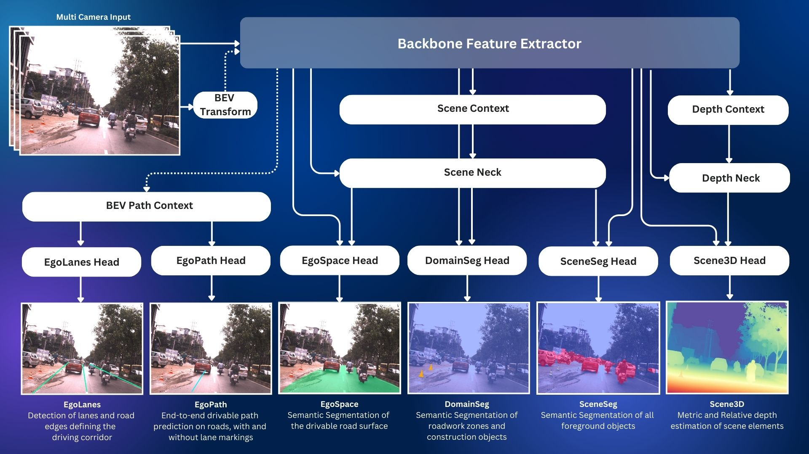

*그림 15. AutoSeg 파운데이션 모델 · 원본: autoware.pov-reference-design-docs `docs/software-configuration/images/AutoSeg.jpg` [21]*

---

## 4. 주행 모델과 컴퓨트 — 무엇이 어떤 칩 위에서 도나

> **요점**
> - 로보택시 트랙의 생성기 후보는 모두 NVIDIA GPU·TensorRT를 전제로 한다. Generator-Selector는 이들이 "같은 스택 위에서 경쟁"하도록 설계됐고, 회원사 독점 모델도 생성기로 명시돼 있다.
> - ADAS 트랙은 ONNX Runtime으로 GPU·CPU를 모두 지원하고, 3–5 INT8 TOPS급 양산 칩을 목표로 한다.
> - Renesas R-Car X5H가 두 트랙의 접점이다. 한 칩에서 AutoSD(Cortex-A720AE)와 FreeRTOS(Cortex-R52)를 함께 돌리는 작업이 끝났고, Open AD Kit v2.1은 "X5H, Vision Pilot"을 소비자로 둔다.

### 4.1 모델별 실행 환경 — 문서에 적힌 것만

| 모델·스택 | 트랙 | 런타임 | 문서에 적힌 실행 환경·수치 | 출처 |
|---|---|---|---|---|
| Diffusion Planner | ① | TensorRT (ONNX→엔진 첫 기동 시 빌드) | NVIDIA GPU 필요 | [1] |
| OnePlanner | ① | TensorRT 10, CUDA 12·13, spconv | NVIDIA GPU(Turing 이상). RTX PRO 6000 Blackwell Max-Q에서 전체 패스 p50 12.7 ms · p99 26.1 ms | [35] |
| LatentDrive | ① | TensorRT 10.8, CUDA 12 컨테이너 | NVIDIA GPU. 엔진 빌드 3카메라 약 7분 · 1카메라 약 1.5분 | [34] |
| AutoE2E | ① | PyTorch | RTX 5080, SwinV2-Tiny, 배치 1에서 최대 약 76 FPS | [32] |
| Alpamayo 노드 | ① | Python 3.10, ROS 2 Humble | NVIDIA GPU 24 GB 이상 VRAM 권장 | [47] |
| Vision Pilot | ② | ONNX Runtime (GPU 기본, CPU 가능) | 3–5 INT8 TOPS급 양산 칩에서 10 FPS 이상(1.0 릴리스 노트). CARLA 문서는 RTX 3060 노트북에서 시험 | [27][71] |
| AutoSeg 모델(POV 가이드 벤치) | ② | TensorRT · ONNX Runtime | Jetson AGX Orin 64GB TensorRT FP16 약 29–30 FPS, ADLINK AL30(RTX 4000 SFF Ada) Zenoh 50–56 FPS | [22] |
| Safety Island | 공통 | Zephyr · FreeRTOS, CycloneDDS | NXP S32Z·S32Z2, R-Car X5H CR52(Core1). 로컬 검증은 FVP·POSIX | [36] |

- **POV 가이드의 칩 지원 상태**: "NVIDIA GPU는 잘 지원되며 AMD·Qualcomm·Hailo-8 NPU는 로드맵에 있음" [18].
- **Autoware 본체**: GPU 없이 설치는 되지만 신경망 기반 검출·신호등 인식은 NVIDIA GPU가 필요하다 [15].

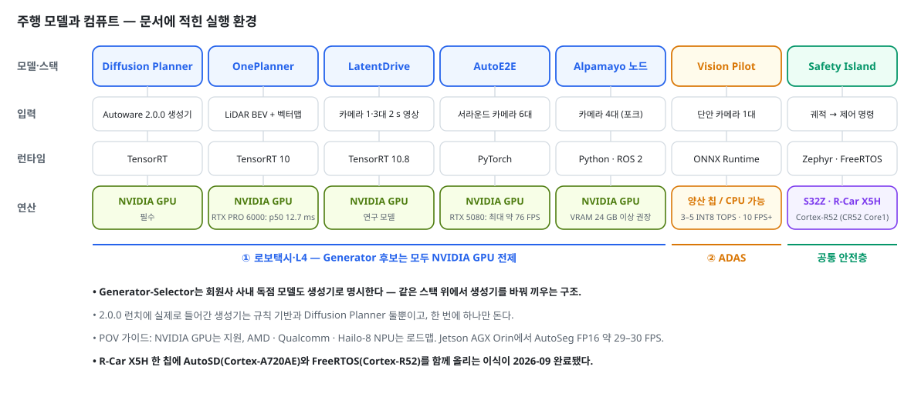

*그림 16. 주행 모델과 컴퓨트 조합 — 두 트랙 · 자체 작성 · 근거 [1][27][32][34][35][36][47][71]*

### 4.2 "같은 스택 위의 생성기 경쟁"

- **구조로 보장된 경쟁**: Generator-Selector는 "여러 생성기가 병렬로 돌고, Selector가 안전 검사 후 순위로 고른다"는 설계다 [1][4].
- **경쟁 참가자의 범위**: 공식 문서는 생성기 예시로 기존 Autoware 스택, **AWF 회원사의 사내 독점 AI 모델**, 오픈소스 Autoware E2E 모델을 나란히 든다 [4].
- **현재 실제로 꽂힌 생성기**: 2.0.0에서는 규칙 기반과 Diffusion Planner 두 개뿐이고 한 번에 하나만 돈다 [1].
- **런치 밖에서 경쟁 중인 후보**: OnePlanner·LatentDrive·AutoE2E·Alpamayo 노드는 각자 독립 런타임으로 공개됐다 [32][34][35][47].
- **모델 간 공개 비교**: AutoE2E README가 KITScenes-Multimodal 검증셋에서 오픈 가중치 모델 8종의 3 s 개루프 오차를 비교한다 [32].

| 모델 | 설정 | ADE@3s (m) | FDE@3s (m) |
|---|---|---|---|
| Qwen Drive 1.0 | 6궤적 중 첫 번째 | 0.565 | 1.397 |
| **AutoE2E (파인튜닝)** | kitscenes-epoch-5 | **0.744** | **1.980** |
| SimForge D1.5 | 카메라 슬롯 7개 | 0.831 | 2.209 |
| **AutoE2E (zero-shot)** | nuplan-epoch-5 | 0.915 | 2.423 |
| Alpamayo 1.5 | 6궤적 중 첫 번째 | 1.020 | 2.820 |
| VAD | Base stage-2 | 1.242 | 2.821 |
| METEOR | 3경로 중 top-1 | 1.240 | 3.282 |
| Drive-JEPA | perception v2 | 2.266 | 4.774 |

- **비교 조건 차이(README 명시)**: AutoE2E는 HD맵·경로를 추가로 받고, VAD·Drive-JEPA는 주행 명령을 받는다. 평가 표본도 202 키프레임과 11,035 샘플로 다르다 [32].

*그림 17. KITScenes-Multimodal 검증 3 s ADE/FDE, 오픈 가중치 8종 · 원본: auto_e2e `Media/readme/benchmark-kitscenes-3s.svg` [32]*

### 4.3 "한 칩 안의 주행 스택과 안전섬" — R-Car X5H

- **단일 SoC 이식 완료**: Open AD Kit 이슈 #120은 CES 2026의 MCO/MRM 데모(두 상자를 CycloneDDS로 연결)를 R-Car X5H 한 칩으로 옮겼다 [74].
    - AutoSD는 Cortex-A720AE 클러스터, FreeRTOS는 Cortex-R52 클러스터에서 돈다.
    - 칩 내부 RPMsg가 이더넷 연결을 대신한다. 2026-08-07 보드에서 왕복 100/100 확인, 2026-09-02 완료 처리.
- **Safety Island의 X5H 타깃**: `freertos-x5h`는 R-Car X5H CR52(Core1)용 FreeRTOS 타깃이다 [36].
- **Open AD Kit v2.1**: 주 소비자를 "X5H, Vision Pilot"으로 적었다 [56].
- **Reference Design WG(2026-10)**: L4 안전섬 설계에서 "최대 안전" 분기는 카메라·레이더 4대·초음파·IMU/GNSS를 R-Car X5H에, "최소 비용" 분기는 S32Z2·AURIX TC4x·Stellar 마이크로컨트롤러에 둔다 [67].
- **L2 Safety Island 실험(2026-10-15 보고)**: CARLA 폐루프에서 Vision Pilot이 계획하고 Safety Island가 승인·정지한다. 고장→제동 4–14 ms(한계 500 ms), 9 m/s로 약 2.5 km 차선 유지 [68].

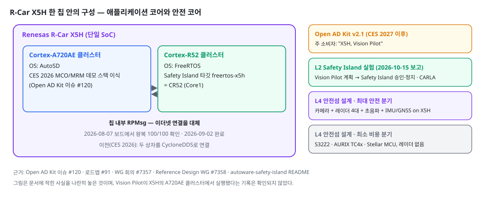

*그림 18. R-Car X5H 한 칩 안의 구성과 관련 계획 · 자체 작성 · 근거 [36][56][67][68][74]*

---

## 5. 배포·안전 층 — Open AD Kit · Safety Island

> **요점**
> - Open AD Kit은 "SOAFEE 블루프린트 + 증거 기반 릴리스"로 재편 중이다. v2.0(Autoware) → v2.1(Vision Pilot) → v3.0(폐루프).
> - Safety Island는 궤적 추종 제어를 안전급 코어로 떼어 내는 구현과, L4 설계 RFC 두 갈래다.

### 5.1 Open AD Kit

- **정의**: Autoware를 컨테이너화된 클라우드·엣지 SDV 컴포넌트로 배포하는 첫 SOAFEE 블루프린트 [26].
- **제공물**: GHCR 컴포넌트 이미지, 배포 구성(planning·logging·scenario·CARLA 시뮬레이션, Zenoh 브리지), 버전 고정 런타임 번들, CI 메타데이터 [26].
- **로드맵(이슈 #91, 2026-10 갱신)** — "날짜는 의도이지 계약이 아니다" [56]

| 릴리스 | 주 소비자 | 테마 |
|---|---|---|
| v2.0 (2026-10 목표, CES 2027 전까지) | AWF 유지자 | 증거 게이트, 통합자 층 |
| v2.0.x | Autoware 릴리스 팀 | RC 증거, 업그레이드 리포트, SBOM, Safety Island 증거 |
| v2.1 (CES 2027 이후) | X5H, Vision Pilot | Vision Pilot + Euro NCAP 파생 시나리오 증거(등급 주장 없음), Quadlet + BlueChi |
| v2.2 | 외부 통합자·차량 파트너 | 랩 증거, 첫 차량 프로파일 |
| v2.3 | 차량 파트너 | 차량 측 단계적 업데이트·롤백 |
| 2027 H1 | Eclipse SDV | Vision Pilot on S-CORE 쇼케이스 제안 또는 차단 목록 |
| v3.0 | 모두 | 빌드→배포→테스트→관측→업데이트→롤백 폐루프 |

- **핵심 결정** [56]
    - 워크로드는 digest로 고정. 모든 후보는 실행 후 결과를 서명(L0 렌더 → L1 프로세스·토픽 생존 → L2 시나리오 통과).
    - 차량 안은 CycloneDDS, 경계는 Zenoh, 쿠버네티스 미사용.
    - Autoware는 2027-05에 Humble 지원 중단.
    - 비목표: 인증 주장(ISO 26262·ISO/SAE 21434·ASPICE), 자체 OTA·MLOps.
- **현황**: 2026-10-15 WG 회의는 v2.0.0의 "10월 말" 목표를 "리스크"로 적었다 [68].

### 5.2 Safety Island

- **`autoware-safety-island`** [36]
    - Autoware 궤적 추종기(MPC 횡방향 + PID 종방향)를 안전급 프로세서에서 돌리고 DDS로 제어 명령을 교환하는 단독 애플리케이션. Autoware 코드 수정 불필요.
    - 런타임: Zephyr(`zephyr-fvp`, `zephyr-s32z`), FreeRTOS(`freertos-posix`, `freertos-s32z2`, `freertos-x5h`).
    - 고정 버전: Autoware 2025.02, Universe 0.40.0, CycloneDDS 0.11.0(AWF 포크).
    - README 원본에 Arm Limited 저작권 주석이 있다.
- **`RFC_L4_SafetyIslandDesign`**: L4 안전섬 설계 RFC·설계 문서·슬라이드 [37]. 2026-10 Reference Design WG는 HPC와 안전섬 사이 ROS 노드 분할과 비상정지를 논의했다 [67].

---

## 6. 공통 기반 — 미들웨어·도구·시뮬레이션

| 저장소 | 무엇 | 2.0.0에서의 위치 | 출처 |
|---|---|---|---|
| `agnocast` | rclcpp 호환 제로카피 IPC. rosidl 생성 메시지 그대로 지원 | core 그룹, 2.4.1 소스 빌드 | [23][41] |
| `callback_isolated_executor` | 콜백 그룹마다 전용 스레드를 배정하는 Executor | Agnocast에 통합 | [41][43] |
| `cuda_blackboard` | REP-2007·2009로 GPU 메모리를 노드 간 복사 없이 공유 | universe 그룹 0.4.0, core/cuda로 이동 예정 | [23][42][65] |
| `autoware_system_designer` | YAML 설계에서 ROS 2 런치·노드 그래프·지연 뷰·파라미터 템플릿 생성 | core 그룹 v0.4.2 | [23][40] |
| `autoware_simple_planning_simulator` | Universe에서 옮긴 단독 planning simulator | core 그룹 1.1.0 | [23][49] |
| `autoware-harness` | 코딩 에이전트용 Autoware 스킬·에이전트·MCP 묶음 | 별도 | [51] |
| `3dgs_io` | 3D Gaussian Splatting 장면 + Autoware 맵 번들 I/O | 별도 | [52] |
| `AWSIM`, CARLA 계열 | 디지털 트윈 시뮬레이터, CARLA 포크·브리지·시나리오 | 별도 | [53] |

- **차종별 프로젝트**
    - 고속도로 트럭(`autoware.trucks`): SAE L4 고속도로 자율 트럭 목표. Truck WG 단기 목표에 "비전 전용 경량 신경망 벤치마크" [46][50].
    - 오프로드(`autoware.off-road`, `autoware_off-road_sim`): 광산 트럭·RoboRacer·행성 로버, Isaac Sim 기반 시뮬레이터. 오프로드 WG는 2026-05-07 회의에서 "추후 통지까지 일시 중단" [44][45][73].
    - 저속 자율주행(LSA)·RoboRacer·GoKart·ITRI 버스: 레퍼런스 디자인 문서 [11].

---

## 7. 저장소 157개 분류

> **요점**
> - 157개 중 아카이브 27개·포크 24개이고, 2026년에 갱신된 비아카이브 저장소는 86개다.
> - 2026년 활동은 재단 자체 AI 모델(B·C), 배포·안전(E), 레지스트리·인프라(F)에 몰려 있다.

| 분류 | 개수 | 2026년에 갱신된 주요 저장소 |
|---|---|---|
| A. 메타·핵심 | 17 | `autoware`, `autoware_core`, `autoware_universe`, `autoware_launch`, `autoware_system_designer`, `autoware_simple_planning_simulator`, `autoware_cuda`, `autoware-documentation` |
| B. 로보택시·L4 E2E | 6 | `auto_e2e`, `autoware_latent_drive`, `autoware_oneplanner`, `alpamayo-autoware`(포크), `3dgs_io` |
| C. ADAS·POV | 13 | `vision_pilot`, `auto_steer`, `auto_speed`, `auto_drive`, `domain_seg`, `ego_lanes`, `blindspot_detector`, `auto_speed_limit` |
| D. 미들웨어·GPU | 14 | `agnocast`, `callback_isolated_executor`, `cuda_blackboard`, `managed_transform_buffer`, `ros2_socketcan`, `spconv_cpp` |
| E. 배포·안전 | 6 | `openadkit`, `open-ad-kit-docs`, `autoware-safety-island`, `RFC_L4_SafetyIslandDesign` |
| F. 레지스트리·인프라·도구 | 19 | `autoware-index`, `aw-index-cli`, `autoware-index-github-actions`, `autoware-harness`, `autoware-repos-visualizer`, `colcon-dashboard` |
| G. 시뮬·평가·데이터 | 19 | `AWSIM`, `autoware_carla_scenario`, `odd-usecase-scenario`, `autoware_off-road_sim`, `autoware_lanelet2_to_opendrive`, `lanelet2_to_sumo` |
| H. 차종 프로젝트·레퍼런스 디자인·WG | 22 | `autoware.off-road`, `LSA-reference-design-docs`, `autoware.orv-reference-design-docs` |
| I. 드라이버·Index 이동 패키지 | 10 | `autoware_livox_tag_filter`, `autoware_image_diagnostics`, `autoware_pose2twist`, `autoware_bluetooth_monitor`, `autoware_component_monitor` |
| J. 레거시·아카이브·포크·벤더 | 31 | (2026년 갱신 없음) Autoware.AI 저장소 9개, Core/Universe 프로토타입 등 |

- 분류는 이 보고서의 정리 기준이다. 전체 목록(설명·별·포크·갱신일·상태)은 [저장소 전수 목록](reference/repo-inventory.md)에 있다 [53].

---

## 8. 로드맵 위의 현재 위치

> **요점**
> - 공식 로드맵 문서와 해당 산출물이 같은 대상을 명시한 경우만 연결했다.

| 공식 로드맵 항목 | 문서 | 확인된 현재 상태(2026-10) |
|---|---|---|
| Architecture 2.0 Step 1 학습 플래너 | [3] | Diffusion Planner가 2.0.0에서 선택 가능 [1] |
| Generator-Selector의 Selector | [4] | 패키지 존재, 2.0.0에서 미기동 [1] |
| POV Phase 1 Vision Pilot | [17] | 1.2 릴리스(2026-08-10), 1.3 진행 중 [64][71] |
| Open AD Kit v2.0 | [56] | 2026-10 말 목표, "리스크" [68] |
| Open AD Kit v2.1 (X5H, Vision Pilot) | [56] | CES 2027 이후 예정. X5H 한 칩 AutoSD+FreeRTOS 이식 완료 [74] |
| Open AD Kit v2.0.x Safety Island 증거 | [56] | L2 Safety Island CARLA 폐루프 실험 보고 [68] |
| Universe → Index 분산 | [70] | Index 공개, 패키지 5개 등록·이동 [54][66] |
| 다년 로드맵 Objective 2 Robotaxi TRL-6 | [10] | Year 3 목표. 기준 연도는 문서에 없음 [10] |

---

## 9. 시사점 — 차량용 HPC 관점

출처 있는 사실에서 바로 도출되는 것만 적었다.

1. **같은 재단 안에 두 개의 연산 등급이 공존한다.**
    - 근거: 로보택시 트랙 모델은 NVIDIA GPU·TensorRT를 전제로 하고(OnePlanner RTX PRO 6000에서 p50 12.7 ms), Vision Pilot은 3–5 INT8 TOPS급 양산 칩에서 10 FPS 이상을 목표로 한다 [35][71].
    - 의미: 어느 트랙을 올리느냐가 SoC 등급을 결정한다.
2. **주행 모델 층이 교체 가능한 부품으로 설계됐다.**
    - 근거: Generator-Selector는 회원사 독점 모델을 생성기로 명시하고, Selector가 안전 검사·순위화를 맡는다 [4].
    - 의미: 플랫폼 쪽은 "어떤 생성기가 와도 돌아가는 연산 + 공통 안전 게이트"를 제공하는 구조다.
3. **안전 코어 분리가 구체적 칩 이름으로 내려왔다.**
    - 근거: Safety Island 타깃은 NXP S32Z·S32Z2와 R-Car X5H CR52이고, X5H 한 칩에서 Cortex-A720AE(AutoSD)와 Cortex-R52(FreeRTOS)를 함께 돌리는 이식이 완료됐다 [36][74].
    - 의미: 애플리케이션 코어와 안전 코어를 한 SoC에 넣는 구성이 오픈소스 레퍼런스로 공개되고 있다.
4. **배포 단위가 "버전 고정 + 서명된 실행 증거"로 바뀐다.**
    - 근거: Open AD Kit은 digest 고정, L0~L2 증거 서명, SBOM, AutoSD·Quadlet·BlueChi, 쿠버네티스 미사용을 결정했다 [56].
5. **제로카피 IPC와 GPU 메모리 공유가 Core의 정식 구성원이 됐다.**
    - 근거: Agnocast는 core 그룹에 소스 빌드로 고정됐고, cuda_blackboard는 core/cuda로 이동이 결정됐다 [23][65].

---

## 10. 조사 방법과 한계

- **조사일·범위**: 2026-10-30. AWF GitHub 저장소·문서 원본·WG 회의록·이슈.
- **방법**: 저장소는 raw 파일과 shallow clone으로 읽었고, 릴리스·이슈·토론은 GitHub 페이지를 직접 열람했다. 실행·실측은 하지 않았다.
- **접근 제약**: 세션 네트워크 정책으로 autoware.org, docs.autoware.org, medium.com, 언론 사이트, GitHub 조직 API에 접근하지 못했다. 공식 문서는 같은 내용의 문서 저장소 원본으로 대신 읽었다.
- **제외한 항목** — 원문으로 확인하지 못해 뺐다.
    - 전시회에서 Vision Pilot을 특정 SoC와 함께 시연했다는 언론 보도(원문 접근 불가).
    - 재단 홈페이지·블로그의 공식 표현과 2026년 사업 계획.
    - 저장소별 생성일(조직 API 차단). "2026년 신규"라는 표현은 쓰지 않고 "2026년 갱신"만 적었다.
    - 각 저장소와 Architecture 2.0 단계의 대응(공식 문서에 없음).
- **수치 기준**: 별·포크 수는 목록 페이지 표기다. Vision Pilot 릴리스 날짜는 릴리스 페이지 날짜이고, 연도는 태그 커밋일로 확인했다 [71].

---

## 출처

1. 💻 Autoware 문서 — Autoware 2.0 architecture (What 2.0.0 does today · Packages · Generator-Selector 개요) — 2026-10-29 — https://github.com/autowarefoundation/autoware-documentation/blob/main/docs/design/autoware-architecture-v2/index.md
2. 💻 Autoware 문서 — Autoware Architecture: Executive Summary (Autoware 1.0 → 2.0) — main — https://github.com/autowarefoundation/autoware-documentation/blob/main/docs/design/autoware-architecture-v2/roadmap/index.md
3. 💻 Autoware 문서 — Autonomous Driving Stack Architecture (Autoware E2E Step 1~4, Figure 1~9) — main — https://github.com/autowarefoundation/autoware-documentation/blob/main/docs/design/autoware-architecture-v2/roadmap/autonomous-driving-stack-architecture.md
4. 💻 Autoware 문서 — Detailed Architectural Interface (Generator-Selector Framework) — main — https://github.com/autowarefoundation/autoware-documentation/blob/main/docs/design/autoware-architecture-v2/roadmap/detailed-architectural-interface.md
5. 💻 Autoware 문서 — Development Roadmap (본문 "TBD") — main — https://github.com/autowarefoundation/autoware-documentation/blob/main/docs/design/autoware-architecture-v2/roadmap/development-roadmap.md
6. 💻 Autoware 문서 — Autoware concepts (Microautonomy, Core & Universe) — main — https://github.com/autowarefoundation/autoware-documentation/blob/main/docs/design/autoware-concepts/index.md
7. 🔍 Autoware 문서 — Repository structure — main — https://github.com/autowarefoundation/autoware-documentation/blob/main/docs/design/repository-structure.md
8. 🔍 Autoware 문서 — repositories/*.repos files — main — https://github.com/autowarefoundation/autoware-documentation/blob/main/docs/design/repos-files.md
9. 🔍 Autoware 문서 — Versioning and release process ("Autoware 2.0.0 uses autoware_core 1.10.0") — main — https://github.com/autowarefoundation/autoware-documentation/blob/main/docs/design/versioning-and-release.md
10. 💻 Autoware 문서 — Autoware Multi-Year Roadmap (Objective 1~8, Year 1~3) — main — https://github.com/autowarefoundation/autoware-documentation/blob/main/docs/home/roadmap/multi-year-roadmap.md
11. 💻 Autoware 문서 — Reference design (Deployment Profile + Reference Software Stack) — main — https://github.com/autowarefoundation/autoware-documentation/blob/main/docs/reference-design/index.md
12. 💻 Autoware 문서 — Autoware Index (aw-index-cli, --reference-design) — main — https://github.com/autowarefoundation/autoware-documentation/blob/main/docs/installation/autoware/autoware-index.md
13. 💻 Autoware 문서 — Home (Autoware 2.0 release notes 배지, Validated use cases) — main — https://github.com/autowarefoundation/autoware-documentation/blob/main/docs/home/index.md
14. 🔍 Autoware 문서 — Architecture 1.0 overview — main — https://github.com/autowarefoundation/autoware-documentation/blob/main/docs/design/autoware-architecture-v1/index.md
15. 🔍 Autoware 문서 — Installation (Target platforms, Universe vs Core) — main — https://github.com/autowarefoundation/autoware-documentation/blob/main/docs/installation/index.md
16. 🔍 autoware-documentation PR #839 — docs: update the documentation for the Autoware 2.0 release — 2026-10-29 — https://github.com/autowarefoundation/autoware-documentation/pull/839
17. 💻 POV 레퍼런스 디자인 — Introduction (Vision Pilot · Plus · Pro · Vision Drive 4단계) — main — https://github.com/autowarefoundation/autoware.pov-reference-design-docs/blob/main/docs/index.md
18. 💻 POV 레퍼런스 디자인 — System Configuration (프레임워크·TOPS·미들웨어) — main — https://github.com/autowarefoundation/autoware.pov-reference-design-docs/blob/main/docs/system-configuration/index.md
19. 💻 POV 레퍼런스 디자인 — ODD Definition — main — https://github.com/autowarefoundation/autoware.pov-reference-design-docs/blob/main/docs/odd-definition/index.md
20. 💻 POV 레퍼런스 디자인 — Hardware Configuration — main — https://github.com/autowarefoundation/autoware.pov-reference-design-docs/blob/main/docs/hardware-configuration/index.md
21. 💻 POV 레퍼런스 디자인 — Software Configuration (AutoSeg 6개 모델) — main — https://github.com/autowarefoundation/autoware.pov-reference-design-docs/blob/main/docs/software-configuration/index.md
22. 💻 POV 레퍼런스 디자인 — Evaluation and Testing (ADLINK AL30 · Jetson AGX Orin 벤치마크) — main — https://github.com/autowarefoundation/autoware.pov-reference-design-docs/blob/main/docs/evaluation-and-testing/index.md
23. 💻 autoware — repositories/autoware.repos 외 tools·simulator·extra-packages.repos (태그 2.0.0, 1.9.0 대조) — 2026-10 — https://github.com/autowarefoundation/autoware/blob/2.0.0/repositories/autoware.repos
24. 💻 autoware_core — README — main — https://github.com/autowarefoundation/autoware_core
25. 💻 autoware_universe — README — main — https://github.com/autowarefoundation/autoware_universe
26. 💻 openadkit — README — main — https://github.com/autowarefoundation/openadkit
27. 💻 vision_pilot — README · VisionPilot/modules 트리 — main — https://github.com/autowarefoundation/vision_pilot
28. 💻 vision_pilot — Functional_Safety/SAFETY_ELEMENT_OUT_OF_CONTEXT.md (SEooC 초안) — main — https://github.com/autowarefoundation/vision_pilot/tree/main/Functional_Safety
29. 💻 auto_steer — README (AutoSteer 2.0) — main — https://github.com/autowarefoundation/auto_steer
30. 💻 auto_speed — README (AutoSpeed) — main — https://github.com/autowarefoundation/auto_speed
31. 💻 auto_drive — README (AutoDrive) — main — https://github.com/autowarefoundation/auto_drive
32. 💻 auto_e2e — README (AutoE2E, 벤치마크 표) — main — https://github.com/autowarefoundation/auto_e2e
33. 💻 auto_e2e — ONBOARDING.md (Robotaxi work group) — main — https://github.com/autowarefoundation/auto_e2e/blob/main/ONBOARDING.md
34. 💻 autoware_latent_drive — README (LatentDrive) — main — https://github.com/autowarefoundation/autoware_latent_drive
35. 💻 autoware_oneplanner — README (OnePlanner) — main — https://github.com/autowarefoundation/autoware_oneplanner
36. 💻 autoware-safety-island — README (Zephyr/FreeRTOS, S32Z·R-Car X5H, Arm Limited 저작권 주석) — main — https://github.com/autowarefoundation/autoware-safety-island
37. 💻 RFC_L4_SafetyIslandDesign — README — main — https://github.com/autowarefoundation/RFC_L4_SafetyIslandDesign
38. 💻 autoware-index — README — main — https://github.com/autowarefoundation/autoware-index
39. 💻 aw-index-cli — README — main — https://github.com/autowarefoundation/aw-index-cli
40. 💻 autoware_system_designer — README — main — https://github.com/autowarefoundation/autoware_system_designer
41. 💻 agnocast — README — main — https://github.com/autowarefoundation/agnocast
42. 💻 cuda_blackboard — README — main — https://github.com/autowarefoundation/cuda_blackboard
43. 💻 callback_isolated_executor — README — main — https://github.com/autowarefoundation/callback_isolated_executor
44. 💻 autoware.off-road — README — main — https://github.com/autowarefoundation/autoware.off-road
45. 💻 autoware_off-road_sim — README — main — https://github.com/autowarefoundation/autoware_off-road_sim
46. 💻 autoware.trucks — README — main — https://github.com/autowarefoundation/autoware.trucks
47. 💻 alpamayo-autoware — README (Alpamayo ROS 2 노드) — main — https://github.com/autowarefoundation/alpamayo-autoware
48. 💻 domain_seg — README (DomainSeg) — main — https://github.com/autowarefoundation/domain_seg
49. 💻 autoware_simple_planning_simulator — README — main — https://github.com/autowarefoundation/autoware_simple_planning_simulator
50. 💻 autoware-projects 위키 — Home(WG 목록) · Privately Owned Vehicles · Software · Safety Assurance · Reference Design · Truck · Low Speed Autonomy WG 페이지 — 2026-10-30 — https://github.com/autowarefoundation/autoware-projects/wiki
51. 💻 autoware-harness — README — main — https://github.com/autowarefoundation/autoware-harness
52. 💻 3dgs_io — README — main — https://github.com/autowarefoundation/3dgs_io
53. 🔍 GitHub — autowarefoundation 조직 저장소 목록(6쪽, 157개) · fork:true 필터(24개) — 2026-10-30 — https://github.com/orgs/autowarefoundation/repositories
54. 🔍 GitHub Release — Autoware 2.0.0 — 2026-10-29 — https://github.com/autowarefoundation/autoware/releases/tag/2.0.0
55. 🔍 GitHub Releases — autoware 릴리스 목록(1.8.0 · 1.9.0 · 2.0.0) — 2026-10-30 — https://github.com/autowarefoundation/autoware/releases
56. 🔍 openadkit issue #91 — Open AD Kit 2026-2027 Roadmap (2026-10 갱신) — 2026-10 — https://github.com/autowarefoundation/openadkit/issues/91
57. 🔍 Discussion #6786 — Privately Owned Vehicle Work Group Meeting 2026/02/09 — 2026-02-09 — https://github.com/orgs/autowarefoundation/discussions/6786
58. 🔍 Discussion #6838 — Privately Owned Vehicle Work Group Meeting 2026/02/23 — 2026-02-23 — https://github.com/orgs/autowarefoundation/discussions/6838
59. 🔍 Discussion #7115 — Privately Owned Vehicle Work Group Meeting 2026/05/18 — 2026-05-18 — https://github.com/orgs/autowarefoundation/discussions/7115
60. 🔍 Discussion #7148 — Privately Owned Vehicle Work Group Meeting 2026/06/08 — 2026-06-08 — https://github.com/orgs/autowarefoundation/discussions/7148
61. 🔍 Discussion #7335 — ADAS Work Group Meeting 2026/09/28 — 2026-09-28 — https://github.com/orgs/autowarefoundation/discussions/7335
62. 🔍 Discussion #7341 — ADAS Work Group Meeting 2026/10/05 — 2026-10-05 — https://github.com/orgs/autowarefoundation/discussions/7341
63. 🔍 Discussion #7366 — ADAS Work Group Meeting 2026/10/19 — 2026-10-19 — https://github.com/orgs/autowarefoundation/discussions/7366
64. 🔍 Discussion #7371 — ADAS Work Group Meeting 2026/10/26 — 2026-10-26 — https://github.com/orgs/autowarefoundation/discussions/7371
65. 🔍 Discussion #7156 — Repository restructuring: Extracting shared CUDA components into core — 2026-06-11 (10월 갱신) — https://github.com/orgs/autowarefoundation/discussions/7156
66. 🔍 Discussion #7375 — Software WG Meeting 2026/10/27 — 2026-10-27 — https://github.com/orgs/autowarefoundation/discussions/7375
67. 🔍 Discussion #7358 — Reference Design WG Meeting (2026-10) — 2026-10-16 — https://github.com/orgs/autowarefoundation/discussions/7358
68. 🔍 Discussion #7357 — Open ADKit Working Group Meeting 2026/10/15 — 2026-10-15 — https://github.com/orgs/autowarefoundation/discussions/7357
69. 🔍 Discussion #7370 — Trucks WG Meeting 2026/10/22 — 2026-10-22 — https://github.com/orgs/autowarefoundation/discussions/7370
70. 🔍 autoware issue #7090 — Establish Autoware Index to federate Universe community packages — 2026-05-02 — https://github.com/autowarefoundation/autoware/issues/7090
71. 🔍 vision_pilot Releases (v0.5 · v0.9 · v1.0 · v1.1 · v1.2, 태그 커밋일 대조) — 2026-01 ~ 08 — https://github.com/autowarefoundation/vision_pilot/releases
72. 💻 autoware 태그 목록과 태그 커밋일(git ls-remote · fetch) — 2026-10-30 — https://github.com/autowarefoundation/autoware/tags
73. 🔍 Discussion #7101 — Off-road/Racing Working Group Meeting 2026/05/07 — 2026-05-07 — https://github.com/orgs/autowarefoundation/discussions/7101
74. 🔍 openadkit issue #120 — Reproduce the CES 2026 MCO/MRM edge stack on a single R-Car X5H ECU (AutoSD + FreeRTOS) — 2026-08-07 (2026-09-02 완료) — https://github.com/autowarefoundation/openadkit/issues/120
75. 💻 README가 한 줄뿐인 저장소 8개 — lite_models · scene_seg · scene_3d · ego_lanes · blindspot_detector · auto_speed_limit · vision_pilot_model_recipes · autoware_launch_v2 — 2026-10-30 — https://github.com/autowarefoundation/lite_models
