# Autoware 재단 스택 지도 — Autoware 2.0 시대의 저장소 157개, 무엇이 무엇이고 로드맵 어디에 있나

> **작성일**: 2026-10-30 · **상태**: 초판
> **배경**: Autoware 재단(AWF) GitHub 조직에 `vision_pilot`, `auto_steer`, `auto_e2e`, `autoware_latent_drive`, `autoware-safety-island`, `autoware-index` 같은 낯선 저장소가 급증했고, 2026-10-29에는 **Autoware 2.0.0**이 공개됐다. 이 보고서는 ① 조직의 저장소 157개를 전수 조사해 10개 묶음으로 분류하고, ② 각 스택이 무엇인지 설명하며, ③ AWF가 공개한 로드맵(다년 로드맵·Architecture 2.0 4단계·POV 4단계·Open AD Kit 사다리) 위에 각 스택을 올려 "지금 어디에 있는지"를 정리한다. "E2E 전환 로드맵이 자율주행 트랙과 ADAS 트랙으로 나뉘고 Vision Pilot은 ADAS 쪽"이라는 질문자의 가설도 공식 자료로 검증한다(§3).
> **대상 독자**: Autoware 1.x 구조(Sensing→Perception→Localization→Planning→Control, Core/Universe)를 아는 엔지니어.
> **출처 표기 원칙**: 모든 사실 문장에 출처 ID를 붙인다. 등급은 💻 **저장소 원본**(raw 파일·shallow clone으로 직접 확인) · 🔍 **1차 페이지**(GitHub 릴리스·이슈·토론을 직접 열람) · 📚 **이 저장소의 앞선 보고서**가 직접 확인한 기록 · 📰 **웹 검색 요약** · ⚠️ **추정·미확인**. 전체 목록은 [출처 기록](reference/references.md).
> **조사 환경 제약**: 세션 네트워크 정책으로 `autoware.org`, `docs.autoware.org`(=`autowarefoundation.github.io`), `medium.com`을 열 수 없었다. 공식 문서는 렌더링 사이트 대신 **문서 저장소(`autoware-documentation`)의 Markdown 원본**을 clone해 읽었고(내용은 동일), 재단 홈페이지·블로그 정보는 GitHub와 검색 결과로 대체했다. GitHub 조직 API는 세션 정책으로 막혀 있어 저장소 목록은 조직 페이지를 직접 열람해 받아 적었다.

---

## 0. 세 줄 요약

1. **AWF의 스택은 "로보택시·L4 트랙"과 "ADAS·개인차량(POV) 트랙" 두 줄기로 읽으면 대부분 정리된다.** 전자는 `autoware`(Core/Universe/Launch)와 그 위의 학습 플래너·E2E 모델(`Diffusion Planner`, `auto_e2e`, `autoware_latent_drive`, `autoware_oneplanner`)이고, 후자는 `vision_pilot`과 그 부품 모델(`auto_steer`·`auto_speed`·`auto_drive`, AutoSeg 계열, `lite_models`)이다. 두 트랙은 같은 E2E 진화 철학(학습 플래너→컴포넌트형 E2E→단일 신경망→하이브리드)을 공유하지만, **주체(Software/Robotaxi WG vs ADAS WG)·센서·하드웨어·릴리스 주기가 다른 별개의 코드베이스**다. 질문자의 가설은 큰 틀에서 맞고, 세부는 §3.4에 채점했다. (💻 D3·D10·R6·R10 · 🔍 G8·G13)
2. **Autoware 2.0.0(2026-10-29 공개)은 "E2E 완성판"이 아니라 "Generator-Selector 구조를 공식화하고 생성기 하나를 바꿔 끼울 수 있게 한 첫 릴리스"다.** 런치 인자 `planning_setting`으로 규칙 기반 플래너와 Diffusion Planner 중 하나를 고르며, Selector(안전 게이트·랭킹)는 패키지는 있으나 아직 기동하지 않는다. 같이 공개된 것은 모델의 Hugging Face 이관, 커뮤니티 패키지 레지스트리 **Autoware Index**, 그리고 Vision Pilot을 첫 사례로 하는 **Reference Design** 개념이다. 버전 체계도 바뀌어 Autoware 2.0.0이 `autoware_core` 1.10.0을 쓴다. (💻 D1·D9·R1 · 🔍 G2)
3. **배포·안전 층이 별도 스택으로 자라고 있다.** `openadkit`은 Autoware·Vision Pilot·Safety Island를 "digest로 고정하고 증거(evidence)를 서명해 내보내는" 배포 계층으로 재편 중이며(v2.0 2026-10 말 목표, v2.1에서 Vision Pilot + Euro NCAP 파생 시나리오, Renesas R-Car X5H), `autoware-safety-island`는 Arm 안전 코어에서 궤적 추종기를 돌리는 구현체다. 로드맵 상 가장 가까운 양산 지향 결합은 "Vision Pilot + Safety Island + Open AD Kit"이고, 로보택시 트랙은 다년 로드맵에서 TRL-6 목표가 3년 차에 놓여 있다. (🔍 G4·G17 · 💻 D10·R13)

---

## 1. 한눈에 보는 지도

<em>그림 1. AWF 스택 지도. 자체 작성. 두 트랙(열) × 다섯 층(행)으로 157개 저장소 중 핵심을 배치했고, 아래에 Architecture 2.0의 E2E 4단계에 각 스택을 대응시켰다. Step 대응은 자체 해석이다.</em>

**읽는 법.** 위 두 행(AI 모델·주행 스택)은 트랙별로 갈리고, 아래 세 행(공통 기반·배포·안전·ODD 프로젝트)은 두 트랙이 공유한다. 표로 압축하면 다음과 같다.

| 층 | ① 로보택시·L4 트랙 | ② ADAS·POV 트랙 | 공통 |
|---|---|---|---|
| 주체(WG) | Software WG(아키텍처·릴리스), Robotaxi WG(`auto_e2e`) | ADAS WG(옛 Privately Owned Vehicle WG), Reference Design WG | Open AD Kit WG, Safety Assurance WG, ODD WG |
| 주행 스택 | **Autoware 2.0.0** = `autoware_core` 1.10.0 + `autoware_universe` 0.53.1 + `autoware_launch` 0.53.0 (ROS 2 Humble/Jazzy) | **Vision Pilot 1.2** (C++ · ONNX Runtime · 미들웨어 없이 실행, ROS 2 인터페이스 옵션) | — |
| AI 모델 | Diffusion Planner(Universe), AutoE2E, LatentDrive, OnePlanner, Alpamayo 노드(포크) | AutoSteer·AutoSpeed·AutoDrive, AutoSeg 계열(SceneSeg·Scene3D·DomainSeg·EgoLanes), Lite models | 가중치는 Hugging Face `AutowareFoundation` |
| 센서·맵 | LiDAR+카메라(+레이더), HD맵(Lanelet2) 또는 2D맵 옵션 | 단안 카메라 1대, **HD맵 없음**(mapless) | — |
| 하드웨어 | NVIDIA GPU(TensorRT), amd64/arm64 | 3–5 INT8 TOPS급 양산 SoC 목표, Jetson Orin·x86 GPU에서 벤치 | Arm 안전 코어(S32Z·R-Car X5H)=Safety Island |
| 배포 | Open AD Kit v2.0 (Autoware 컨테이너·증거) | Open AD Kit v2.1 (Vision Pilot·X5H) | `autoware-index`(패키지 레지스트리), Reference Design |
| 로드맵 위치 | Arch 2.0 Step 1(학습 플래너) 공식 진입, Step 2~3 연구 | POV Phase 1(Vision Pilot L2) 출시, Phase 2(Plus: 레이더 융합) 착수 | 다년 로드맵 Y1: LSA·POV TRL-6, Y3: Robotaxi TRL-6 |

(출처: 💻 R1·D1·D10·R6·P1 · 🔍 G2·G4·G13. 각 항목의 근거는 §4~§7에서 반복한다.)

---

## 2. 2026년에 무엇이 바뀌었나

### 2.1 릴리스 타임라인

| 릴리스 | 날짜 | 핵심 변화 | 출처 |
|---|---|---|---|
| 0.45.0 / 0.45.1 | 2025-06-23 / 2025-07-19 | 0.x 체계의 마지막 | 🔍 G3·G21 |
| **1.5.0** | 2025-11-20 | `autoware_core` 버전과 동일한 1.x 체계 시작(1.0~1.4는 태그 없음) | 🔍 G21·💻 D9 |
| 1.6.0 / 1.7.0 / 1.7.1 | 2026-01-27 / 02-17 / 02-18 | 월간 릴리스 | 🔍 G21 |
| 1.8.0 | 2026-05-04 | 12번 보고서의 로컬 코드 기준(universe 0.51.0) | 🔍 G3 · 📚 12번 |
| 1.9.0 | 2026-07-16 | core 1.9.0 · universe 0.52.0 · agnocast 2.3.5 · system_designer v0.4.1 | 🔍 G3 · 💻 R1 |
| **2.0.0** | **2026-10-29** (태그 커밋 10-21) | Generator-Selector 공식화, `planning_setting` 런치 인자, 모델 Hugging Face 이관, Autoware Index, Reference Design. core 1.10.0 · universe 0.53.1 · launch 0.53.0 · agnocast 2.4.1 | 🔍 G2 · 💻 R1·G21 |

**분석.** 버전 번호의 의미가 바뀐 점을 먼저 알아야 한다. 2.0.0 이전에는 Autoware 버전이 곧 `autoware_core` 버전이었고, 2.0.0부터 Autoware는 자기 번호를 갖는다("Autoware 2.0.0 uses autoware_core 1.10.0"). 각 릴리스 태그의 `repositories/autoware.repos`가 하위 저장소 버전을 기록하므로, "Autoware X.Y.Z"는 사실상 **고정된 하위 저장소 버전의 묶음 이름**이다. (💻 D9·R1) 릴리스는 "대략 월간"이 원칙이다. (💻 D9)

### 2.2 바뀐 것 일곱 가지

| # | 변화 | 내용 | 출처 |
|---|---|---|---|
| 1 | **Architecture 2.0 공식 진입** | 문서에서 "Under Construction" 표시가 사라지고 "What Autoware 2.0.0 does today" 절이 생겼다. 규칙 기반 플래너와 Diffusion Planner를 런치 시점에 선택. Selector는 미기동 | 💻 D1·D17 |
| 2 | **AI 모델 허브가 Hugging Face로** | Diffusion Planner v3.0~v5.0(2.0.0은 v5.0), lidar_centerpoint v4.1, PTv3, tensorrt_vad 등을 `artifacts` Ansible 역할이 `hf` CLI로 고정 버전 다운로드. 1.9.0 이전 모델 폴더와 호환되지 않음 | 🔍 G2 · 💻 D1 |
| 3 | **Autoware Index·aw-index-cli** | Universe 밖 커뮤니티 패키지를 등록·검증·조합하는 레지스트리. `autoware_livox_tag_filter`가 Universe를 떠나 Index로 간 첫 사례. Universe를 "레거시·축소 중"으로 규정한 2026-05 제안의 결과 | 🔍 G2·G19 · 💻 R15·D12 |
| 4 | **Reference Design 개념** | "배포 프로파일 + 레퍼런스 SW 스택"으로 정의하고 Vision Pilot을 첫 사례로 등록. `aw-index-cli compose --reference-design` | 💻 D11 · 🔍 G2 |
| 5 | **AWF 자체 AI 모델 저장소 군** | `auto_e2e`(로보택시 WG), `auto_steer`·`auto_speed`·`auto_drive`(Vision Pilot), `autoware_latent_drive`, `autoware_oneplanner`, AutoSeg 계열 분리 저장소 | 💻 R7~R12 · 🔍 G1 |
| 6 | **배포·안전 계층 재편** | Open AD Kit 2026–2027 로드맵(v2.0→v3.0), Safety Island(Arm 구현 + L4 설계 RFC), CES 2027 X5H 트랙 | 🔍 G4·G17 · 💻 R13·R14 |
| 7 | **조직 재편** | POV WG 회의가 2026-09부터 "ADAS Work Group Meeting"으로 게시, `auto_e2e`는 "Robotaxi working group"에서 개발, Off-road/Racing WG 일시 중단(2026-05), Autoware Architecture WG는 "일시 정지" | 🔍 G9·G10·G13 · 💻 R10·R31 · 📰 W3 |

### 2.3 Autoware 1.x와 무엇이 다른가 — 구조 그림으로

<em>그림 2. Autoware Architecture 1.0 개요. 출처: autoware-documentation `design/autoware-architecture-v1/image/autoware-architecture-overview.drawio.svg` (💻 D14)</em>

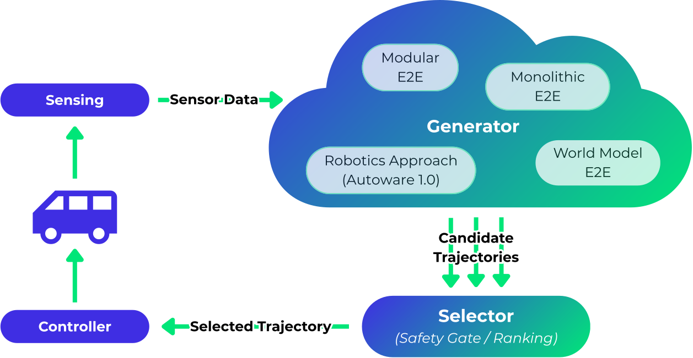

<em>그림 3. Architecture 2.0의 Generator-Selector 개념도. 출처: autoware-documentation `design/autoware-architecture-v2/images/generator-selector-simple.svg` (💻 D1)</em>

1.0은 "Sensing→Map/Localization→Perception→Planning→Control→Vehicle Interface"의 7개 스택을 고정 파이프라인으로 잇는 계층 구조였다(그림 2). 2.0은 파이프라인의 앞부분을 추상화해 **"궤적을 내는 무엇이든 Generator, 그것을 검사·선택하는 것이 Selector"** 로 바꿨다(그림 3). 공식 문서의 표현은 "우리는 파이프라인의 앞 절반을 추상화했다(abstracted away the front half of the pipeline)"이다. Generator는 규칙 기반·최적화 플래너, 원시 센서를 쓰는 E2E 모델, 학습·샘플링 플래너 어느 것이든 될 수 있고, 여러 개가 병렬로 돌 수 있다. Selector는 안전 검사(규칙 준수·주행가능영역)와 랭킹·선택을 맡는다. (💻 D1·D4)

---

## 3. "두 트랙" 가설 검증 — 공식 자료가 말하는 구조

### 3.1 다년 로드맵: E2E 3년 계단과 ODD별 TRL 계단

AWF 공식 문서의 "Multi-Year Roadmap"은 8개 목표를 3년(Y1~Y3)으로 나눈다. 기술 목표 두 개가 이 보고서의 축이다. (💻 D10. 문서에 기준 연도는 적혀 있지 않다 ⚠️)

| 목표 | Y1 | Y2 | Y3 |
|---|---|---|---|
| **Objective 1: AI-first 기술 도입** | LiDAR·비전·레이더 **컴포넌트형 AI 인식** 스택 도입. **AI 기반 플래너 초판**으로 "완전한 E2E 컴포넌트 기반 스택" 달성(자체 개발 + 회원사 기술 통합) | **단일 신경망 E2E 스택 초판**(센서→궤적 직접 계산) | **완전한 하이브리드 AI 스택**: E2E가 주 모드, 컴포넌트형 AI 스택이 병렬 안전층·기반 기술층 |
| **Objective 2: 양산 가능(Production-Capable) Autoware** | Open AD Kit와 결합한 **저속 자율주행(LSA)·개인차량(POV, 고속도로 파일럿)** 초판, **TRL-6** | LSA·POV TRL-7. **Robobus·오프로드** 초판 TRL-6 | LSA·POV TRL-8, Robobus·오프로드 TRL-7, **Robotaxi 초판 TRL-6** |
| Objective 3: 실차 배치 | LSA·POV 앵커 기업 1곳(후보: Eve Autonomy·Whale Dynamic·Robeff / AMD·DeepenAI·AutoCore.ai) 단일 차량 | 소규모 다차량 + Robobus(ADASTEC)·오프로드(DriveBlocks) 단일 차량 | 플릿 + **Robotaxi 단일 차량(후보: TIER IV)** |

Objective 4(커뮤니티)의 Y2 항목 "ROS Index 스타일의 Autoware 패키지 목록"과 "GUI 설정 대시보드"는 각각 **Autoware Index**와 **System Designer/launch GUI**로 실체화됐다. (💻 D10·R15·R17)

**분석.** 이 표가 "두 트랙" 가설의 공식 근거다. 기술 축(Objective 1)은 하나의 E2E 계단이고, 제품 축(Objective 2·3)은 **ODD별로 계단이 다르다.** POV(개인차량)가 LSA와 함께 가장 먼저 TRL-6을 노리고, Robotaxi는 가장 늦다. 즉 "E2E 로드맵이 두 트랙으로 갈린다"기보다 **"하나의 E2E 기술 계단을 ODD별 제품 트랙이 각자의 속도로 오른다"** 가 정확한 표현이다.

### 3.2 Architecture 2.0 로드맵의 E2E 4단계

Architecture 2.0 문서의 로드맵 절(`roadmap/autonomous-driving-stack-architecture.md`)은 Autoware 1.0(전통 로보틱스 스택)에서 Autoware 2.0(데이터 중심 AI 스택)으로의 진화를 4단계로 정의한다. 목표는 "SAE Level 4+"다. (💻 D2·D3)

<em>그림 4. 단계적 기술 진화(Stepwise technology evolution). 출처: autoware-documentation `design/autoware-architecture-v2/roadmap/media/detailed_architecture_figure1.png` (💻 D4)</em>

| 단계 | 정의(공식 문서) | 맵 옵션 | 2026-10 현재 대응 스택(자체 해석) |
|---|---|---|---|
| Step 1 **Learned Planner** | HD맵 기준 자차 위치 + 3D 박스·신호등 등 "로컬 월드 표현"을 받아 궤적을 내는 학습 플래너. 병합·끼어들기·양보를 데이터로 배움 | HD맵 | **Diffusion Planner**(2.0.0에서 `planning_setting:=diffusion_planner`), OnePlanner(LiDAR BEV + 벡터맵) |
| Step 2 **Component-based E2E** | 학습 인식 + 학습 플래너. 둘 사이 인터페이스가 남아 "내성 가능한(introspectable)" E2E | A: HD맵 / B: 2D맵 | AutoE2E Reactive 모델(카메라→BEV→GRU 플래너, 맵 래스터 옵션), Vision Pilot의 인식축(AutoSeg→AutoSteer) |
| Step 3 **Learned Driving** | 명시적 인식·계획 모듈 없는 단일 모놀리식 신경망. CNN형(엣지 배포 가능) 또는 VLA형(ViT+LLM+디퓨전 디코더) | A/B | LatentDrive(V-JEPA 잠재 공간에서 계획), AutoDrive(프레임 2장→거리·곡률), Alpamayo(외부, VLA) |
| Step 4 **Learned Hybrid** | E2E 주행 모델 + 별도 **Safety Perception**(LiDAR·레이더·규칙 기반 가능) + **Safety Guardian**(교차 검증, V2X 활용 가능). "업계가 개발 중" | A/B | Vision Pilot 1.x의 "하이브리드 E2E"(인식 모델 ∥ E2E 모델 → Safety Guardian), Safety Island |

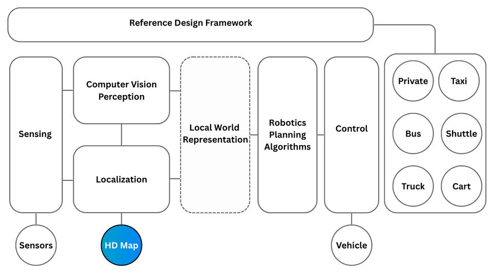

<em>그림 5. 전통 로보틱스 스택(Figure 1). 출처: autoware-documentation roadmap media `architecture_figure01.png` (💻 D3)</em>

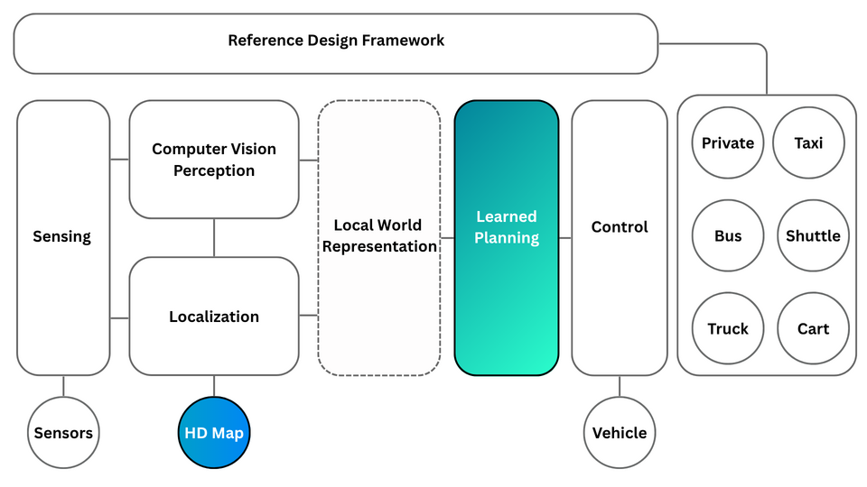

<em>그림 6. Step 1 학습 플래너(Figure 3). 출처: 상동 `architecture_figure03.png` (💻 D3)</em>

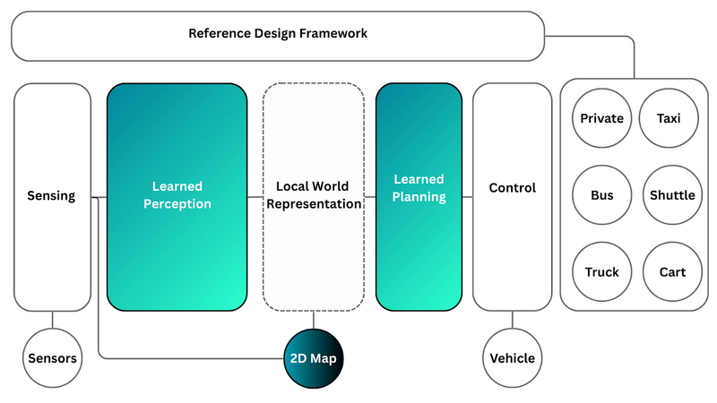

<em>그림 7. Step 2 컴포넌트형 E2E, 2D맵 옵션(Figure 5). 출처: 상동 `architecture_figure05.png` (💻 D3)</em>

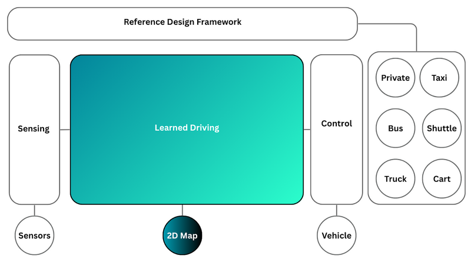

<em>그림 8. Step 3 단일 신경망 학습 주행, 2D맵 옵션(Figure 7). 출처: 상동 `architecture_figure07.png` (💻 D3)</em>

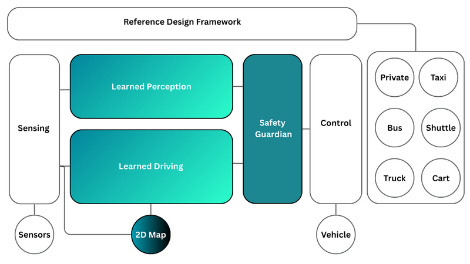

<em>그림 9. Step 4 학습 하이브리드, 2D맵 옵션(Figure 9). 출처: 상동 `architecture_figure09.png` (💻 D3)</em>

문서가 각 단계마다 "옵션 A(HD맵)"와 "옵션 B(2D 내비 맵)"를 두는 점이 중요하다. 옵션 B의 장점은 "HD맵 구축·유지 없이 2D맵이 있는 곳 어디서나 동작"이고, 옵션 A의 장점은 "HD맵이 비가시선 센서처럼 정적 환경을 알려주는 강건성"이다. (💻 D3) **분석**: 옵션 B가 사실상 ADAS·POV 트랙의 전제이고(Vision Pilot은 mapless), 옵션 A가 로보택시 트랙의 전제다. 같은 4단계 그림을 두 트랙이 다른 옵션으로 오르고 있다.

로드맵 폴더의 `development-roadmap.md`는 본문이 "TBD"뿐이다. 2.0 문서 PR은 "TBD인 로드맵 페이지 4개를 숨긴다"고 적었다. 즉 **날짜 박힌 공식 개발 일정표는 아직 없다.** (💻 D5·D17)

### 3.3 트랙을 가르는 것은 "E2E 로드맵"이 아니라 "워킹그룹과 ODD"다

| 근거 | 내용 | 출처 |
|---|---|---|
| `auto_e2e` README·온보딩 | "AutoE2E is developed in the **Autoware Robotaxi working group**". Discord의 'robotaxi' 채널에서 매주 수요일 2슬롯 회의 | 💻 R10 |
| `auto_e2e` README | 출력은 "LiDAR·레이더 안전층과 융합해 **무인 로보택시**로, 또는 카메라만으로 **L2++ 핸즈프리 ADAS**로" 쓸 수 있다고 명시 | 💻 R10 |
| GitHub 토론 제목 | 2026-09-28부터 "**ADAS Work Group Meeting** - Slot 1&2"(라벨 `meeting:adas-wg`, 푸터 라벨은 아직 "Privately Owned Vehicle Working Group"). 2026-06까지는 "Privately Owned Vehicle Work Group Meeting" | 🔍 G8·G10·G13 |
| POV WG 위키 | 범위: "개인 소유 차량의 자율주행, 핸즈오프·아이즈오프(L3+), 주로 고속도로. 비전 우선 + 4D 레이더, **LiDAR·HD맵 의존 없음**". 리더 Muhammad Zain Khawaja(AWF Senior Tech Lead) | 💻 R31 |
| POV WG 2026-06-08 회의록 | "VisionPilot의 빠른 개발과 Safety Assurance 준수의 간극", "**로보택시의 E2E 연구 성과를 VisionPilot에 재사용하고 그 역도**" 논의. 두 WG 사이 주간 릴레이 담당자 지정 | 🔍 G8 |
| Open AD Kit 로드맵 | Autoware·Vision Pilot·Safety Island를 **각각 digest 고정된 별개 워크로드**로 취급. Autoware 증거는 v2.0.x, Vision Pilot은 v2.1 | 🔍 G4 |
| Vision Pilot README | "OEM·Tier-1의 양산 승용차에 통합되도록 설계", "미들웨어 없는 배포 지원 + ROS 2 통합 인터페이스 제공" — Autoware 본체와 **코드·런타임을 공유하지 않음** | 💻 R6 · 🔍 G20 |
| 문서 홈 "Validated use cases" | Robo-taxi · Cargo delivery · Robo-bus · **Privately-owned vehicles(POV)** 네 가지를 나란히 열거 | 💻 D13 |

### 3.4 가설 채점

| 질문자의 가설 | 판정 | 근거 요약 |
|---|---|---|
| "E2E로 전환하는 로드맵이 있다" | **맞음** | Architecture 2.0 로드맵 4단계 + 다년 로드맵 Objective 1의 3년 계단 (💻 D3·D10) |
| "자율주행 트랙과 ADAS 트랙으로 나뉜다" | **대체로 맞음, 표현 수정 필요** | 갈라지는 기준은 E2E 로드맵이 아니라 ODD·WG(Robotaxi/Software WG vs ADAS WG). E2E 4단계는 두 트랙이 공유하고, 맵 옵션(A/B)과 센서가 다르다 (💻 D3·R10 · 🔍 G13) |
| "ADAS 트랙 안에 vision_pilot이 들어간다" | **맞음** | Vision Pilot = 옛 POV WG(현 ADAS WG)의 산출물. Reference Design의 POV 가이드가 Vision Pilot→Plus→Pro→Vision Drive 4단계를 정의 (💻 R6·P1·R31) |
| (보완) "두 트랙은 완전히 분리돼 있다" | **아님** | `auto_e2e`는 두 용도를 모두 표방, 6/8 회의록의 상호 재사용 논의, Open AD Kit·Safety Island·Hugging Face·Index가 공통 기반 (💻 R10 · 🔍 G8·G4) |
| (보완) "autoware 본체도 ADAS를 한다" | **부분적** | Autoware 2.0 문서는 L4+ 로보택시·버스가 주 대상이지만, 다년 로드맵의 "Production-Capable Autoware for POV"는 Open AD Kit와 결합한 Vision Pilot 패키징을 뜻하는 것으로 읽힌다 ⚠️ (💻 D10 · 🔍 G4) |

---

## 4. 저장소 157개 분류 지도

조직 페이지가 표기하는 저장소 수는 157개다(2026-10-30, 아카이브 27·포크 24 포함). (🔍 G1) 아래는 이 보고서의 자체 분류 A~J다. 전체 열(언어·별·포크·상태)은 [전수 목록](reference/repo-inventory.md)에 있다. "활성"은 2026년에 갱신된 저장소, "휴면"은 2025년 이전이 마지막 갱신이다.

| 분류 | 개수 | 한 줄 |
|---|---|---|
| A. 메타·핵심 | 17 | Autoware 2.0.0 워크스페이스를 이루는 저장소(`autoware.repos`에 고정된 AWF 소유 저장소 + 문서) |
| B. 로보택시·L4 트랙 E2E | 6 | AWF가 직접 만드는 E2E 모델·런타임과 외부 VLA 포크 |
| C. ADAS·POV 트랙 | 13 | Vision Pilot과 부품 모델, POV 레퍼런스 디자인 문서 |
| D. 미들웨어·실행 기반·GPU | 14 | 제로카피 IPC, Executor, GPU 공유, 센서 전송층, TensorRT 벤더 |
| E. 배포·안전 | 6 | Open AD Kit, Safety Island |
| F. 레지스트리·개발 인프라·도구 | 19 | Autoware Index, CI, 에이전트 하네스, 시각화, GUI |
| G. 시뮬레이션·평가·데이터 | 19 | AWSIM, CARLA 계열, Isaac Sim 오프로드, 시나리오, 맵 변환, rosbag 도구 |
| H. ODD 프로젝트·레퍼런스 디자인·WG 운영 | 22 | 트럭·오프로드·LSA·버스, 레퍼런스 차량·센서킷(대부분 아카이브), 챌린지 |
| I. 드라이버·Index 이동 패키지 | 10 | 센서·DBW 드라이버, Universe에서 Index로 옮겨간 소형 패키지 5개 |
| J. 레거시·아카이브·포크·벤더 | 31 | Autoware.AI 9개, Core/Universe 프로토타입, 벤더 패키지, 무관 포크 |

#### A. 메타·핵심 — Autoware 2.0.0 워크스페이스를 이루는 저장소 (17개)

| 저장소 | 무엇인가 | 최근 갱신 | 상태 | 비고 |
|---|---|---|---|---|
| [`autoware`](https://github.com/autowarefoundation/autoware) | 메타 저장소. 소스 코드는 없고 repositories/*.repos 로 하위 저장소 버전을 고정, Docker·Ansible 설치 스크립트 보유 | 2026-10-29 | 활성 | 2.0.0 (2026-10-29 공개) |
| [`autoware_core`](https://github.com/autowarefoundation/autoware_core) | AWF가 직접 유지하는 고품질·안정 패키지(sensing·perception·localization·planning·control·map·API) | 2026-10-29 | 활성 | 1.10.0이 Autoware 2.0.0에 고정 |
| [`autoware_universe`](https://github.com/autowarefoundation/autoware_universe) | 커뮤니티 확장 패키지 모음(241개 패키지). Diffusion Planner·trajectory selector·VAD 등 E2E 부품도 여기 | 2026-10-29 | 활성 | 0.53.1이 2.0.0에 고정. Index로 분산 중 |
| [`autoware_lanelet2_extension`](https://github.com/autowarefoundation/autoware_lanelet2_extension) | Lanelet2 HD맵 확장 라이브러리 | 2026-10-29 | 활성 | 1.3.0 |
| [`autoware_rviz_plugins`](https://github.com/autowarefoundation/autoware_rviz_plugins) | RViz 플러그인 | 2026-10-29 | 활성 | 0.6.0. 추가 플러그인은 Index의 autoware_extra_rviz_plugins로 분리 제안 중 |
| [`autoware_tools`](https://github.com/autowarefoundation/autoware_tools) | 개발·평가 도구(주행 중 실행하지 않는 것들). tools.repos로 별도 체크아웃 | 2026-10-29 | 활성 | 0.8.0 |
| [`autoware_system_designer`](https://github.com/autowarefoundation/autoware_system_designer) | YAML로 노드·모듈·시스템을 기술하면 ROS 2 런치·다이어그램·파라미터 템플릿을 생성하는 툴체인 | 2026-10-29 | 활성 | v0.4.2, core 그룹에 포함 |
| [`autoware-documentation`](https://github.com/autowarefoundation/autoware-documentation) | 공식 문서 원본(MkDocs). Architecture 2.0·Index·Reference Design 문서가 여기 | 2026-10-29 | 활성 | 2.0 반영 PR #839 2026-10-29 머지 |
| [`autoware_simple_planning_simulator`](https://github.com/autowarefoundation/autoware_simple_planning_simulator) | Universe에서 떼어낸 단독 planning simulator(+dummy perception, learning-based vehicle model) | 2026-10-27 | 활성 | 1.1.0, core 그룹으로 빌드 |
| [`autoware_launch`](https://github.com/autowarefoundation/autoware_launch) | 런치 파일·파라미터. planning_setting 인자(rule_based/diffusion_planner)가 여기 정의 | 2026-10-26 | 활성 | 0.53.0 |
| [`autoware_cmake`](https://github.com/autowarefoundation/autoware_cmake) | 공통 CMake 매크로 | 2026-10-21 | 활성 | 1.4.0 |
| [`autoware_utils`](https://github.com/autowarefoundation/autoware_utils) | C++ 공통 유틸(math·geometry·system 등 서브패키지) | 2026-10-21 | 활성 | 1.11.0 |
| [`autoware_msgs`](https://github.com/autowarefoundation/autoware_msgs) | 컴포넌트 간(inter-component) 메시지 정의(perception→planning 등). 시뮬레이터 연동에도 사용 | 2026-10-12 | 활성 | 1.13.0 |
| [`autoware_internal_msgs`](https://github.com/autowarefoundation/autoware_internal_msgs) | 컴포넌트 내부(intra-component) 메시지. CandidateTrajectories 등 Generator-Selector 메시지 포함 | 2026-10-12 | 활성 | 1.16.0 |
| [`autoware_adapi_msgs`](https://github.com/autowarefoundation/autoware_adapi_msgs) | 외부 시스템(HMI·원격·플릿) 용 AD API 메시지 | 2026-10-12 | 활성 | 1.9.2 |
| [`autoware_cuda`](https://github.com/autowarefoundation/autoware_cuda) | Universe의 CUDA/TensorRT 공통 패키지(cuda_utils·tensorrt_common·cuda_dependency_meta)를 모을 신설 저장소 | 2026-10-05 | 활성 | 2026-10 이전 작업 중, 아직 비어 있음 |
| [`autoware_launch_v2`](https://github.com/autowarefoundation/autoware_launch_v2) | README 제목만 있는 빈 저장소. 차세대 런치(System Designer 기반 추정) 자리로 보임 | 2026-03-31 | 활성 | ⚠️ 내용 없음, 용도 미확인 |

#### B. 로보택시·L4 트랙 — E2E 모델과 런타임 (6개)

| 저장소 | 무엇인가 | 최근 갱신 | 상태 | 비고 |
|---|---|---|---|---|
| [`auto_e2e`](https://github.com/autowarefoundation/auto_e2e) | AWF 자체 E2E 주행 모델(AutoE2E). 서라운드 6카메라→BEV→GRU 플래너, 79.9M 파라미터, 10 Hz, 6.4 s 궤적. 로보택시 WG 개발 | 2026-10-30 | 활성 | HF에 v1.0 체크포인트. 2026 최신 활동 |
| [`autoware_latent_drive`](https://github.com/autowarefoundation/autoware_latent_drive) | LatentDrive: V-JEPA 잠재 월드모델 위의 카메라 전용 E2E 플래너 TensorRT C++ 런타임 + ROS 2 재생 노드 | 2026-10-30 | 활성 | 연구용, 공도 제어 금지 명시 |
| [`autoware_oneplanner`](https://github.com/autowarefoundation/autoware_oneplanner) | OnePlanner: LiDAR BEV(BEVFusion-L 백본)+벡터맵+신호등 → 궤적. Autoware Core 위에서 TensorRT로 LiDAR 주기 실행 | 2026-10-28 | 활성 | RTX PRO 6000에서 p50 12.7 ms |
| [`3dgs_io`](https://github.com/autowarefoundation/3dgs_io) | 3D Gaussian Splatting 장면(glTF·3D Tiles·SPZ)+Autoware 맵 번들 I/O 라이브러리. 신경 재구성 시뮬(alpasim ENU 프레임) 연동 | 2026-10-27 | 활성 | Architecture 2.0 로드맵의 'Neural World Simulation' 축 |
| [`alpamayo-autoware`](https://github.com/autowarefoundation/alpamayo-autoware) | NVIDIA Alpamayo 1.5·2 Super VLA를 Autoware ROS 2 노드로 돌리는 포크(TIER IV 기원) | 2026-08-06 | 포크 | 본 저장소 07·09·14번 보고서 참조 |
| [`modelzoo`](https://github.com/autowarefoundation/modelzoo) | 과거 ML 모델 모음(TVM 시절). 현재는 Hugging Face AutowareFoundation 조직으로 대체 | 2023-02-06 | 휴면 | 비활성 |

#### C. ADAS·POV 트랙 — Vision Pilot 계열 (13개)

| 저장소 | 무엇인가 | 최근 갱신 | 상태 | 비고 |
|---|---|---|---|---|
| [`auto_steer`](https://github.com/autowarefoundation/auto_steer) | AutoSteer 2.0: 카메라 프레임→자차 미래 경로 웨이포인트(차선 검출 없이 E2E). Vision Pilot 횡방향 모델 | 2026-10-30 | 활성 | mAP@50 0.969, INT8 ONNX 제공 |
| [`vision_pilot`](https://github.com/autowarefoundation/vision_pilot) | 오픈소스 L2 ADAS 스택(ACC·FCW·AEB·LKAS·LDW·ISA·단일차로 오토파일럿). 단안 카메라 1대, 맵 불필요, 하이브리드 E2E | 2026-10-19 | 활성 | v1.2(2026-08-10). 옛 이름 autoware.privately-owned-vehicles → autoware_vision_pilot |
| [`auto_speed_limit`](https://github.com/autowarefoundation/auto_speed_limit) | 속도제한 표지 검출·인식 모델(ISA용) | 2026-10-08 | 활성 | README 한 줄 |
| [`blindspot_detector`](https://github.com/autowarefoundation/blindspot_detector) | 측면 어안 카메라 사각지대 점유 검출 모델 | 2026-10-06 | 활성 | Vision Pilot Plus 단계용으로 추정 |
| [`ego_lanes`](https://github.com/autowarefoundation/ego_lanes) | EgoLanes: 차선·도로 경계 분할·분류(AutoSeg 계열). Vision Pilot 0.5의 조향 입력 | 2026-09-10 | 활성 | 설명 잘림 |
| [`domain_seg`](https://github.com/autowarefoundation/domain_seg) | DomainSeg: 공사구간·로드워크 객체 분할(AutoSeg 계열). ROADWork 데이터셋 mIoU 46.6 | 2026-09-09 | 활성 | RTX3060 FP16 23.9 FPS |
| [`auto_drive`](https://github.com/autowarefoundation/auto_drive) | AutoDrive: 연속 2프레임→CIPO 거리·도로 곡률·CIPO 존재 확률을 내는 소형 E2E 모델 | 2026-07-28 | 활성 | Vision Pilot 1.0의 'E2E' 축 |
| [`auto_speed`](https://github.com/autowarefoundation/auto_speed) | AutoSpeed: YOLOv11 변형의 경로 내 객체(CIPO) 검출기. ACC·FCW·AEB용 종방향 모델 | 2026-07-08 | 활성 | AutoSpeed 2.0 권장 |
| [`vision_pilot_model_recipes`](https://github.com/autowarefoundation/vision_pilot_model_recipes) | Vision Pilot 모델의 추론·컨테이너·미들웨어 레시피 | 2026-06-15 | 활성 | README 한 줄 |
| [`scene_seg`](https://github.com/autowarefoundation/scene_seg) | SceneSeg: 전경 객체 시맨틱 분할(AutoSeg 계열) | 2026-06-09 | 활성 | vision_pilot 모노레포에서 분리된 빈 껍데기 README |
| [`scene_3d`](https://github.com/autowarefoundation/scene_3d) | Scene3D: 단안 깊이 추정(AutoSeg 계열) | 2026-06-09 | 활성 | 상동 |
| [`lite_models`](https://github.com/autowarefoundation/lite_models) | 제약 장치용 경량 모델 패밀리(SceneSeg·Scene3D·EgoLanes Lite) | 2026-06-09 | 활성 | README 한 줄. 12번 보고서의 20–28× 가속 모델 |
| [`autoware.pov-reference-design-docs`](https://github.com/autowarefoundation/autoware.pov-reference-design-docs) | 개인차량(PoV) 레퍼런스 디자인 가이드(MkDocs): Vision Pilot→Plus→Pro→Vision Drive 4단계, ODD·센서·ECU·벤치마크 | 2025-12-23 | 휴면 | 2025-09 기준 작성 |

#### D. 미들웨어·실행 기반·GPU 가속 (14개)

| 저장소 | 무엇인가 | 최근 갱신 | 상태 | 비고 |
|---|---|---|---|---|
| [`agnocast`](https://github.com/autowarefoundation/agnocast) | rclcpp 호환 진정한 제로카피 IPC(모든 ROS 메시지 타입). Autoware 2.0.0에 소스 빌드로 포함 | 2026-10-27 | 활성 | 2.4.1 고정. TIER IV→AWF 이관 |
| [`callback_isolated_executor`](https://github.com/autowarefoundation/callback_isolated_executor) | 콜백 그룹마다 전용 스레드를 주는 컴포넌트 컨테이너·Executor. Agnocast에 통합 | 2026-10-27 | 활성 | RTAS 2025 논문 |
| [`cuda_blackboard`](https://github.com/autowarefoundation/cuda_blackboard) | REP-2007/2009 타입 적응·협상으로 GPU 메모리를 노드 간 복사 없이 공유 | 2026-10-27 | 활성 | 0.4.0. universe/external→core/cuda로 이동 예정 |
| [`negotiated`](https://github.com/autowarefoundation/negotiated) | ROS 2 타입 협상(REP-2009) 포크(osrf) | 2026-10-21 | 포크 | autoware.repos는 osrf 원본 커밋을 고정 |
| [`agnocast_doc`](https://github.com/autowarefoundation/agnocast_doc) | Agnocast 문서 사이트 | 2026-10-20 | 활성 |  |
| [`callback_isolated_executor_doc`](https://github.com/autowarefoundation/callback_isolated_executor_doc) | 위 문서 사이트 | 2026-10-20 | 활성 |  |
| [`managed_transform_buffer`](https://github.com/autowarefoundation/managed_transform_buffer) | TF 버퍼 관리 라이브러리 | 2026-09-22 | 활성 | 0.3.0 |
| [`ros2_socketcan`](https://github.com/autowarefoundation/ros2_socketcan) | Linux SocketCAN ROS 2 래퍼(Continental 호환 버전) | 2026-09-07 | 활성 |  |
| [`bevdet_vendor`](https://github.com/autowarefoundation/bevdet_vendor) | BEVDet TensorRT C++ 구현 벤더 패키지(Orin 실시간) | 2026-09-01 | 포크 | 0.2.1 |
| [`transport_drivers`](https://github.com/autowarefoundation/transport_drivers) | 전송 계층 드라이버 포크(복사 감소 버전) | 2026-06-10 | 포크 |  |
| [`cyclonedds`](https://github.com/autowarefoundation/cyclonedds) | Eclipse Cyclone DDS 포크. Safety Island용 0.11.0 AWF 포크 | 2026-06-01 | 포크 |  |
| [`spconv_cpp`](https://github.com/autowarefoundation/spconv_cpp) | 희소 컨볼루션(spconv/cumm) C++ 라이브러리. OnePlanner·BEVFusion 의존 | 2026-05-26 | 활성 |  |
| [`trt_batched_nms`](https://github.com/autowarefoundation/trt_batched_nms) | TensorRT batched NMS 플러그인 ROS 2 패키지 | 2026-01-22 | 활성 | CUDA 재구조화에서 제외 |
| [`agnocast_ci_test`](https://github.com/autowarefoundation/agnocast_ci_test) | 이관 전 CI 테스트용 복사본 | 2026-02-18 | 아카이브 | 아카이브 |

#### E. 배포·안전 — Open AD Kit·Safety Island (6개)

| 저장소 | 무엇인가 | 최근 갱신 | 상태 | 비고 |
|---|---|---|---|---|
| [`open-ad-kit-docs`](https://github.com/autowarefoundation/open-ad-kit-docs) | Open AD Kit 문서(MkDocs) | 2026-10-26 | 활성 |  |
| [`RFC_L4_SafetyIslandDesign`](https://github.com/autowarefoundation/RFC_L4_SafetyIslandDesign) | L4 Safety Island 설계 RFC·설계 문서·슬라이드(NTU Reference Design WG) | 2026-10-24 | 활성 | HPC/안전섬 노드 분할 논의 중 |
| [`autoware-safety-island`](https://github.com/autowarefoundation/autoware-safety-island) | Arm 안전 코어(Cortex-R52 등)에서 Autoware 궤적 추종기(MPC+PID)를 Zephyr/FreeRTOS로 돌리고 DDS로 교환. S32Z·R-Car X5H 타깃 | 2026-10-20 | 활성 | Arm 주도. L2 Safety Island(Vision Pilot 감독) 실험 중 |
| [`openadkit`](https://github.com/autowarefoundation/openadkit) | Open AD Kit: Autoware·Vision Pilot·Safety Island를 컨테이너·증거(evidence) 기반으로 배포하는 SOAFEE 블루프린트 CLI·이미지·번들 | 2026-10-19 | 활성 | v2.0.0 2026-10 말 목표(리스크), v2.1에 Vision Pilot |
| [`open_ad_kit`](https://github.com/autowarefoundation/open_ad_kit) | 초기 Open AD Kit 포크 | 2023-12-21 | 포크 | 비활성 |
| [`openadkit_demo`](https://github.com/autowarefoundation/openadkit_demo) | 옛 Open AD Kit 데모 아카이브 | 2025-11-14 | 아카이브·포크 | 아카이브 |

#### F. 패키지 레지스트리·개발 인프라·도구 (19개)

| 저장소 | 무엇인가 | 최근 갱신 | 상태 | 비고 |
|---|---|---|---|---|
| [`autoware-index`](https://github.com/autowarefoundation/autoware-index) | Autoware Index: 커뮤니티 패키지 레지스트리(distribution.yaml)+최신 릴리스 대상 빌드·테스트 이력. index.autoware.org | 2026-10-29 | 활성 | 2.0.0 공개 항목. Universe 슬림화 수단 |
| [`autoware-repos-visualizer`](https://github.com/autowarefoundation/autoware-repos-visualizer) | 릴리스별 autoware.repos 핀 이력을 스윔레인으로 보여주는 웹 시각화 | 2026-10-29 | 활성 |  |
| [`autoware-ci-metrics`](https://github.com/autowarefoundation/autoware-ci-metrics) | CI 빌드 시간·이미지 크기 대시보드 | 2026-10-29 | 활성 |  |
| [`autoware-spell-check-dict`](https://github.com/autowarefoundation/autoware-spell-check-dict) | 스펠체크 사전 | 2026-10-29 | 활성 |  |
| [`autoware-harness`](https://github.com/autowarefoundation/autoware-harness) | 코딩 에이전트용 Autoware 스킬·에이전트·MCP 묶음(Claude Code·Codex·Cursor 플러그인) | 2026-10-27 | 활성 | 2026 신규 |
| [`autoware-github-actions`](https://github.com/autowarefoundation/autoware-github-actions) | 공용 GitHub Actions | 2026-10-26 | 활성 |  |
| [`.github`](https://github.com/autowarefoundation/.github) | 조직 프로필·공용 템플릿 | 2026-10-26 | 활성 |  |
| [`aw-index-cli`](https://github.com/autowarefoundation/aw-index-cli) | Index 소비 CLI: compose(.repos 생성)·check·list. --reference-design 옵션 | 2026-10-20 | 활성 | pipx 배포 |
| [`autoware-contributor-metrics`](https://github.com/autowarefoundation/autoware-contributor-metrics) | 기여자 통계 | 2026-10-20 | 활성 |  |
| [`colcon-dashboard`](https://github.com/autowarefoundation/colcon-dashboard) | colcon 빌드 실시간 웹 대시보드 | 2026-10-20 | 활성 | 2026 신규 |
| [`sync-file-templates`](https://github.com/autowarefoundation/sync-file-templates) | 저장소 공통 파일 템플릿 동기화 | 2026-10-20 | 활성 |  |
| [`autoware-github-runner-ansible`](https://github.com/autowarefoundation/autoware-github-runner-ansible) | 셀프호스트 러너 Ansible | 2026-10-05 | 활성 |  |
| [`autoware-index-github-actions`](https://github.com/autowarefoundation/autoware-index-github-actions) | Index 등록 패키지가 호출하는 재사용 워크플로(validate-package 등) | 2026-09-30 | 활성 |  |
| [`autowarefoundation.github.io`](https://github.com/autowarefoundation/autowarefoundation.github.io) | autoware.universe→autoware_universe 문서 리다이렉트 | 2026-07-08 | 활성 |  |
| [`autoware-guideline-check`](https://github.com/autowarefoundation/autoware-guideline-check) | 가이드라인 검사기 | 2026-03-27 | 활성 |  |
| [`autoware_dummy_repository`](https://github.com/autowarefoundation/autoware_dummy_repository) | 릴리스 프로세스 테스트용 더미 | 2025-06-18 | 휴면 |  |
| [`autoware-launch-gui`](https://github.com/autowarefoundation/autoware-launch-gui) | Tauri/Next.js 런치 GUI | 2024-08-12 | 휴면 | 비활성 |
| [`autoware-build-gui`](https://github.com/autowarefoundation/autoware-build-gui) | 빌드 GUI | 2024-06-11 | 휴면 | 비활성 |
| [`autoware-deb-packages`](https://github.com/autowarefoundation/autoware-deb-packages) | Debian 패키징(아카이브). Core는 ROS 빌드팜 배포로 전환 | 2026-08-06 | 아카이브 | 아카이브 |

#### G. 시뮬레이션·평가·데이터 (19개)

| 저장소 | 무엇인가 | 최근 갱신 | 상태 | 비고 |
|---|---|---|---|---|
| [`autoware_carla_scenario`](https://github.com/autowarefoundation/autoware_carla_scenario) | CARLA 시나리오(신설, 설명 없음) | 2026-10-30 | 활성 | 2026-10 활동 |
| [`odd-usecase-scenario`](https://github.com/autowarefoundation/odd-usecase-scenario) | ODD 유스케이스·시나리오 자연어 기술(ODD WG) | 2026-10-27 | 활성 | Open AD Kit 증거 시나리오 출처 |
| [`AWSIM`](https://github.com/autowarefoundation/AWSIM) | Unity 기반 디지털 트윈 시뮬레이터(공식) | 2026-10-20 | 활성 |  |
| [`autoware_lanelet2_to_opendrive`](https://github.com/autowarefoundation/autoware_lanelet2_to_opendrive) | Lanelet2 맵→OpenDRIVE 변환(CARLA 등 시뮬 연동용) | 2026-10-20 | 활성 |  |
| [`lanelet2_to_sumo`](https://github.com/autowarefoundation/lanelet2_to_sumo) | Lanelet2 맵→SUMO 변환 | 2026-09-17 | 활성 |  |
| [`TeraSim`](https://github.com/autowarefoundation/TeraSim) | 생성형 시뮬로 미지의 위험 이벤트 탐색(포크) | 2026-09-16 | 포크 |  |
| [`autoware_msg_bag_converter`](https://github.com/autowarefoundation/autoware_msg_bag_converter) | rosbag 메시지 변환기 | 2026-07-10 | 포크 |  |
| [`autoware_off-road_sim`](https://github.com/autowarefoundation/autoware_off-road_sim) | NVIDIA Isaac Sim 기반 오프로드·RoboRacer 다차량 시뮬레이터(UPenn CoE) | 2026-06-25 | 활성 |  |
| [`autoware_sample_scenarios`](https://github.com/autowarefoundation/autoware_sample_scenarios) | 샘플 시나리오 | 2026-05-03 | 활성 |  |
| [`carla-agent-controller`](https://github.com/autowarefoundation/carla-agent-controller) | Autoware planning simulator의 더미 객체·신호등을 CARLA 에이전트와 동기화하는 ROS 2 브리지(TIER IV 기원) | 2026-04-03 | 활성 |  |
| [`carla-scenario-database`](https://github.com/autowarefoundation/carla-scenario-database) | CARLA 시나리오 DB(설명 없음) | 2026-03-18 | 활성 |  |
| [`carla`](https://github.com/autowarefoundation/carla) | CARLA 시뮬레이터 포크 | 2026-03-10 | 포크 |  |
| [`2025-Autoware-scenario-running-on-CARLA`](https://github.com/autowarefoundation/2025-Autoware-scenario-running-on-CARLA) | scenario_simulator_v2 시나리오를 CARLA에서 돌리는 TIER IV 프로젝트 | 2025-08-04 | 포크 |  |
| [`autoware_rosbag2_anonymizer`](https://github.com/autowarefoundation/autoware_rosbag2_anonymizer) | rosbag 익명화 도구 | 2025-01-09 | 포크 |  |
| [`scenario-simulator-failure-evaluation-tool`](https://github.com/autowarefoundation/scenario-simulator-failure-evaluation-tool) | 시나리오 실패를 일으킨 커밋 탐색 도구 | 2023-11-30 | 휴면 | 비활성 |
| [`perception_benchmark_tool`](https://github.com/autowarefoundation/perception_benchmark_tool) | 인식 벤치마크 도구 | 2023-03-21 | 휴면 | 비활성 |
| [`carla-autoware-extension`](https://github.com/autowarefoundation/carla-autoware-extension) | CARLA 확장(아카이브) | 2026-09-05 | 아카이브 | 아카이브 |
| [`custom_dataset_composer`](https://github.com/autowarefoundation/custom_dataset_composer) | 데이터셋 구성 도구(아카이브) | 2026-04-06 | 아카이브 | 아카이브 |
| [`AWSIM-Labs`](https://github.com/autowarefoundation/AWSIM-Labs) | AWSIM 커뮤니티 포크(아카이브) | 2026-01-11 | 아카이브·포크 | 아카이브 |

#### H. ODD별 프로젝트·레퍼런스 디자인·WG 운영 (22개)

| 저장소 | 무엇인가 | 최근 갱신 | 상태 | 비고 |
|---|---|---|---|---|
| [`autoware.off-road`](https://github.com/autowarefoundation/autoware.off-road) | 오프로드 자율주행 파일럿(광산 트럭·RoboRacer·행성 로버). EfficientNet-B0 기반 주행가능영역·고도 네트워크, CARLA 광산 데모 | 2026-04-15 | 활성 | Off-road/Racing WG(2026-05 일시 중단) |
| [`autoware.orv-reference-design-docs`](https://github.com/autowarefoundation/autoware.orv-reference-design-docs) | 오프로드 차량(OrV) 레퍼런스 디자인 가이드 | 2026-03-20 | 활성 | 2026 Q1/Q2 예정 |
| [`LSA-reference-design-docs`](https://github.com/autowarefoundation/LSA-reference-design-docs) | 저속 자율주행(LSA) 레퍼런스 디자인 가이드(RoboRacer·GoKart 포함) | 2026-02-27 | 활성 |  |
| [`autoware.trucks`](https://github.com/autowarefoundation/autoware.trucks) | 고속도로 자율 트럭(L4) 프로젝트. 현재 Vision Pilot 트럭 모델·J1939 인터페이스 작업 | 2025-12-07 | 휴면 | Trucks WG |
| [`autoware.low-speed-autonomy-vehicles`](https://github.com/autowarefoundation/autoware.low-speed-autonomy-vehicles) | LSA 차량 목표·유스케이스·설계 | 2025-08-14 | 휴면 |  |
| [`autoware_launch.gdwbus`](https://github.com/autowarefoundation/autoware_launch.gdwbus) | 특정 버스용 launch 포크 | 2025-01-18 | 포크 |  |
| [`RefDesignWG`](https://github.com/autowarefoundation/RefDesignWG) | Reference Design WG 문서 저장소 | 2025-01-03 | 휴면 |  |
| [`autoware_tier4_robot`](https://github.com/autowarefoundation/autoware_tier4_robot) | TIER IV 로봇용 autoware 포크 | 2024-09-10 | 포크 |  |
| [`autoware_challenge_2024`](https://github.com/autowarefoundation/autoware_challenge_2024) | Autoware Challenge 2024 | 2024-08-02 | 휴면 |  |
| [`autoware-coe`](https://github.com/autowarefoundation/autoware-coe) | Autoware Center of Excellence 웹사이트 | 2024-05-28 | 휴면 |  |
| [`awf_reference_sensor_kit_launch`](https://github.com/autowarefoundation/awf_reference_sensor_kit_launch) | AWF 레퍼런스 센서킷 launch | 2024-01-24 | 휴면 |  |
| [`autoware-projects`](https://github.com/autowarefoundation/autoware-projects) | 비코드 과제·WG 위키(워킹그룹 목록·거버넌스) | 2023-09-11 | 휴면 | 위키가 WG 목록의 공식 출처 |
| [`awf_reference_vehicle_launch`](https://github.com/autowarefoundation/awf_reference_vehicle_launch) | AWF 레퍼런스 차량 description·launch | 2023-09-04 | 휴면 |  |
| [`itri_bus_sensor_kit`](https://github.com/autowarefoundation/itri_bus_sensor_kit) | ITRI 버스 센서킷 | 2023-09-04 | 휴면 |  |
| [`autoware_challenge_2023`](https://github.com/autowarefoundation/autoware_challenge_2023) | Autoware Challenge 2023 | 2023-04-10 | 휴면 |  |
| [`cbus_vehicle_launch`](https://github.com/autowarefoundation/cbus_vehicle_launch) | ITRI 프로젝트 차량 launch | 2023-02-01 | 휴면 |  |
| [`autoware_individual_params`](https://github.com/autowarefoundation/autoware_individual_params) | 개별 차량 파라미터(아카이브) | 2025-04-14 | 아카이브 | 아카이브 |
| [`sample_vehicle_launch`](https://github.com/autowarefoundation/sample_vehicle_launch) | 샘플 차량 launch(아카이브, Universe/Launch로 흡수) | 2025-04-01 | 아카이브 | 아카이브 |
| [`single_lidar_sensor_kit_launch`](https://github.com/autowarefoundation/single_lidar_sensor_kit_launch) | 단일 LiDAR 센서킷(아카이브) | 2025-04-01 | 아카이브 | 아카이브 |
| [`awsim_labs_vehicle_launch`](https://github.com/autowarefoundation/awsim_labs_vehicle_launch) | AWSIM Labs 차량 launch(아카이브) | 2025-04-01 | 아카이브·포크 | 아카이브 |
| [`awsim_labs_sensor_kit_launch`](https://github.com/autowarefoundation/awsim_labs_sensor_kit_launch) | AWSIM Labs 센서킷(아카이브) | 2025-04-01 | 아카이브·포크 | 아카이브 |
| [`sample_sensor_kit_launch`](https://github.com/autowarefoundation/sample_sensor_kit_launch) | 샘플 센서킷 launch(아카이브) | 2025-03-28 | 아카이브 | 아카이브 |

#### I. 센서·차량 드라이버와 Index로 옮겨간 소형 패키지 (10개)

| 저장소 | 무엇인가 | 최근 갱신 | 상태 | 비고 |
|---|---|---|---|---|
| [`autoware_component_monitor`](https://github.com/autowarefoundation/autoware_component_monitor) | 컴포넌트 컨테이너 CPU·메모리 모니터. Index 등록 | 2026-10-28 | 활성 |  |
| [`autoware_image_diagnostics`](https://github.com/autowarefoundation/autoware_image_diagnostics) | 카메라 이미지 진단. Index로 이동 | 2026-10-19 | 활성 | 2026-10 |
| [`autoware_pose2twist`](https://github.com/autowarefoundation/autoware_pose2twist) | pose→twist 계산. Index 등록 | 2026-10-13 | 활성 |  |
| [`autoware_livox_tag_filter`](https://github.com/autowarefoundation/autoware_livox_tag_filter) | Livox 포인트 필터. Universe에서 빠져 Autoware Index로 이동한 첫 패키지 | 2026-10-12 | 활성 | 2.0.0 업그레이드 노트 |
| [`autoware_bluetooth_monitor`](https://github.com/autowarefoundation/autoware_bluetooth_monitor) | 블루투스 연결 모니터. Index 등록 | 2026-10-12 | 활성 |  |
| [`applanix`](https://github.com/autowarefoundation/applanix) | Applanix POS-LVX GNSS/INS 드라이버 | 2024-09-18 | 휴면 |  |
| [`lucid_vision_driver`](https://github.com/autowarefoundation/lucid_vision_driver) | Lucid Vision 카메라 ROS 2 드라이버 | 2024-02-14 | 휴면 |  |
| [`awf_velodyne`](https://github.com/autowarefoundation/awf_velodyne) | Velodyne VLS 드라이버 포크 | 2023-06-06 | 포크 |  |
| [`autoware-mih-dbw-interface`](https://github.com/autowarefoundation/autoware-mih-dbw-interface) | MIH DBW 인터페이스 | 2022-11-03 | 휴면 |  |
| [`ros2_socketcan-release`](https://github.com/autowarefoundation/ros2_socketcan-release) | 릴리스 저장소(아카이브) | 2024-07-16 | 아카이브 | 아카이브 |

#### J. 레거시·아카이브·포크·벤더 패키지 (31개)

| 저장소 | 무엇인가 | 상태 |
|---|---|---|
| `zmqpp_vendor` | zmqpp 벤더(scenario simulator 의존) | 휴면 |
| `ament_cmake` | ament_cmake 포크 | 포크 |
| `mmdetection3d` | OpenMMLab mmdetection3d 포크 | 포크 |
| `autoware_auto_msgs_adapter` | Autoware.Auto 메시지 어댑터 | 휴면 |
| `aw-universe` | Universe 포크 | 포크 |
| `autodistill` | autodistill 포크(파운데이션 모델로 라벨링) | 포크 |
| `autoware.universe_planning` | Universe planning 포크 | 포크 |
| `tvm_vendor` | Apache TVM 벤더 패키지(Autoware.Auto 시절) | 휴면 |
| `qpoases_vendor` | qpOASES 벤더 | 휴면 |
| `rancher-cows-demo` | Rancher 데모 포크(무관) | 포크 |
| `qpoases_vendor-release` | 릴리스 저장소 | 휴면 |
| `tvm_vendor-release` | 릴리스 저장소 | 휴면 |
| `acado_vendor` | ACADO 벤더 | 휴면 |
| `ansys-vrxperience-ros2` | ANSYS VRXPERIENCE 인터페이스 | 휴면 |
| `ansys-vrxperience-ros2-release` | 위 릴리스 저장소 | 휴면 |
| `autocore_sim` | ROS1/ROS2 다중 로봇 시뮬레이터(AutoCore) | 휴면 |
| `autoware_ai_messages-release` | 릴리스 저장소 | 휴면 |
| `autoware-backup` | 수명 종료 태그 보관(아카이브) | 아카이브 |
| `autoware_common` | 옛 공통 패키지(아카이브, autoware_utils 등으로 분리) | 아카이브 |
| `autoware_ai` | Autoware.AI(ROS 1, 1세대) 메타(아카이브) | 아카이브 |
| `autoware_ai_perception` | Autoware.AI 인식(아카이브) | 아카이브 |
| `autoware_ai_planning` | Autoware.AI 계획(아카이브) | 아카이브 |
| `autoware_ai_messages` | Autoware.AI 메시지(아카이브) | 아카이브 |
| `autoware_ai_simulation` | Autoware.AI 시뮬(아카이브) | 아카이브 |
| `autoware_ai_visualization` | Autoware.AI 시각화(아카이브) | 아카이브 |
| `autoware_ai_drivers` | Autoware.AI 드라이버(아카이브) | 아카이브 |
| `autoware_ai_utilities` | Autoware.AI 유틸(아카이브) | 아카이브 |
| `autoware_ai_common` | Autoware.AI 공통(아카이브) | 아카이브 |
| `autoware_ai_documentation` | Autoware.AI 문서(아카이브) | 아카이브 |
| `autoware_core_universe_prototype` | Core/Universe 초기 프로토타입(아카이브) | 아카이브 |
| `autoware_ai_docker` | Autoware.AI Docker(아카이브) | 아카이브 |

**분석 — 숫자가 말하는 것.** 157개 중 2026년에 갱신된 저장소는 약 90개이고, 그중 2026년에 **새로 생긴** 것으로 보이는 저장소(갱신일과 README 내용으로 판단 ⚠️)는 B·C·E·F 묶음에 집중된다: `auto_e2e`, `autoware_latent_drive`, `autoware_oneplanner`, `autoware_cuda`, `autoware-index`·`aw-index-cli`·`autoware-index-github-actions`, `autoware-harness`, `colcon-dashboard`, `autoware-repos-visualizer`, `autoware_carla_scenario`, `blindspot_detector`, `auto_speed_limit`, `vision_pilot_model_recipes`, 그리고 `scene_seg`·`scene_3d`·`lite_models` 같은 "모노레포에서 떼어낸 빈 껍데기" 저장소들이다. 즉 2026년의 증가분은 **(1) AWF 자체 AI 모델, (2) Universe를 쪼개는 레지스트리 인프라, (3) Vision Pilot 모노레포의 분해** 세 흐름으로 설명된다. (🔍 G1 · 💻 R30)

---

## 5. 핵심 스택 상세

### 5.1 Autoware 2.0 본체 — Core · Universe · Launch

<em>그림 10. Autoware Core/Universe 생태계. 출처: autoware-documentation `design/autoware-concepts/images/autoware_ecosystem.png` (💻 D6)</em>

**무엇인가.** `autoware`는 소스가 없는 메타 저장소이고, `repositories/autoware.repos`가 하위 저장소의 태그를 고정한다. 2.0.0의 고정판은 core 그룹 11개(agnocast 2.4.1, autoware_msgs 1.13.0, adapi_msgs 1.9.2, internal_msgs 1.16.0, cmake 1.4.0, utils 1.11.0, lanelet2_extension 1.3.0, **autoware_core 1.10.0**, rviz_plugins 0.6.0, simple_planning_simulator 1.1.0, system_designer v0.4.2), universe 그룹(**autoware_universe 0.53.1** + tier4_autoware_msgs 1.0.0-alpha, bevdet_vendor 0.2.1, cuda_blackboard 0.4.0, managed_transform_buffer 0.3.0, MapIV eagleye 등 외부 커밋), launcher(**autoware_launch 0.53.0**), sensor_component(tier4 nebula v1.2.0, transport_drivers, ros2_socketcan)다. 도구는 `tools.repos`(autoware_tools 0.8.0), 시뮬레이터는 `simulator.repos`(tier4 scenario_simulator_v2 22.0.0)로 따로 받는다. (💻 R1·D8)

**Core와 Universe의 역할 분담**은 변하지 않았다. Core는 "AWF가 유지하는 엄격한 기준(단위·통합·성능·실차 테스트)의 안정 기반", Universe는 "원저자가 품질 기준을 정하는 커뮤니티 샌드박스"이고, 성숙한 Universe 패키지가 Core로 승격된다. (💻 D6) 다만 2026년에는 **Universe를 줄이는 방향**이 명시됐다: 2026-05 제안은 "autoware_universe = 레거시, 축소 중"이라 적었고(🔍 G19), 2026-06 재구조화 안내는 Universe 241개 패키지 중 CUDA/TensorRT 관련 약 27개를 `autoware_cuda`로 모으고 나머지 CUDA 패키지는 Index의 개별 패키지로 보내는 "Universe 슬림화의 기초"라고 설명한다(🔍 G14). 이 재구조화는 TIER IV 측 반대("강한 이유를 모르겠다")와 포크 동기화 사정으로 2026-09 말까지 연기됐다가 10-05 재개됐고, 10-15 전환 목표의 완료 여부는 확인하지 못했다. (🔍 G14 ⚠️)

**2.0.0에서 실제로 도는 것**은 다음 표가 정확하다. (💻 D1)

| 역할 | 패키지(모두 `autoware_universe` 0.53.1) | 2.0.0 상태 |
|---|---|---|
| Generator | `autoware_diffusion_planner` | `planning_setting:=diffusion_planner`일 때 실행. TensorRT, NVIDIA GPU 필요, 첫 기동 시 엔진 빌드 |
| 후처리 | `autoware_trajectory_modifier` | 상동. 후보 중 **첫 번째**를 `/planning/trajectory_generator/trajectory`로 내보냄 |
| Selector 노드 | `autoware_trajectory_selector` | **미기동**(런치 파일에 자리만 있음) |
| Safety gate | `autoware_trajectory_validator` | 미기동, selector 내부 라이브러리 |
| Ranking | `autoware_trajectory_ranker` | 미기동, selector가 쓸 수 있는 라이브러리 |
| 메시지 | `autoware_internal_planning_msgs` 1.16.0 | `CandidateTrajectories`·`CandidateTrajectory`·`GeneratorInfo` |

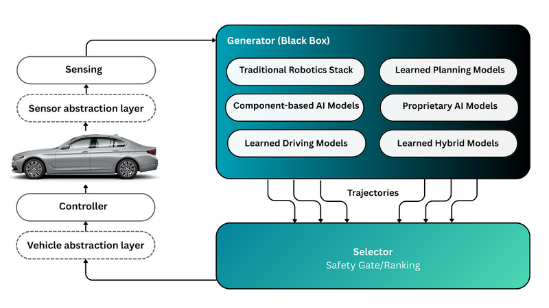

<em>그림 11. Generator-Selector 프레임워크(Figure 2). 출처: autoware-documentation roadmap media `detailed_architecture_figure2.png` (💻 D4)</em>

**분석.** 12번 보고서(2026-06, Autoware 1.8.0 기준)가 "구조는 정해졌고 부품은 머지됐으나 기본 경로로 배선·검증되지 않은 실험 단계"라고 적었던 상태에서, 2.0.0은 **"런치 인자 하나로 생성기를 바꿀 수 있다"** 까지 전진했고 **Selector 기동은 아직**이다. (📚 12번 · 💻 D1) Generator-Selector 문서가 Generator의 예로 "전통 로보틱스 스택(기존 Autoware 그대로)", "**회원사의 사내 독점 AI 모델**", "오픈소스 Autoware E2E 모델"을 나란히 적은 점(💻 D4)은 이 구조의 사업적 의도를 보여준다. 즉 회원사가 자기 모델을 Generator로 꽂고, AWF의 Selector로 안전 게이트를 거치는 그림이다.

**문서 체계.** `design/` 네비게이션은 Concepts → System capabilities → Architecture 1.0 → Architecture 2.0 → Repository structure → Repos files → Versioning 순이고, Architecture 2.0 아래에 roadmap(개요·스택 아키텍처·상세 인터페이스)이 있다. 숨겨진 TBD 페이지는 `assessment-safety-and-benchmarks`, `data-mlops-and-training`, `neural-world-simulation`, `development-roadmap`이다. (💻 D-nav·D17)

### 5.2 Autoware Index와 Reference Design — Universe를 쪼개는 새 유통 구조

<em>그림 12. Autoware Index 브라우즈 사이트(index.autoware.org). 출처: autoware-documentation `installation/autoware/images/autoware-index/browse-site.png` (💻 D12)</em>

**Autoware Index**는 "Autoware를 확장하는 커뮤니티 ROS 2 패키지의 레지스트리"다. 어떤 패키지가 있고, 소스가 어디 있고, **최신 Autoware 릴리스에 대해 빌드·테스트를 통과하는지**를 기록한다. 등록은 `distributions/<distro>.yaml`에 저장소 하나·ref 하나·패키지 목록을 적는 PR로 하고, 머지되면 CI가 최신 릴리스에 대해 빌드·테스트해 결과를 `data` 브랜치에 append-only로 쌓는다. `branch` ref는 매일 재검증, `tag`/`sha`는 고정이다. 소비자는 브라우즈 사이트의 Repos builder나 `aw-index-cli compose --rosdistro jazzy --packages …`로 `repositories/autoware-index.repos`를 생성해 `vcs import`한다. (💻 R15·R16·D12)

3층 구조 제안(2026-05, 열린 상태)은 Core(AWF 큐레이션·하드 핀) / Universe(연합 커뮤니티 패키지, "레거시·축소") / Index(레지스트리·CI·사이트·CLI)다. 2.0.0 시점에 Index로 간 패키지는 `autoware_livox_tag_filter`(Universe에서 제거), `autoware_image_diagnostics`(2026-10 이동), `autoware_pose2twist`·`autoware_bluetooth_monitor`·`autoware_component_monitor`(등록됐으나 0.53.1에는 아직 포함; 2.0.0 워크스페이스에 중복 추가 금지)이고, RViz 플러그인을 `autoware_extra_rviz_plugins`로 떼는 제안이 열려 있다. (🔍 G2·G15·G19)

**Reference Design**은 "배포 프로파일(차량·운행 조건·용도) + 레퍼런스 SW 스택(모듈·모델 버전·파라미터)"의 조합으로, Index 항목에 `reference_design: true` 마커(리뷰어 승인)를 달아 표시한다. 첫 사례가 **Vision Pilot**이고, `aw-index-cli compose --reference-design`이 `vision_pilot`을 돌려준다. 문서는 POV·LSA(RoboRacer·GoKart 포함)·오프로드(예정)·ITRI 버스 가이드를 나열한다. (💻 D11·R15·D17)

**분석.** Index는 다년 로드맵 Objective 4-Y2의 "ROS Index 스타일 패키지 목록"의 구현이자, Universe 모노리스를 "한 리뷰 큐에 묶이지 않는" 연합 구조로 바꾸는 장치다. Vision Pilot이 Reference Design의 첫 사례로 등록된 것은 **ADAS 트랙이 Autoware 본체와 코드를 공유하지 않으면서도 Autoware 유통 체계 안에 들어오는 접점**이다.

### 5.3 AutoE2E (`auto_e2e`) — AWF 자체 E2E 주행 모델

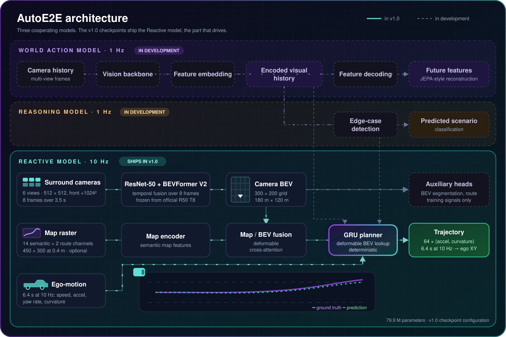

<em>그림 13. AutoE2E 아키텍처(World Action · Reasoning · Reactive 세 모델). 출처: auto_e2e `Media/readme/architecture.svg` (💻 R10)</em>

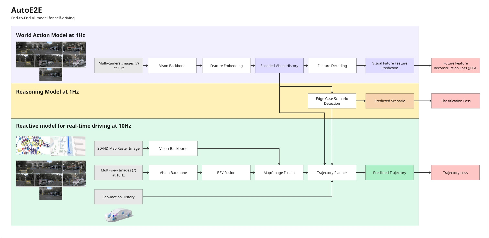

<em>그림 14. AutoE2E 원 설계도. 출처: auto_e2e `Media/auto_e2e_architecture.jpg` (💻 R10)</em>

**무엇인가.** "고속도로·간선·도심을 위한 오픈소스 카메라 우선 E2E 주행 모델". 서라운드 6카메라를 BEV 격자로 올리고(맵 래스터 융합 옵션), GRU 플래너가 장면+자차 운동 이력으로 **다음 6.4 s의 가속도·곡률**을 낸다. 79.9M 파라미터, 10 Hz. 세 모델 중 **Reactive**만 완성이고 1 Hz의 World Action·Reasoning 모델은 개발 중이다. 체크포인트는 Hugging Face `AutowareFoundation/auto_e2e`(nuPlan v1.1 학습 `nuplan-epoch-5`, KITScenes 파인튜닝 `kitscenes-epoch-5`). 추론은 RTX 5080에서 최대 약 76 FPS(SwinV2-Tiny). 학습 플랫폼은 Flyte·MLflow·k8s(AWS)이고 읽기 전용 대시보드를 공개한다. (💻 R10)


<em>그림 15. KITScenes-Multimodal 검증 3 s ADE/FDE, 오픈 가중치 8종 비교. 출처: auto_e2e `Media/readme/benchmark-kitscenes-3s.svg` (💻 R10)</em>

| 모델 | 설정 | ADE@3s (m) | FDE@3s (m) |
|---|---|---|---|
| Qwen Drive 1.0 | 6궤적 중 첫 번째 | 0.565 | 1.397 |
| **AutoE2E fine-tuned** | kitscenes-epoch-5 | **0.744** | **1.980** |
| SimForge D1.5 | 7카메라 슬롯 | 0.831 | 2.209 |
| **AutoE2E** zero-shot | nuplan-epoch-5 | 0.915 | 2.423 |
| Alpamayo 1.5 | 6궤적 중 첫 번째 | 1.020 | 2.820 |
| VAD | Base stage-2 | 1.242 | 2.821 |
| METEOR | top-1/3 | 1.240 | 3.282 |
| Drive-JEPA | perception v2 | 2.266 | 4.774 |

(README 표 전재. 입력 조건이 모델마다 다르다는 단서가 붙어 있다: AutoE2E는 HD맵·경로를 추가로 받고 VAD·Drive-JEPA는 주행 명령을 받는다. 💻 R10)

**로드맵 위치.** README는 "LiDAR·레이더 안전층과 융합해 **무인 로보택시**로, 또는 카메라만으로 **L2++ 핸즈프리 ADAS**로"라고 두 용도를 모두 적는다. Reactive 모델(학습 인식 BEV + 학습 플래너)은 Architecture 2.0의 **Step 2(컴포넌트형 E2E, 옵션 B 2D맵/맵 없음)** 에, 안전층 융합 구상은 **Step 4**에 해당한다(자체 해석). Autoware 본체 런치에 통합된 흔적은 2.0.0 문서에 없다. ⚠️ (💻 R10·D1)

### 5.4 LatentDrive · OnePlanner · Alpamayo 노드 — 로보택시 트랙의 다른 생성기 후보

<em>그림 16. LatentDrive 개루프 재생 6장면(리본이 계획, 녹색→적색 = 지금→+4 s). 출처: autoware_latent_drive `docs/latent_drive_scenes.png` (💻 R11)</em>

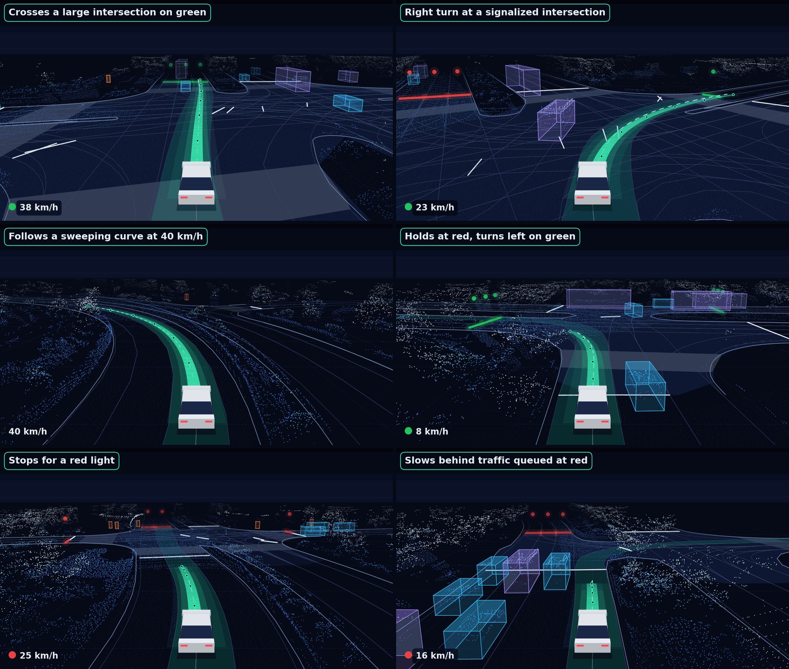

<em>그림 17. OnePlanner 개루프 재생 6장면. 출처: autoware_oneplanner `media/oneplanner_scenes.png` (💻 R12)</em>

| | **LatentDrive** (`autoware_latent_drive`) | **OnePlanner** (`autoware_oneplanner`) | **Alpamayo 노드** (`alpamayo-autoware`, 포크) |
|---|---|---|---|
| 입력 | 전방(또는 전방 3개) 카메라 최근 2 s 영상(0.5 s 간격 4프레임, 256×512), 경로점 6개, 자차 속도·가속도 | LiDAR 포인트클라우드 → BEVFusion-L 고정 백본의 BEV 특징 시계열(SE(2) 워프), 벡터맵·경로·신호등, 자차 상태 | 카메라 4대(압축 이미지) + 자차 오도메트리 |
| 모델 | **V-JEPA ViT-L** 잠재 월드모델 + 소형 계획 헤드(객체 검출·추적 없음) | 학습 플래너(BEV 특징 + 맵 컨텍스트) | NVIDIA Alpamayo 1.5(10B)·2 Super VLA |
| 출력 | 4 s 자차 궤적 40점(0.1 s), 10 Hz | 6 s 궤적, LiDAR 주기 | 예측 궤적 + 추론 텍스트(CoT) |
| 런타임 | ROS 의존 없는 C++ 라이브러리 + TensorRT + rosbag 재생 ROS 2 노드. Autoware universe-devel-cuda 컨테이너 | Autoware **Core 1.x** 위 ROS 2 노드(Jazzy/Humble), TensorRT 10, spconv_cpp, universe의 tensorrt_plugins 필요 | Python ROS 2 노드, 24 GB+ VRAM |
| 성능 | 미기재 | RTX PRO 6000 Blackwell에서 전체 패스 p50 12.7 ms / p99 26.1 ms | 📚 07·14번 보고서 참조 |
| 모델 배포 | HF `AutowareFoundation/latent_drive` v1.0 (1·3카메라 ONNX) | HF `AutowareFoundation/oneplanner` v1.0 | HF nvidia(접근 승인 필요) |
| 상태 | "연구 모델, 인증된 주행 시스템 아님, 공도 제어 금지" | "차에 쓰려면 Autoware 궤적 검증 뒤에 배선" | 데모 |
| Arch 2.0 단계(자체 해석) | Step 3(단일 신경망, 카메라 전용) | Step 1(학습 플래너, LiDAR 입력) | Step 3(VLA) |

(💻 R11·R12·R26)

**분석.** 세 저장소는 모두 **"Generator 후보"** 다. OnePlanner README가 "드라이브하려면 Autoware의 궤적 검증(trajectory validation) 뒤에 꽂아라"라고 쓴 것, LatentDrive가 "ROS 의존 없는 라이브러리 + 재생 노드"로만 제공되는 것은, 2.0.0의 Selector가 아직 기동하지 않는 상태에서 각 모델이 **독립 런타임 + 기존 planning validator** 경로로 실험되고 있음을 보여준다. Diffusion Planner만이 공식 런치 인자에 들어갔다.

### 5.5 Vision Pilot — 오픈소스 L2 ADAS 스택

<em>그림 18. Vision Pilot 1.0 개요. 출처: vision_pilot `Media/VisionPilot_1.0.png` (💻 R6)</em>

**무엇인가.** README의 자기 정의는 "**양산 가능하고(productionizable) 안전 인증 가능한(safety certifiable)** 오픈소스 L2 ADAS 시스템". OEM·Tier-1의 양산 승용차 통합을 겨냥하며 버스·트럭에도 쓸 수 있고, 모델 가중치까지 Apache 2.0으로 공개한다. 기능은 ACC·FCW·AEB·LKAS·LDW·ISA·단일차로 핸즈프리 오토파일럿이고, 센서는 **단안 전방 카메라 1대(52–55° HFOV, 1–2MP)**, **HD맵 불필요(mapless)** 다. 1.0 릴리스 노트는 "3–5 INT8 TOPS급 저가 양산 칩에서 전체 파이프라인 10 FPS 이상", "미들웨어 없는 배포 + ROS 2 통합 인터페이스"를 적었다. (💻 R6 · 🔍 G20)

<em>그림 19. Vision Pilot의 "Hybrid End-to-End AI Architecture". 출처: vision_pilot `Media/VisionPilot_architecture.png` (💻 R6)</em>

**구조.** "인식 AI 모델(안전)과 E2E AI 모델(성능)이 **병렬로** 데이터를 처리하는 하이브리드 E2E"다. 세 모델이 축이다. (💻 R6~R9)

| 모델 | 저장소 | 역할 | 구조·성능 |
|---|---|---|---|
| **AutoSteer 2.0** | `auto_steer` | 자차 미래 경로 웨이포인트(횡방향). 차선 검출 없이 전체 프레임을 E2E로 처리해 차선이 지워진 도로에서도 동작 | 1024×512(2:1) 입력, TUSimple+OpenLane+CurveLanes 학습, 검증 mAP@50 0.969(INT8 0.966). 구판은 EgoLanes 마스크 2장→조향각 확률 벡터 |
| **AutoSpeed 2.0** | `auto_speed` | 경로 내 객체(CIPO) 검출(종방향: ACC·FCW·AEB) | YOLOv11 백본의 c3k2를 자체 "context" 블록으로 치환. 클래스는 "경로 안/끼어듦·이탈/경로 밖". OpenLane CIPO 학습, mAP@50 0.74(INT8 0.73) |
| **AutoDrive** | `auto_drive` | 연속 2프레임(t-1, t)→CIPO 거리·도로 곡률·CIPO 존재 확률 | 곡률 평균 오차 핸들각 4°, 존재 정확도 88%, 거리 5–40 m 90%·100–150 m 72%. AutoSpeed 백본 워밍업 지원 |

런타임 모듈은 `VisionPilot/modules/` 아래 `engine`(ONNX Runtime GPU/CPU), `models`, `sensing`(camera_interface·image_preprocessing·vehicle_interface), **`safety_guardian`(fusion·planning)**, `middleware_interfaces/ros2_interface`, `visualization`, `logging`, `config`로 나뉜다. 0.9 노트 기준으로 호모그래피로 픽셀→도로 좌표 변환, 칼만 필터로 CIPO 추적, **RSS(Responsibility-Sensitive Safety) 영감의 속도 계획**, PID 종방향·MPC 횡방향(1.1부터 공간 영역 MPC) 제어를 쓴다. (💻 R6 · 🔍 G20)

**릴리스 이력.** (🔍 G20 · 🔍 G5·G7·G8·G18)

| 버전 | 날짜 | 내용 |
|---|---|---|
| 0.5 | 2026-01-22 | EgoLanes+AutoSteer 조향만. OEM 사설 트랙에서 정속 실차 테스트, 고곡률(20°+)·뱅크에서 인간 조향 대비 90%+ 일치 |
| 0.9 | 2026-03-02 | AutoSpeed+ObjectFinder 종방향 인식·추적, CIPO 선택, RSS 영감 속도 계획, PID, 횡·종 병렬 파이프라인, POSIX 공유메모리 IPC |
| 1.0 | 2026-07-06 | AutoSpeed·AutoSteer·AutoDrive 3모델, 교차 모달 융합 + 궤적 계획, "production-ready" 기능 7종. 당초 6월 말 목표(5월 중순 앞당기기 시도) |
| 1.1 | 2026-07-27 | 공간 영역 MPC, 융합·추적 개선, Docker, CARLA 0.9.16 |
| 1.2 | 2026-08-10 | CARLA 통합·횡방향 추적 개선, 3D 점유 시각화, Rerun 로깅. Ubuntu 22.04/ROS 2 Humble 테스트 |
| 1.3 (예정) | — | CARLA Ackermann·1V1R 브리지, 점유 BEV 창, 융합·추적 개선, "Code Compliance". 카메라+레이더 융합은 "(현재 중단)", 8MP·120° 카메라는 다음 릴리스 |

**안전 문서.** 저장소 `Functional_Safety/`에 SAFETY_PLAN·SAFETY_ELEMENT_OUT_OF_CONTEXT·SAFETY_METRICS·SOFTWARE_REQUIREMENTS가 있다. SEooC 문서(초안)는 "선택된 Autoware Vision Pilot 컴포넌트로 **ISO 26262 Part 6(+Part 8 지원 프로세스) 준수 소프트웨어 SEooC**를 제공하고, 차량 수준 안전 활동은 OEM·Tier-1에 남긴다"고 범위를 정한다. README 로드맵은 "ISO 26262, ISO 8800 안전 검증·표준 준수"를 적고, 2026-10 ADAS WG 회의록은 "**안전 인증 마무리에 집중**"이라고 적었다. (💻 R6 · 🔍 G13)

**POV 레퍼런스 디자인의 4단계.** Reference Design WG의 POV 가이드(2025-09 기준 작성)는 Vision Pilot을 Phase 1로 두고 4단계를 정의한다. (💻 P1~P4)

<em>그림 20. POV 레퍼런스 디자인 로드맵 4단계와 센서 배치. 출처: autoware.pov-reference-design-docs `docs/system-configuration/images/Roadmap.jpg` (💻 P2)</em>

| Phase | 이름 | 목표 레벨·ODD | 센서(가이드) | 요구 연산(가이드) |
|---|---|---|---|---|
| 1 | **Vision Pilot** | L2+/2++, 단일차로 고속도로(0–70 mph, 맑은 날, 공사구간 없음), 운전자 상시 감독 | 전방 카메라(가이드: 8MP 120° + 8MP 30° 장거리) + 전방 4D 레이더 1 | 50–80 TOPS |
| 2 | Vision Pilot **Plus** | L3, 다차로 고속도로, 자율 차선 변경, 감독 불필요(조건 내), 합류·출구 미지원 | + 전·후 4D 레이더 2, 사각 레이더 4 | 150 TOPS |
| 3 | Vision Pilot **Pro** | L3, 상동 | + 측면 카메라 4(8MP 100°), 2D 내비 맵 | 500 TOPS |
| 4 | **Vision Drive** | L4, 상동 | + LWIR·SWIR 카메라 | 1000 TOPS |

가이드는 "NVIDIA GPU는 잘 지원되며 AMD·Qualcomm·Hailo-8 NPU는 로드맵"이라 적고, 미들웨어로 ROS 2(기존 Autoware와 브리지)와 Zenoh(고성능) 두 파이프라인을 둔다. (💻 P2) **주의**: 가이드의 센서 사양(8MP 120°+30°, 4D 레이더)과 현재 코드의 사양(1–2MP 52–55° 단안)이 다르다. 가이드가 목표 사양, 코드가 현재 구현이라고 읽힌다 ⚠️. 12번 보고서가 기록한 옛 모노레포의 4단계 명칭("Vision Pilot/Plus/PRO/Drive", L2→L4)과도 레벨 표기가 조금 다르다. (📚 12번 · 💻 P3)

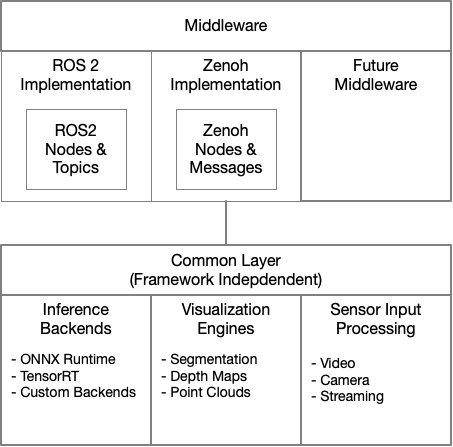

<em>그림 21. VisionPilot 프레임워크(공통 층 + ROS 2/Zenoh 미들웨어 층). 출처: autoware.pov-reference-design-docs `docs/system-configuration/images/VisionPilotFramework.png` (💻 P2)</em>

**벤치마크(POV 가이드).** ADLINK ADM-AL30(RTX 4000 SFF Ada)에서 SceneSeg·DomainSeg·Scene3D가 Zenoh 50–56 FPS, ROS 2 47–54 FPS. Jetson AGX Orin 64GB에서 TensorRT FP16 약 29–30 FPS, FP32 약 17 FPS(ONNX Runtime은 8 FPS). (💻 P6)

**업계 접점.** TIER IV는 Automotive World 2026에서 **Renesas R-Car X5H**와 짝지은 Vision Pilot(L2)을 전시했고, 레퍼런스 모델은 Jetson Orin에서 카메라 전용 BEV 인식·궤적 생성을 수행했다(📰 W1). Open AD Kit 로드맵은 v2.1을 "X5H, Vision Pilot"의 릴리스로 정의하고, Reference Design WG는 2026-10 "최대 안전" 분기를 "카메라+레이더 4+초음파+IMU/GNSS를 R-Car X5H에"로 적었다. (🔍 G4·G16)

### 5.6 AutoSeg 계열·Lite 모델·보조 모델 — ADAS 트랙의 부품 창고

<em>그림 22. AutoSeg 파운데이션 모델(Depth·Scene·Path 3분기, 6개 전문가 모델). 출처: autoware.pov-reference-design-docs `docs/software-configuration/images/AutoSeg.jpg` (💻 P5)</em>

AutoSeg는 "단일 백본 + 컨텍스트 블록 + 특징 넥 + 다중 분할·검출 헤드"의 실시간 시각 인식 파운데이션 모델이고, Depth 분기(Scene3D), Scene 분기(SceneSeg·DomainSeg·EgoSpace), Path 분기(EgoPath·EgoLanes)로 나뉜다. (💻 P5) 2026-06에 각 모델이 별도 저장소로 떼어졌지만, `scene_seg`·`scene_3d`·`lite_models`·`ego_lanes`는 README 한 줄뿐인 빈 저장소이고 코드는 아직 `vision_pilot`(옛 모노레포 경로 `autoseg`가 같은 페이지로 연결)에 있다. `domain_seg`만 실체가 있다(ROADWork 데이터셋 mIoU 46.6, RTX 3060 Mobile FP16 23.9 FPS). (💻 R27·R30 · 🔍 G1) Lite 모델은 12번 보고서가 기록한 "SceneSeg/Scene3D/EgoLanes 20–28× 가속(10→87–104 FPS)" 계열이고, 2026-02 회의록은 AEI(Alternative Embedded Innovation)가 "정확도 유지하며 3× 속도"의 경량판을 만들었다고 적었다. (📚 12번 · 🔍 G6) `blindspot_detector`(측면 어안 사각지대)와 `auto_speed_limit`(속도제한 표지)은 Phase 2 기능 후보다. (💻 R30 ⚠️ 용도는 추정)

### 5.7 Open AD Kit와 Safety Island — 배포·안전 층

**Open AD Kit(`openadkit`)** 는 "Autoware를 컨테이너화된 클라우드/엣지 SDV 컴포넌트로 배포하는 **첫 SOAFEE 블루프린트**"다. 컴포넌트 이미지(GHCR), 배포 구성(planning/logging/scenario/carla-simulation, zenoh-bridge), 버전 고정 런타임 번들, CI 메타데이터를 제공하고 `openadkit setup --verify && openadkit run planning-simulation` 한 줄로 기동한다. (💻 R5)

2026–2027 로드맵(이슈 #91, 2026-10 갱신)은 자기 역할을 "AWF의 오픈 자율주행 SW(Autoware·Vision Pilot·Safety Island)를 **고정되고(pinned) 증거가 붙은(evidenced) 배포 가능한 릴리스**로 내보내는 것"으로 정의한다. (🔍 G4)

| 릴리스 | 주 소비자 | 테마 |
|---|---|---|
| v2.0 (2026-10 목표, "CES 2027(1/6–9) 전까지는 반드시") | AWF 유지자 | 첫 증거 기반·계층화 릴리스: 증거 게이트, 통합자 층, `nodes` |
| v2.0.x | Autoware 릴리스 팀 | RC 증거, 업그레이드 리포트, SBOM, **Safety Island 증거** |
| v2.1 (CES 후) | X5H, Vision Pilot | **Vision Pilot + Euro NCAP 파생 시나리오 증거**(등급 주장 없음), Quadlet+BlueChi, OCI 배달 |
| v2.2 | 외부 통합자·차량 파트너 | 랩 증거, 가상 차량 네트워크, 첫 차량 프로파일, 호환성 카탈로그 |
| v2.3 | 차량 파트너 | 차량 측 단계적 업데이트·롤백 |
| 2027 H1 | Eclipse SDV | **Vision Pilot on S-CORE** 쇼케이스 제안 또는 차단 목록 |
| v3.0 | 모두 | 빌드→배포→테스트→관측→업데이트→롤백 폐루프 |

핵심 결정: 워크로드는 digest로 고정, 모든 후보는 실행 후 결과를 서명(L0 렌더 → L1 프로세스·토픽 생존 → L2 골든 패스·시나리오 통과 → L3+ HIL·필드), in-toto 증명과 `gh attestation verify`, OCI 패키지로 AutoSD·eSync 플릿에 배달, 차량 내 CycloneDDS·경계 Zenoh·"쿠버네티스 없음", Humble/Jazzy 동등 증거(Autoware는 2027-05 Humble 중단). 비목표는 S-CORE 모듈, 자체 OTA/MLOps, 인증 주장(ISO 26262·21434·ASPICE)이다. 2026-10-15 WG 회의는 v2.0.0의 "10월 말" 목표를 "리스크 있음"으로 적었다. (🔍 G4·G17 · "Dates are intent, not contracts")

**Safety Island**는 두 저장소로 나뉜다. `autoware-safety-island`(Arm 저작권)는 Autoware의 궤적 추종기(MPC 횡·PID 종)를 **Arm 안전급 프로세서**에서 Zephyr/FreeRTOS로 돌리고 DDS(CycloneDDS AWF 포크)로 제어 명령을 교환하는 단독 애플리케이션이다. 타깃은 로컬 검증용 `zephyr-fvp`·`freertos-posix`, 하드웨어 NXP S32Z/S32Z2, **Renesas R-Car X5H CR52(Core1)**. 고정 버전은 Autoware 2025.02·Universe 0.40.0으로 오래됐다. (💻 R13) `RFC_L4_SafetyIslandDesign`은 NTU 주도 Reference Design WG의 L4 안전섬 설계 RFC·슬라이드이며, 2026-10 회의는 "HPC와 안전섬 사이 ROS 노드 분할", 비상정지 "B4" 추가, 최소비용(S32Z2/AURIX TC4x/Stellar MCU, 레이더 없음)과 최대안전(X5H, 레이더 4) 두 분기를 논의했다. (💻 R14 · 🔍 G16) Open AD Kit WG는 2026-10-15 "**L2 Safety Island**: Vision Pilot이 계획하고 안전섬이 승인·정지하며 액추에이터 하나가 차를 움직이는" CARLA 폐루프 실험을 보고했다(fault-to-brake 4–14 ms, 9 m/s로 약 2.5 km 차선 유지). (🔍 G17)

**분석.** Architecture 2.0 Step 4의 "Safety Guardian"이 소프트웨어 안에서 E2E 출력을 교차 검증하는 것이라면, Safety Island는 그것을 **별도 안전 코어로 물리적으로 분리**한 것이다. 둘 다 ADAS 트랙(Vision Pilot)에서 먼저 실험되고 있다.

### 5.8 미들웨어·실행 기반 — Agnocast · CIE · cuda_blackboard · System Designer

| 저장소 | 무엇 | Autoware 2.0.0에서의 위치 |
|---|---|---|
| `agnocast` | rclcpp 호환 **진정한 제로카피 IPC**. rosidl이 생성한 메시지 구조체 그대로 지원. RTAS 2025·ISORC 2025/2026 논문 기반, CallbackIsolatedExecutor 통합 | core 그룹에 **소스 빌드 2.4.1**로 포함("이행 기간 동안 소스 제공, 안정되면 ROS 배포 패키지 사용" 주석) |
| `callback_isolated_executor` | 콜백 그룹마다 전용 스레드를 배정하는 컴포넌트 컨테이너·Executor | Agnocast에 통합 |
| `cuda_blackboard` | REP-2007 타입 적응·REP-2009 타입 협상으로 **GPU 메모리를 노드 간 복사 없이 공유**(프로세스당 싱글턴 블랙보드, 티켓 기반 수명) | universe/external 0.4.0 → `core/cuda`로 이동 예정 |
| `autoware_system_designer` | Node/Module/System/Parameter Set YAML에서 ROS 2 런치·노드 그래프·트리거 체인·지연 뷰·파라미터 템플릿을 생성 | core 그룹 v0.4.2 |
| `autoware_cuda` | cuda_utils·tensorrt_common·cuda_dependency_meta를 모을 신설 저장소 | 2026-10 전환 작업 중, 비어 있음 |

(💻 R1·R17·R19·R20·R21 · 🔍 G14)

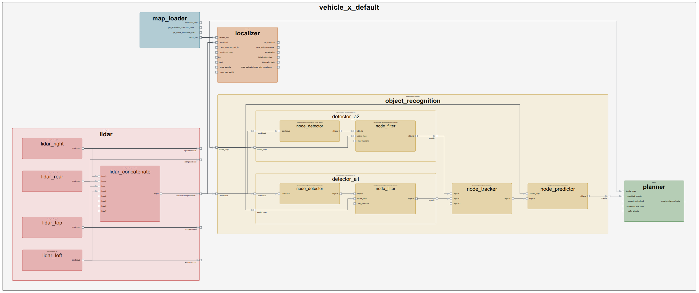

<em>그림 23. Autoware System Designer가 생성한 노드 다이어그램 예. 출처: autoware_system_designer `autoware_system_designer/doc/images/node_diagram.png` (💻 R17)</em>

**분석.** 09번 보고서가 Agnocast·cuda_blackboard를 "데이터 흐름의 제로카피 경로"로 다뤘는데, 2.0.0에서는 둘 다 **core 그룹의 정식 구성원**이 됐다(cuda_blackboard는 이동 중). System Designer는 다년 로드맵 Y2의 "GUI 설정 대시보드"의 백엔드 격이며, 빈 저장소 `autoware_launch_v2`가 이것과 연결된 차세대 런치 자리라는 추정은 확인하지 못했다. ⚠️

### 5.9 ODD별 프로젝트 — 트럭 · 오프로드 · 저속 · 버스

| 프로젝트 | 저장소 | 내용 | WG·상태 |
|---|---|---|---|
| 고속도로 자율 트럭 | `autoware.trucks` | "안전한 SAE L4 고속도로 자율 트럭 오픈소스 시스템". 단기 목표: 레퍼런스 디자인, 차량 인터페이스(J1939), 트럭용 계획·제어, **비전 전용 경량 NN 벤치마크**. 2026-10 회의: Vision Pilot v1.2 트럭 모델 작업, Inceptio가 CARLA 0.9.16+Vision Pilot 시뮬 | Truck WG(Inceptio·TIER IV). 11월부터 의장 교체 |
| 오프로드 | `autoware.off-road`, `autoware_off-road_sim`, `autoware.orv-reference-design-docs` | 광산 트럭·RoboRacer 오프로드·행성 로버. EfficientNet-B0 백본의 주행가능영역 분할·윤곽·고도 네트워크, CARLA `Mine_01` 데모, Isaac Sim 기반 1/5 스케일 다차량 시뮬(UPenn CoE) | Off-road/Racing WG. 2026-05 "추후 통지까지 일시 중단" |
| 저속 자율(LSA) | `LSA-reference-design-docs`, `autoware.low-speed-autonomy-vehicles` | 주차장 로봇·셔틀·소형 차량 TRL-6 가이드, RoboRacer·GoKart 포함 | Reference Design WG(NTU) |
| 버스 | docs `reference-design/itri-bus`, `itri_bus_sensor_kit`, `cbus_vehicle_launch` | ITRI 버스 레퍼런스(대부분 "To-be-added") | — |

(💻 R22·R23·R24·R31·D11 · 🔍 G18 · 📰 W3)

---

## 6. 두 트랙 특징 비교

| 항목 | ① 로보택시·L4 트랙 (Autoware 2.0) | ② ADAS·POV 트랙 (Vision Pilot) |
|---|---|---|
| 목표 | SAE L4+ 무인(로보택시·로보버스·물류) | 양산 승용차 L2 → Plus L3 → Drive L4 (고속도로) |
| 코드베이스 | ROS 2(Humble/Jazzy) 메타 저장소 + 하위 20여 개, 패키지 수백 개 | 단일 C++ 애플리케이션(`VisionPilot/`), ONNX Runtime, 미들웨어 선택(없음/ROS 2/Zenoh) |
| 센서·맵 | LiDAR+카메라(+레이더), Lanelet2 HD맵 기본(2D맵 옵션은 로드맵) | 단안 카메라 1대, HD맵 없음. Phase 2부터 4D 레이더 |
| 인식 | 점군·BEV·융합 인식 파이프라인(centerpoint·BEVFusion·PTv3·traffic light 등) | AutoSeg 계열 분할·깊이 + AutoSpeed 검출 |
| 계획 | 규칙 기반 시나리오 플래너 ↔ Diffusion Planner(런치 선택). 후보: AutoE2E·LatentDrive·OnePlanner | AutoSteer(경로) + RSS 영감 속도 계획 + Safety Guardian |
| 제어 | MPC 횡·PID 종(autoware_core) | MPC 횡·PID 종(자체 구현) |
| 하드웨어 | NVIDIA GPU(TensorRT) 전제, 8코어·16GB 권장 | 3–5 INT8 TOPS 양산 SoC 목표. 벤치는 Jetson Orin·RTX 4000 SFF. 가이드: Phase 1 50–80 TOPS |
| 모델 배포 | Hugging Face + Ansible `artifacts` 역할 | Google Drive(모델 저장소) + Hugging Face(일부) |
| 릴리스 | 월간(2.0.0 2026-10-29) | 0.5→0.9→1.0→1.1→1.2(2026-01~08), 1.3 준비 |
| 안전 접근 | Selector(safety gate·ranking, 미기동), planning validator, Safety Island(L4 RFC) | Safety Guardian 모듈, SEooC(ISO 26262 Part 6) 문서, ISO 8800 목표, L2 Safety Island 실험, Euro NCAP 파생 시나리오(Open AD Kit v2.1) |
| 배포 | Open AD Kit v2.0 | Open AD Kit v2.1 (R-Car X5H) |
| 주체 | AWF Software WG(TSC 의장 mitsudome-r, 아키텍트 xmfcx), TIER IV, Robotaxi WG | AWF Senior Tech Lead(m-zain-khawaja), ADAS WG 기여자(atanasko·pranavdoma 등), AEI, NTU |
| 라이선스 | Apache 2.0 | Apache 2.0(가중치 포함) |

(💻 R1·R6·R10·D15·P2 · 🔍 G2·G4·G20)

---

## 7. 로드맵 위에 올려본 각 스택

| 스택(저장소) | 다년 로드맵 | Arch 2.0 단계(자체 해석) | POV Phase | Open AD Kit | 2026-10 상태 |
|---|---|---|---|---|---|
| Autoware 2.0 본체(`autoware`·core·universe·launch) | Obj.1 Y1 "컴포넌트형 AI 인식 + AI 플래너 초판" ↔ 2.0.0이 Diffusion Planner 선택 가능 | Step 1 진입 | — | v2.0(2026-10 목표) | 공개(2026-10-29) |
| Diffusion Planner(universe) | Obj.1 Y1 | Step 1 | — | v2.0 | 런치 인자로 선택 |
| Selector(validator·ranker·selector) | Obj.1 Y3 "하이브리드"의 전제 | Step 4의 Safety Guardian에 해당 | — | — | 패키지 존재, 미기동 |
| `auto_e2e` | Obj.1 Y1~Y2 | Step 2(Reactive) → Step 4 구상 | — | — | HF v1.0, 로보택시 WG |
| `autoware_latent_drive` | Obj.1 Y2 "단일 신경망 E2E 초판" 후보 | Step 3 | — | — | 연구용 v1.0 |
| `autoware_oneplanner` | Obj.1 Y1 | Step 1 | — | — | v1.0, Core 위 노드 |
| `alpamayo-autoware` | 회원사 모델 통합 사례 | Step 3(VLA) | — | — | 데모 |
| `vision_pilot` + 모델 3종 | Obj.2 Y1 "POV 고속도로 파일럿 TRL-6", Obj.3 Y1 앵커 기업 | Step 4 구조(하이브리드)로 Step 2·3 요소 포함 | **Phase 1** | v2.1 | 1.2 공개, 1.3 준비, 안전 인증 집중 |
| AutoSeg 계열·`lite_models` | Obj.1 Y1 "비전 컴포넌트형 AI 인식" | Step 2의 학습 인식 | Phase 1~ | — | 분리 저장소 대부분 빈 상태 |
| `blindspot_detector`·`auto_speed_limit` | — | — | Phase 2 후보 ⚠️ | — | 초기 |
| `openadkit` | Obj.2 "Open AD Kit와 결합한 Production-Capable Autoware" | — | — | 자체 사다리 v2.0→v3.0 | v2.0.0 리스크 |
| `autoware-safety-island`·RFC | Obj.1 Y3 "병렬 안전층" | Step 4 Safety Perception/Guardian의 HW 분리 | Plus~ | v2.0.x 증거 | v0.2.0 범위 미정, L2 실험 |
| `autoware-index`·Reference Design | Obj.4 Y2 "패키지 목록" | — | Vision Pilot=첫 RD | — | 공개 |
| `autoware_system_designer` | Obj.4 Y2 "GUI 대시보드" 기반 ⚠️ | — | — | — | v0.4.2 core |
| `autoware.trucks` | Obj.2(명시 없음) | — | Vision Pilot 재사용 | — | 활동 중 |
| `autoware.off-road` | Obj.2 Y2 "오프로드 TRL-6" | — | — | — | WG 일시 중단 |
| LSA 가이드 | Obj.2 Y1 "LSA TRL-6" | — | — | — | 문서 공개 |

(💻 D1·D3·D10·D11·P1 · 🔍 G4·G13·G17)

---

## 8. 차량 HPC 관점의 시사점

1. **두 가지 연산 프로파일이 공존한다.** 로보택시 트랙은 TensorRT·GPU 전제이고(Diffusion Planner, OnePlanner RTX PRO 6000 기준 12.7 ms), ADAS 트랙은 3–5 INT8 TOPS 양산 SoC에서 10 FPS를 목표로 한다. 같은 재단의 두 스택이 **요구 연산량에서 두 자릿수 차이**를 내므로, HPC 설계에서는 "어느 트랙을 올리는가"가 SoC 등급을 결정한다. (💻 R6·R12 · 🔍 G20)
2. **안전 코어 분리가 구체적 하드웨어 이름으로 내려왔다.** Safety Island의 타깃이 NXP S32Z/S32Z2와 Renesas R-Car X5H CR52이고, Reference Design WG가 최소비용(S32Z2/AURIX TC4x/Stellar)과 최대안전(X5H) 분기를 논의한다. 15번 보고서의 ETAS×Elektrobit(ASIL-B 리눅스+미들웨어)과 달리 AWF는 **Zephyr/FreeRTOS 안전 코어 + DDS 경계**라는 다른 층에서 접근한다. (💻 R13 · 🔍 G16 · 📚 15번)
3. **배포 단위가 "증거 붙은 OCI 이미지"로 바뀐다.** Open AD Kit의 L0~L3 증거 등급, SBOM, in-toto 증명, AutoSD·eSync 배달은 HPC 소프트웨어 플랫폼이 받아들여야 할 **입력 포맷**이 된다. 쿠버네티스 비채택·Quadlet+BlueChi 채택도 차량 측 컨테이너 런타임 선택에 참고가 된다. (🔍 G4)
4. **제로카피·GPU 공유가 표준 구성원이 됐다.** Agnocast(소스 빌드 포함)와 cuda_blackboard(core/cuda 이동)는 09번 보고서가 예측한 "zero-copy 경로 분화"의 공식화다. HPC 미들웨어 평가 시 이 둘이 기준선이다. (💻 R1 · 📚 09번)
5. **모델 유통이 Hugging Face로 표준화됐다.** `artifacts` Ansible 역할이 버전 태그로 모델을 받으므로, 차량 측 모델 관리(버전 고정·무결성)도 같은 체계를 전제로 설계할 수 있다. (🔍 G2)

---

## 9. 불확실·미확인 항목

| # | 항목 | 상태 |
|---|---|---|
| 1 | 다년 로드맵의 **기준 연도**(Y1이 몇 년인지) | 문서에 없음. 2.0.0 내용과 대조하면 Y1≈2025–2026으로 보이나 ⚠️ 추정 |
| 2 | `autoware_launch_v2`의 용도 | README 제목만 있음. System Designer 기반 차세대 런치로 추정 ⚠️ |
| 3 | CUDA 재구조화(`autoware_cuda`)의 2026-10-15 전환 완료 여부 | 저장소가 비어 있고 안내 페이지에 완료 기록 없음 |
| 4 | Open AD Kit v2.0.0의 실제 공개 여부 | 2026-10-15 회의록 "리스크 있음". 이슈 #91 스냅샷에 rc.1 기록 없음 |
| 5 | POV WG → ADAS WG 개명의 공식 일자 | 회의 제목만 바뀜(2026-09-28부터). 위키·푸터 라벨은 옛 이름 |
| 6 | Robotaxi WG의 공식 지위 | `auto_e2e` README·온보딩과 Discord 채널에만 등장, `autoware-projects` 위키 WG 목록에는 없음 |
| 7 | Vision Pilot의 센서 사양 불일치(가이드 8MP 120°+30°·4D 레이더 vs 코드 1–2MP 52–55° 단안) | 가이드=목표, 코드=현재로 읽힘 ⚠️ |
| 8 | AutoE2E·LatentDrive·OnePlanner의 Autoware 런치 통합 | 2.0.0 문서에 없음. 독립 런타임 단계 |
| 9 | "New VisionPilot Architecture" 그림(2026-05·06 회의록 첨부) | 이미지 접근 불가로 내용 미확인 |
| 10 | 재단 홈페이지·블로그의 공식 표현("두 트랙" 등) | autoware.org 차단으로 미열람. 본 보고서의 트랙 구분은 GitHub·문서 원본 근거 |
| 11 | 별·포크 수 | 목록 페이지 표기(k 단위 반올림), 정확 값 아님 |

---

## 부록 A. 워킹그룹 목록 (autoware-projects 위키, 2026-10 열람)

활성: Software WG(아키텍처·릴리스·코드 품질, 리더 mitsudome-r·xmfcx) · Operational Design Domain WG · Simulation WG · Off-road(Racing) WG(2026-05 일시 중단) · Open AD Kit WG · Reference Design WG(NTU·ADLink, LSA·POV·안전섬 RFC) · Safety Assurance WG(Deepen AI·ASU, ISO 8800 영향, 안전 메트릭 프레임워크) · Privately Owned Vehicles WG(=ADAS WG, 리더 Muhammad Zain Khawaja) · Low Speed Autonomy WG · Truck WG(Inceptio·TIER IV). 아카이브·병합: Hardware WG(→Open AD Kit), Maps and routing, Vehicle interfaces, Planning & Control·Sensing & Perception·Localisation & Mapping·API WG(→Software WG), **Autoware Architecture WG(일시 정지)**. 위키 목록에 없는 Robotaxi WG는 `auto_e2e`에서 확인된다. (💻 R31·R10 · 📰 W3)

## 부록 B. 용어

- **Generator / Selector**: Architecture 2.0의 두 구성 요소. 궤적 후보를 내는 모든 모듈이 Generator, 후보를 안전 검사·랭킹해 하나를 고르는 것이 Selector. (💻 D4)
- **Autoware Index**: 커뮤니티 패키지 레지스트리. `.repos` 파일이 락파일 역할. (💻 R15)
- **Reference Design**: 배포 프로파일 + 레퍼런스 SW 스택. Index 항목의 `reference_design: true`. (💻 D11)
- **Open AD Kit**: Autoware 생태계의 배포 계층(SOAFEE 블루프린트). (💻 R5)
- **Safety Island**: 안전급 프로세서에서 돌리는 궤적 추종·감독 애플리케이션. (💻 R13)
- **SEooC**: Safety Element out of Context, ISO 26262에서 특정 차량 맥락 없이 개발하는 안전 요소. Vision Pilot이 표방. (💻 R6)
- **TRL**: Technology Readiness Level. 다년 로드맵의 양산 성숙도 척도(6→7→8). (💻 D10)
- **CIPO**: Closest In-Path Object. AutoSpeed·AutoDrive의 대상. (💻 R8)
- **POV**: Privately Owned Vehicle, 개인 소유 차량. (💻 R31)

## 부록 C. 관련 보고서

- [12-autoware-e2e-architecture](../12-autoware-e2e-architecture/autoware-e2e-architecture-transition.md) — 2026-06, Autoware 1.8.0 기준 E2E 전환 2트랙 해부. 본 보고서는 그 후속 상황(2.0.0, Vision Pilot 1.x, 신규 저장소)을 다룬다.
- [09-ad-sw-stack-deep-dive](../09-ad-sw-stack-deep-dive/ad-sw-stack-deep-dive.md) — Autoware 컴포넌트·데이터 흐름(Agnocast·cuda_blackboard).
- [07-tier4-alpamayo-autoware](../07-tier4-alpamayo-autoware/tier4_alpamayo_autoware_보고서.md), [14-alpamayo-hardware-alternatives](../14-alpamayo-hardware-alternatives/alpamayo-hardware-alternatives.md) — `alpamayo-autoware` 포크의 상세.
- [15-etas-elektrobit-partnership](../15-etas-elektrobit-partnership/etas-elektrobit-partnership.md) — 안전 OS·미들웨어 층의 다른 접근.
