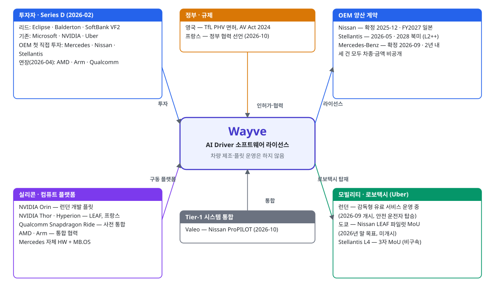
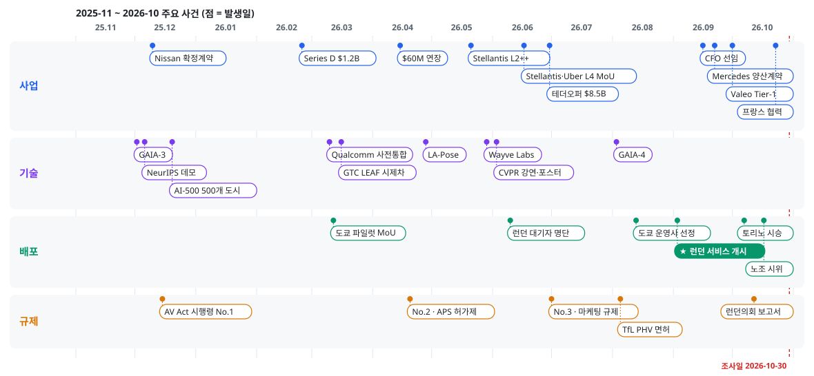
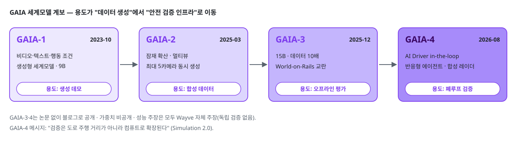
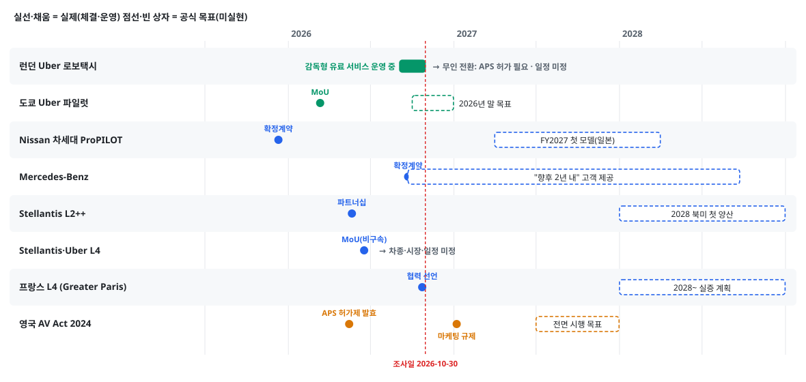
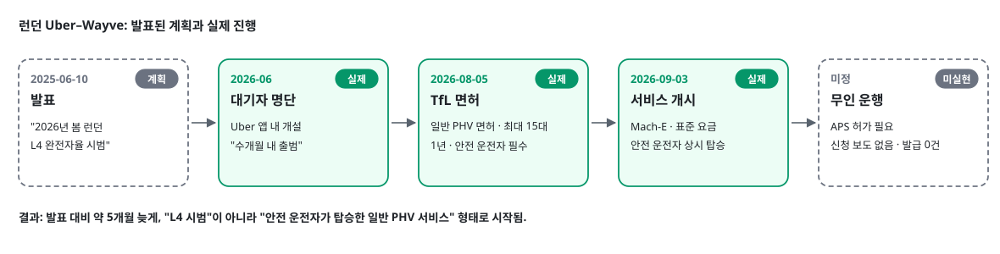
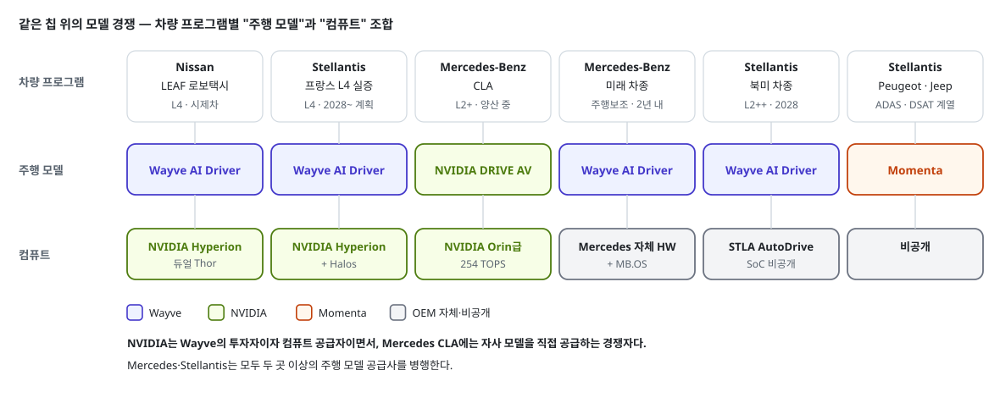

# Wayve 최근 12개월 동향 — 라이선스형 End-to-End 자율주행의 상용화 전환기

> **작성일**: 2026-10-30 (2판 — 용어 풀이·각주·도식 추가, 글머리 형식으로 재구성)
> **조사 범위**: Wayve(영국 런던, 2017년 창업)의 2025-11-01 ~ 2026-10-30 동향. 창업~2025년 계보는 배경으로 압축했다.
> **출처 표기 원칙**: 모든 사실 문장·표 행에 `[번호]`로 출처를 달고, 말미 출처 목록에 등급과 URL을 수록했다. 등급은 🔍 공식(기업·정부 1차 자료) · 📄 논문·기술 블로그 · 📰 언론·서드파티. 미검증 보도와 단일 약한 출처 항목은 제외했다(8장).
> **표기 약속**: "발표·계획"과 "실제 운영·체결"을 구분한다. 그림은 모두 **자체 작성 도식**이며, 그림 아래에 근거 출처 번호를 달았다. 조사 환경에서 공식 사이트 이미지를 내려받을 수 없어 원본 그림은 싣지 못했다(8장).

---

## 0. 한눈에 보기

**세 줄 요약**

1. **자본과 고객을 동시에 확보했다.** 2026-02 Series D에서 $1.2B를 조달했고, 여기에 Mercedes-Benz·Nissan·Stellantis가 완성차 회사로는 처음 직접 투자했다. 같은 세 회사와 양산 적용 계약도 맺었다 [18][34][46][55].
2. **첫 유료 서비스는 시작됐지만 무인은 아니다.** 2026-09-03 런던에서 Uber 앱으로 부르는 서비스가 개시됐지만, 일반 PHV 면허로 최대 15대를 안전 운전자가 탄 채 운행한다. 영국의 무인 여객 서비스(APS) 허가는 2026-10 말까지 0건이다 [83][92][96].
3. **경쟁의 축이 "같은 칩 위의 모델 경쟁"으로 옮겨 갔다.** Nissan 로보택시와 프랑스 L4 프로젝트는 NVIDIA 플랫폼 위에 Wayve 모델을 얹는다. 반면 Mercedes CLA는 같은 NVIDIA 칩에 NVIDIA 자체 모델을 쓴다 [41][122][59].

**핵심 숫자**

| 지표 | 값 | 출처 |
|---|---|---|
| Series D 규모 · 기업가치 | $1.2B · post-money $8.6B | [18][19] |
| 공개된 누적 투자(Series A~D + 연장) | 약 $2.5B (Uber 조건부 자본 제외) | [2][3][4][18][25] |
| 인력 | 약 1,200명 (1년 전 약 650명) | [10][30] |
| 완성차 양산 계약 | 3건 — Nissan · Stellantis · Mercedes-Benz | [34][46][55] |
| 실제 운영 중인 유료 서비스 | 1곳 — 런던(최대 15대, 안전 운전자 탑승) | [83][90] |
| 가장 빠른 양산 적용 | Nissan FY2027(2027-04 ~ 2028-03), 일본 | [34] |
| 최신 공시 재무 | FY2024 세전손실 £62m, 실질 매출 없음 | [10] |

*그림 1. Wayve를 둘러싼 투자자·고객·플랫폼·규제 관계 — 자체 작성 · 근거 [18][25][34][37][44][46][49][55][60][63][83]*

---

## 읽기 전에 — 주요 용어

**투자·계약**

| 용어 | 뜻 |
|---|---|
| Series A·B·C·D | 스타트업이 단계별로 받는 투자 라운드의 순번이다. 뒤로 갈수록 규모가 크고 사업화에 가까운 단계다. |
| Post-money 기업가치 | 이번 투자금이 들어온 직후의 기업가치다. "투자 전 가치 + 투자금"으로 계산한다. |
| 리드 투자자 | 라운드 조건을 주도하고 보통 가장 많이 넣는 투자자다. |
| 연장(extension) 라운드 | 끝난 라운드에 같은 조건으로 투자자를 더 받는 것이다. |
| 테더오퍼(tender offer) | 직원·초기 주주의 주식을 투자자가 사들이는 거래다. 회사로 새 돈이 들어오지 않고, 직원이 현금화한다. |
| 조건부(마일스톤 연동) 자본 | 정해진 목표를 달성하면 집행하기로 약속한 투자금이다. |
| MoU · 비구속 | 양해각서다. 협력 의사를 밝힌 문서로 법적 구속력이 없다. |
| 확정 계약(definitive agreement) | 조건이 확정되어 구속력이 있는 본계약이다. |
| OEM | 완성차 제조사다(Nissan, Mercedes-Benz 등). |
| Tier-1 | 완성차에 시스템·모듈을 직접 납품하는 1차 협력사다(Valeo 등). |
| FY2027 (Nissan) | Nissan 회계연도 2027이며, 2027-04 ~ 2028-03에 해당한다. |

**자율주행 기술**

| 용어 | 뜻 |
|---|---|
| SAE 레벨 L2 · L3 · L4 | 국제 자율주행 단계다. L2는 운전자 감독 하의 조향·가감속 보조, L3는 조건부로 전방 주시가 필요 없는 단계, L4는 정해진 조건에서 운전자 없이 달리는 단계다. |
| L2+ · L2++ | 표준 용어가 아닌 업계 마케팅 표현이다. L2이되 핸즈프리·내비게이션 연동 등 기능 범위가 넓다는 뜻이다. |
| hands-free · eyes-on · eyes-off | 손을 떼도 됨 · 전방 주시 필요 · 전방 주시 불필요. |
| End-to-end (E2E) | 센서 입력에서 주행 행동까지 하나의 학습 모델로 처리하는 방식이다. 인지·판단·제어를 모듈로 나누는 전통 방식과 대비된다. |
| AV2.0 | Wayve가 자사 접근을 부르는 이름이다. 규칙·정밀지도 중심 방식 대신 데이터로 학습한 E2E 모델을 쓴다는 뜻이다. |
| HD맵 · 맵리스 | 차선 단위 정밀 지도 · 정밀 지도 없이 주행하는 방식. |
| 세계모델 (World model) | 주행 장면의 다음 상황을 영상 등으로 생성·예측하는 생성형 AI다. 시뮬레이션과 평가에 쓴다. |
| VLA · VLAM | Vision-Language-Action (Model). 영상을 보고 언어로 설명·추론하며 행동까지 출력하는 모델이다. |
| 오프라인 평가 · 폐루프(closed-loop) 평가 | 기록된 장면에서 모델 출력만 채점하는 방식 · 모델의 행동이 다음 장면을 바꾸는 상호작용 시뮬레이션. |
| Zero-shot | 해당 도시·조건의 데이터를 학습하지 않고 바로 동작하는 것이다. |
| 안전 운전자 · 개입(disengagement) | 시험 차량에 타고 있다가 필요하면 수동으로 넘겨받는 운전자 · 그 수동 전환. |
| Safety case | 시스템이 충분히 안전하다는 논증과 증거를 묶은 문서다. 영국 규제 승인의 근거가 된다. |

**컴퓨트·플랫폼**

| 용어 | 뜻 |
|---|---|
| SoC · TOPS | 차량용 통합 반도체 칩 · 초당 조(兆) 단위 연산 횟수로 나타낸 AI 성능 지표. |
| HPC · 도메인 컨트롤러 | 여러 제어기 기능을 모은 고성능 중앙 컴퓨터 · ADAS 같은 한 영역을 맡는 중앙 제어기. |
| NVIDIA DRIVE Orin · Thor | NVIDIA의 차량용 SoC다. Thor가 후속 세대다. |
| NVIDIA DRIVE Hyperion | NVIDIA의 L4용 컴퓨트·센서 레퍼런스 아키텍처다. |
| NVIDIA Halos · DriveOS | NVIDIA의 차량 안전 프레임워크 · 차량용 운영체제. |
| Qualcomm Snapdragon Ride | Qualcomm의 ADAS·자율주행용 SoC·소프트웨어 플랫폼이다. |
| MB.OS · STLA AutoDrive | Mercedes-Benz 자체 차량 운영체제 · Stellantis의 자율주행 플랫폼 이름. |

**영국 규제**

| 용어 | 뜻 |
|---|---|
| AV Act 2024 | 영국 자율주행차법(Automated Vehicles Act 2024)이다. 조항별로 단계 시행 중이다. |
| 시행령 (Commencement Regulations · SI) | 법 조항별 시행일을 정하는 하위 규정이다. SI는 행정입법(Statutory Instrument) 번호다. |
| APS 허가 | Automated Passenger Services. 무인 여객 서비스 시범을 허가하는 제도다(AV Act Part 5). |
| ASDE | Authorised Self-Driving Entity. 자율주행 시스템의 안전 책임을 지는 인가 주체다. |
| PHV 면허 | Private Hire Vehicle. Uber 같은 사전예약 차량에 쓰는 일반 면허이며, 자율주행 면허가 아니다. |
| TfL · DfT · DVSA · VCA | 런던교통공사 · 영국 교통부 · 운전·차량표준청 · 차량인증청. |

---

## 1. 회사 개요와 계보 (요약)

- **정체**: 2017년 영국 케임브리지에서 Alex Kendall과 Amar Shah가 창업한 E2E 학습 기반 자율주행 소프트웨어 기업이다 [1].
- **사업 모델**: 차량을 만들거나 로보택시를 직접 운영하지 않는다. 완성차·모빌리티 회사에 "Wayve AI Driver"를 라이선스한다 [18].
- **전환점**: 2024년 이후 미국·독일·일본에 거점을 열고 Nissan·Uber와 첫 상업 파트너십을 맺으며 연구 기업에서 공급사로 바뀌었다 [5][6][7][8][9].
- **경영**: CEO는 공동창업자 Alex Kendall이다 [18].

| 시기 | 사건 | 출처 |
|---|---|---|
| 2017-08 | 케임브리지에서 창업, Wayve Technologies Ltd 등기(회사번호 10924127) | [1] |
| 2019-11 | Series A $20M, Eclipse Ventures 주도 | [2] |
| 2022-01 | Series B $200M, Eclipse 주도 | [3] |
| 2024-05 | Series C $1.05B, SoftBank Group 주도, NVIDIA·Microsoft 참여 | [4] |
| 2024-10 ~ 2025-04 | Sunnyvale(미국)·Stuttgart 권역(독일)·Yokohama(일본) 거점 개설 | [5][6][7] |
| 2025-04 ~ 06 | Nissan 첫 글로벌 OEM 파트너 발표, Uber와 런던 L4 시범 파트너십 발표 | [8][9] |
| 2025-09 | Gen 3 차량 플랫폼(NVIDIA DRIVE AGX Thor) 발표, NVIDIA $500M 투자 검토 의향서 | [11][12][13] |

**모델 계보** (공개 발표 기준)

| 모델 | 시기 | 한 줄 설명 | 출처 |
|---|---|---|---|
| LINGO-1 | 2023-09 | 주행 장면을 자연어로 설명·질의응답하는 비전-언어 모델 | [14] |
| GAIA-1 | 2023-10 | 영상·텍스트·행동 조건으로 주행 영상을 만드는 생성형 세계모델(9B 파라미터) | [15] |
| LINGO-2 | 2024-04 | 공공도로에서 시험한 폐루프 VLA 주행 모델(Wayve 표현) | [16] |
| GAIA-2 | 2025-03 | 잠재 확산 기반 멀티뷰 세계모델, 최대 5개 카메라 동시 생성 | [17] |
| GAIA-3 | 2025-12 | 15B 파라미터, 오프라인 평가·안전 검증용 세계모델 | [67][68] |
| LA-Pose | 2026-04 | 라벨 없는 주행 영상 1,020만 클립으로 사전학습한 카메라 자세 추정(CVPR 2026) | [71][72] |
| GAIA-4 | 2026-08 | AI Driver를 루프 안에 넣은 폐루프 시뮬레이션용 멀티모달 세계모델 | [70] |

---

## 2. 최근 12개월 타임라인 (2025-11 ~ 2026-10)

*그림 2. 분야별 주요 사건 — 자체 작성 · 근거는 아래 표의 출처 열*

| 날짜 | 사건 | 구분 | 출처 |
|---|---|---|---|
| 2025-12-02 | GAIA-3 공개(15B 세계모델, 오프라인 평가 목적) | 기술 | [67][68] |
| 2025-12-06 | NeurIPS 2025 "Embodied World Models" 워크숍 산업 데모 | 기술 | [78] |
| 2025-12-10 | Nissan과 차세대 ProPILOT 확정 계약, 첫 모델 FY2027 일본 | 사업 | [34][35] |
| 2025-12-15 | 영국 AV Act 시행령 No.1 제정(2026-01-01 일부 시행) | 규제 | [101] |
| 2025-12 | AI-500 로드쇼 완료 — 6~12월 90→500개 도시, AI Driver 작동 1.45M km | 기술 | [76][77] |
| 2026-02-24 | Series D $1.2B(post $8.6B), Mercedes·Nissan·Stellantis 첫 OEM 직접 투자 | 사업 | [18][19][23] |
| 2026-03-10 | Qualcomm Snapdragon Ride와 AI Driver 사전 통합 발표 | 기술 | [60][61] |
| 2026-03-12 | Wayve·Uber·Nissan 도쿄 로보택시 MoU(2026년 말 파일럿 목표) — 발표 | 배포 | [37][38] |
| 2026-03-16 | GTC 2026에서 Nissan LEAF 로보택시 시제차 공개(듀얼 DRIVE AGX Thor) | 기술 | [39][40][41] |
| 2026-04 | LA-Pose 논문 arXiv 공개 | 기술 | [71] |
| 2026-04-15 | Series D 연장 $60M — AMD · Arm · Qualcomm Ventures | 사업 | [25][26][27] |
| 2026-04-20 | AV Act 시행령 No.2 — APS 허가제 2026-05-15 발효 | 규제 | [102] |
| 2026-04-23 | 영국 정부, APS 허가 규정 의회 제출 | 규제 | [103] |
| 2026-05-21 | Stellantis 파트너십 — STLA AutoDrive에 AI Driver 통합, L2++, 북미 2028 | 사업 | [46][47][48] |
| 2026-05-29 | 프런티어 연구 조직 Wayve Labs 출범 | 기술 | [74][75] |
| 2026-06-03 · 06-07 | CVPR 2026에서 Kendall 초청강연, LA-Pose 포스터 발표 | 기술 | [79][73] |
| 2026-06-17 | Stellantis·Wayve·Uber L4 로보택시 MoU(비구속) — 발표 | 사업 | [49][50] |
| 2026-06 | Uber 앱 내 런던 로보택시 대기자 명단 개설 | 배포 | [89] |
| 2026-06-30 | 직원 테더오퍼 $85M, 기업가치 $8.5B, 인력 약 1,200명 | 사업 | [28][29][30] |
| 2026-07-01 | AV Act 시행령 No.3 — 마케팅 규제 2027-01-07 시행 | 규제 | [104] |
| 2026-08-03 | GAIA-4 공개(AI Driver in-the-loop 폐루프 시뮬레이션) | 기술 | [70] |
| 2026-08-05 | TfL, Ford Mustang Mach-E 최대 15대에 PHV 면허(1년, 안전 운전자 필수) | 규제 | [83][84][85] |
| 2026-08-13 | Uber Japan, 도쿄 택시회사 Hinomaru Kotsu를 파일럿 운영사로 선정 | 배포 | [42][43] |
| 2026-09-03 | **런던 Uber–Wayve 승객 서비스 실제 개시**(안전 운전자 탑승, 표준 요금) | 배포 | [90][91][92] |
| 2026-09-16 | 전 Waymo CFO Elisa de Martel을 CFO로 선임 | 사업 | [31][32] |
| 2026-09-22 | Mercedes-Benz와 양산 확정 계약(2년 내, MB.OS 통합) | 사업 | [55][56] |
| 2026-10-01 | Valeo, Nissan 차세대 ProPILOT 시스템 Tier-1으로 선정 | 사업 | [44][45] |
| 2026-10-07 ~ 09 | 토리노 Wave by Vento에서 Fiat 500e·Maserati Grecale L2++ 시승 | 배포 | [51][52] |
| 2026-10-12 | 런던의회 교통위원회, TfL에 AV 대수 상한·허가 철회 권한 부여 요구 | 규제 | [99] |
| 2026-10-17 | 앱 운전자 노조(ADCU), Wayve 본사 앞 로보택시 반대 시위 | 배포 | [97][98] |
| 2026-10-23 | Wayve·Stellantis·NVIDIA, 프랑스 정부와 자율주행 배포 협력 발표 | 사업·규제 | [63][64][65] |

---

## 3. 사업·자금·파트너십

> **요점**
> - Series D로 확보한 자금은 $1.2B이며, "$1.5B 확보"라는 공식 표현에는 Uber의 조건부 자본이 포함돼 있다.
> - 12개월 동안 완성차 3사와 양산 계약을 맺었지만, 세 건 모두 차종·금액·물량은 공개되지 않았다.
> - Uber는 투자자이자 로보택시 유통 채널이고, Valeo는 Nissan 프로그램의 시스템 통합을 맡는다.

### 3.1 Series D — 자본 구조

- **규모**: 지분 투자 $1.2B, post-money 기업가치 $8.6B다 [18][19][20].
- **"$1.5B 확보"의 실체**: Uber가 로보택시 배치 목표에 연동해 최대 $300M을 추가로 약정했다. 이 조건부 자본을 합친 숫자라서 확정 입금액이 아니다 [18][21].
- **추가 자금**: 2026-04-15 반도체 3사가 $60M을 연장 라운드로 넣었다. 2026-06-30에는 기업가치 $8.5B로 직원 테더오퍼 $85M이 진행됐다 [25][28].
- **잔여 자금**: Kendall은 Series D 발표 때 2024년 Series C $1.05B의 "대부분(vast majority)"이 아직 남아 있다고 말했다 [21].
- **공개되지 않은 것**: 2025-09 NVIDIA의 $500M 투자 검토 의향서가 Series D에서 얼마로 집행됐는지는 나오지 않았다 [12][13].

| 항목 | 내용 | 출처 |
|---|---|---|
| 공동 리드 | Eclipse · Balderton · SoftBank Vision Fund 2 | [22][23] |
| 기존 투자자 | Microsoft · NVIDIA · Uber | [20][22] |
| OEM 첫 직접 투자 | Mercedes-Benz · Nissan · Stellantis (금액 비공개) | [20][24] |
| 기타 | Ontario Teachers' Pension Plan · Baillie Gifford · British Business Bank 등 | [24][133] |
| Uber 조건부 자본 | 최대 $300M, 로보택시 배치 목표 연동 | [18][21] |
| 연장(2026-04-15) | $60M — AMD · Arm · Qualcomm Ventures, 각사 하드웨어에서 AI Driver 구동 협력 | [25][26][27] |
| 테더오퍼(2026-06-30) | 약 $85M, 기업가치 $8.5B, 2024년 이후 두 번째 직원 유동화 | [28][29][30] |
| 누적(공개 라운드) | A $20M + B $200M + C $1.05B + D $1.2B + 연장 $60M ≈ $2.5B | [2][3][4][18][25] |

### 3.2 완성차 양산 계약 3건

| OEM | 체결 | 적용 범위 | 양산 시점(공식) |
|---|---|---|---|
| Nissan | 2025-12-10 확정 계약 | 차세대 ProPILOT, 운전자 감독형 L2 | FY2027 일본, 이후 글로벌 |
| Stellantis | 2026-05-21 전략 파트너십 | STLA AutoDrive 통합, 고속도로·도심 핸즈프리 L2++ | 2028 북미 |
| Mercedes-Benz | 2026-09-22 양산 확정 계약 | 도심·고속 point-to-point 주행보조 | "향후 2년 내", 글로벌 |

*출처: Nissan [33][34][35] · Stellantis [46][47][48] · Mercedes-Benz [55][56][57]*

**Nissan**
- **범위**: 차세대 ProPILOT에 Wayve AI Driver를 넣는다. Nissan은 이를 운전자 감독형 L2로 명시했다 [34][36].
- **센서**: Nissan의 차세대 LiDAR 기반 인지 기술 "Ground Truth Perception"과 결합한다. 시제차에는 카메라 11개, 레이더 5개, LiDAR 1개가 달렸다 [33][34].
- **Tier-1**: 시스템 통합은 Valeo가 맡는다(3.4절) [44].
- **Nissan의 자기 평가**: 자사를 "광범위한 세그먼트에 Wayve AI를 대규모 배포하기로 약속한 첫 자동차 제조사"로 표현했다 [34].
- **첫 차종**: Reuters는 Nissan 기술 책임자를 인용해 일본 시장 Elgrand 밴이라고 보도했다. 다만 Nissan 공식 자료에는 차종이 없다 [107][34].
- **비공개**: 차종(공식), 양산 ECU, 물량.

**Stellantis**
- **범위**: Stellantis 자율주행 플랫폼 STLA AutoDrive에 AI Driver를 통합해 고속도로·도심 핸즈프리 "L2++"를 구현한다 [46][47].
- **개발차**: 2026-05 Jeep Grand Cherokee로 시작했고, 2026-10에는 Fiat 500e·Maserati Grecale로 시승 행사를 열었다 [47][51].
- **통합 속도**: Stellantis는 Fiat 500e·Maserati Grecale에서 통합부터 도로 시험까지 4주가 안 걸렸다고 밝혔다 [51].
- **비공개**: 브랜드·차종, 금액.

**Mercedes-Benz**
- **범위**: 운전자가 개입 준비를 유지하는 도심·고속 point-to-point 주행보조다 [55][56].
- **통합**: Mercedes 자체 하드웨어와 MB.OS, 지도 인터페이스에 통합을 마쳤다고 Wayve가 밝혔다 [55].
- **Mercedes의 평가**: CTO Jörg Burzer는 "프리미엄 세그먼트 최초의 Wayve AI Driver 통합"이라고 말했다 [55][58].
- **복수 공급사**: 3주 뒤 Mercedes는 NVIDIA와의 자동화 주행 파트너십 확장도 발표했다 [59].
- **비공개**: 차종, SAE 레벨, 금액.

### 3.3 Uber — 투자자이자 유통 채널

- **역할**: Series D 투자자이면서 조건부 $300M을 약정했다. Wayve의 로보택시는 모두 Uber 네트워크로 나간다 [18][21].
- **3자 구조**: OEM이 L4 대응 차량을 만들고, Wayve가 AI Driver를 얹고, Uber가 플릿을 소유·운영한다. Nissan(도쿄)과 Stellantis(글로벌) 두 건이 이 구조로 발표됐다 [18][37][49].
- **10개 도시 계획**: Kendall은 Series D 때 2026년 중 Uber와 10개 도시에 로보택시를 배치하겠다고 했지만 도시명은 밝히지 않았다 [21].
- **실제 공식 도시**: 2026-10 말까지 발표된 곳은 런던(운영 중)과 도쿄(파일럿 준비)뿐이다 [37][90].
- **Stellantis 3자 MoU**: 비구속이며 차종·시장·일정이 정해지지 않았다 [49][50].

### 3.4 Tier-1 — Valeo의 Nissan ProPILOT 통합 선정

- **발표**: 2026-10-01 Valeo가 Nissan 차세대 ProPILOT의 시스템 Tier-1(리드 시스템 통합자)로 선정됐다고 밝혔다 [44][45].
- **역할 분담**: Valeo는 센서, ADAS 도메인 컨트롤러, 하드웨어·소프트웨어 플랫폼을 공급·통합한다. 주행 의사결정은 Wayve AI Driver가 맡는다 [44].
- **비공개**: 적용 차종과 출시 시점은 Valeo 발표에 없다 [44].

### 3.5 경영진·인력·거점

- **CFO 교체**: 2026-09-16 전 Waymo CFO Elisa de Martel을 CFO로 선임했다. Sunnyvale에서 글로벌 재무를 총괄하며, 전임 Max Warburton은 전략 자문으로 옮겼다 [31][32].
- **인력**: 2025-07 약 650명에서 2026-06 약 1,200명으로 1년 만에 두 배 가까이 늘었다 [10][30].
- **거점**: Wayve는 "6개국 3대륙 오피스"와 미국 채용 확대를 밝혔다 [30]. 조사 기간 중 새 오피스 개설 발표는 없었다.

### 3.6 재무 공시 — 확인된 사실만

- **최신 계정**: 영국 기업등기소[^ch]에 낸 FY2024(2024-08-31 결산) 계정은 세전손실 £62m(전년 약 £41m)이며, 실질 매출이 없다고 보도됐다 [10][1].
- **공개하지 않는 것**: 매출, 수주잔고, 계약 금액, 현금 소진율. 세 건의 OEM 계약 발표 모두 재무 조건을 밝히지 않았다 [35][46][55].
- **매출 시작 시점**: 라이선스 매출이 생기는 양산 중 가장 이른 것은 Nissan FY2027이다 [34].

---

## 4. 기술·연구

> **요점**
> - 세계모델 GAIA를 "데이터 생성 도구"에서 "안전 검증 인프라"로 키우는 것이 기술 투자의 중심이다.
> - 기간 내 정식 논문은 LA-Pose 1건이고, 나머지는 블로그·강연으로 공개됐다.
> - 컴퓨트는 NVIDIA 중심에서 Qualcomm·AMD·Arm·OEM 자체 하드웨어로 넓어졌다. 모델 크기·지연시간은 어디에도 공개되지 않았다.

### 4.1 AV2.0 접근 — 맵리스 · E2E · 센서 비종속

- **핵심 주장**: 정밀 지도, 운행 구역 제한, 도시별 재학습 없이 센서 입력에서 주행 행동까지 하나의 학습 모델로 잇는다. Mercedes 계약 발표 때도 이 점을 다시 강조했다 [56].
- **하드웨어 비종속**: Kendall은 소프트웨어가 "OEM이 이미 차량에 갖춘 GPU"에서 돌 수 있다고 말했다. 제품 페이지도 "유연하고 센서 비종속적인 하드웨어 스택"을 내세운다 [20][82].
- **센서 철학**: Kendall은 Wayve AI가 카메라·레이더·LiDAR와 함께 작동하도록 설계됐다며, "맵리스 일반화와 다중 센서 안전"의 결합을 "best of both worlds"라고 표현했다 [80]. 카메라만 쓰는 Tesla 노선과 다르다.
- **실제 사례**: Nissan 양산 ProPILOT은 Nissan의 차세대 LiDAR와 Wayve AI Driver를 결합한다 [33][34].

### 4.2 GAIA-3 · GAIA-4 — 세계모델을 "검증 인프라"로

*그림 3. GAIA 계보와 용도 변화 — 자체 작성 · 근거 [15][17][67][70]*

| 항목 | GAIA-3 (2025-12-02) | GAIA-4 (2026-08-03) |
|---|---|---|
| 규모 | 15B 파라미터 잠재 확산 모델. GAIA-2 대비 모델 2배, 영상 토크나이저 2배, 학습 데이터 10배 | 파라미터 수 미공개. 카메라에 합성 레이더를 더한 멀티모달 |
| 목적 | "확장 가능하고 현실적이며 제어 가능한 오프라인 평가" | AI Driver를 루프 안에 넣은 폐루프 시뮬레이션 |
| 제어 방식 | 자차 행동 조건화 + World-on-Rails[^wor] 교란으로 실주행 영상을 통제해 변형 | World-on-Rails와 반응형 에이전트 두 방식을 지원. 공개 예시에서는 선행차만 반응 |
| 평가 모드 | 위험 시나리오 생성, 차종 간 이식 평가[^emb], 시각 다양성 통제 | 반사실 시험 — "안전요원이 개입하지 않았다면", "양보 대신 진행했다면" |
| Wayve의 주장 | 합성 개입과 실도로 실험의 상관 분석이 "상대적 정책 성능을 신뢰성 있게 예측"함을 시사 | 같은 고속도로 장면을 카메라만 쓸 때와 레이더를 더할 때 궤적이 달라짐 → 레이더가 의사결정에 유효 |
| 외부 연계 | DriveSafeSim — 영국 정부 지원, Warwick 대학 WMG와 세계모델의 공식 안전평가 활용을 검증 | "검증은 도로 주행 거리가 아니라 컴퓨트로 확장된다"는 "Simulation 2.0" 메시지 |
| 출처 | [67][68][69] | [70] |

- **용도 이동**: GAIA-1 생성 데모 → GAIA-2 제어 가능한 멀티뷰 → GAIA-3 평가 도구 → GAIA-4 정책 in-the-loop 순으로, 데이터 생성에서 안전 검증으로 무게가 옮겨 갔다 [15][17][67][70].
- **공개 방식**: GAIA-3·4는 논문 없이 블로그·보도자료로 공개됐고, 가중치와 코드는 공개되지 않았다 [67][70].
- **확인 불가 영역**: 상관 분석의 방법·표본 수, GAIA-4의 해상도·카메라 수·실시간성은 공개되지 않았다. 성능 주장은 모두 Wayve 자체 주장이며 독립 검증은 확인되지 않았다 [67][70].

### 4.3 LA-Pose — 기간 내 유일한 정식 논문

- **발표**: arXiv 2604.27448, CVPR 2026 본회의 포스터(2026-06-07) [71][73].
- **방법**: 두 단계로 학습한다 [71][72].
  - 1단계 — 라벨 없는 주행 영상으로 Genie 방식 역동역학 모델[^genie]을 사전학습해, 연속 프레임 쌍마다 "잠재 행동(latent action)"을 뽑는다.
  - 2단계 — 작은 자세 추정 헤드를 붙여 라벨이 있는 3D 데이터로 후학습한다.
- **데이터**: 사내 무라벨 주행 영상 1,020만 클립으로 사전학습하고, Waymo·nuScenes·Argoverse로 자세 추정을 학습했다 [72].
- **결과**:

| 벤치마크 | LA-Pose | 비교 기준 VGGT[^vggt] | 지표 | 출처 |
|---|---|---|---|---|
| Waymo (held-out) | 91.4% | 74.8% | AUC@5[^auc] | [72][73] |
| PandaSet | 86.3% | 75.0% | AUC@5 | [72][73] |

- **발견**: 50차원 잠재 병목이 1,536차원보다 자세 추정에 더 유리했다 [72].
- **한계(Wayve 명시)**: 후진 동작에서 성능이 떨어진다 [72].
- **다른 논문**: 기간 중 Wayve 소속 저자의 다른 arXiv 논문은 검색 범위에서 확인되지 않았다.

### 4.4 Wayve Labs와 학회 활동

- **Wayve Labs**: 2026-05-29 Chief Scientist Jamie Shotton이 이끄는 프런티어 연구 조직으로 출범했다 [74][75].
  - 연구 영역 — world models, vision-language-action, robot learning, cross-embodiment.
  - 핵심 열린 문제 — 서로 다른 차량·로봇 형태로 지식을 옮기는 cross-embodiment transfer.
- **학회 노출**: 논문보다 초청강연·산업 데모 중심이었다.
  - NeurIPS 2025 Embodied World Models 워크숍 산업 데모 "Scaling World Models to Power Evaluation and Validation"(2025-12-06) [78]
  - CVPR 2026 자율주행 워크숍[^wad] Kendall 초청강연 "Frontier Challenges in Bringing AI to 1B Robots"(2026-06-03) [79]
  - CVPR 2026 본회의 LA-Pose 포스터 [73]
- **LINGO 계열**: 기간 내 새 모델 발표는 없다. 최신은 2024-04 LINGO-2다 [16].

### 4.5 데이터 플라이휠 — 공개된 수치

| 지표 | 수치 | 출처 |
|---|---|---|
| AI-500 로드쇼(2025-06 ~ 12) | 단일 파운데이션 모델로 재학습·HD맵 없이 90개 도시(90일) → 500개 도시. AI Driver 작동 거리 1.45M km | [76][77] |
| 도시별 사전 데이터 | 219개 도시는 사전 로컬 데이터 없음(zero-shot), 260개 도시 10 km 미만, 81개 도시 100 km 미만 | [76] |
| 새 차종 이식 속도 | Stellantis 시제차 2개월 미만(Kendall, 5월). Fiat 500e·Maserati Grecale 통합→도로 시험 4주 미만(Stellantis, 10월) | [48][51] |
| 학습 인프라 | Microsoft Azure 기반으로 수천 개 GPU 연결. 2025-10 전략 협약으로 확대 | [81] |
| 공개되지 않음 | 총 플릿 대수, 누적 주행 시간·데이터 용량, OEM 플릿에서의 데이터 회수, 로드쇼 중 개입 횟수 | — |

### 4.6 컴퓨트 플랫폼 — 실리콘 다변화

| 플랫폼 | 쓰임새 | 상태(2026-10) | 출처 |
|---|---|---|---|
| NVIDIA DRIVE Orin | 개발 플릿(런던 Mach-E 포함) | 실도로 운행 중 | [20] |
| NVIDIA DRIVE AGX Thor (Gen 3) | L3 eyes-off · L4 무인을 겨냥한 차량 플랫폼 | 2025-09 발표 | [11] |
| NVIDIA Hyperion + 듀얼 Thor | Nissan LEAF 로보택시 시제차. 360° 카메라, 이미징 레이더, 전방 LiDAR, 완전 이중화 | 시제차(도쿄 파일럿 기준 차량) | [39][40][132] |
| NVIDIA Hyperion + Halos | 프랑스 L4 프로젝트(Stellantis 차량) | 2026-10-23 발표 | [63][64] |
| Qualcomm Snapdragon Ride | 사전 통합한 ADAS/AD 패키지. 핸즈오프부터 eyes-off까지 | 2026-03-10 발표 | [60][61][62] |
| AMD · Arm | 연장 투자와 함께 각사 하드웨어 통합 협력 | 2026-04-15 발표 | [25][27] |
| Mercedes 자체 HW + MB.OS | 양산 아키텍처에 통합 완료(Wayve 주장) | 계약 체결, 2년 내 양산 | [55][56] |
| Valeo ADAS 도메인 컨트롤러 | Nissan 프로그램의 센서·중앙 연산·플랫폼 통합 | 2026-10-01 발표 | [44] |

> **공개되지 않은 것**
> - AI Driver의 모델 파라미터 수, 추론 지연시간, 프레임레이트, 최소 TOPS·메모리 요구치.
> - Nissan·Stellantis·Mercedes 양산 ECU의 구체 SoC.
> - 2026-10 기준 실도로에서 확인되는 것은 Orin(런던)과 Thor(도쿄 시제차)뿐이다 [20][39].

---

## 5. 제품·배포·규제

> **요점**
> - 소비자용 양산차는 아직 0대다. 실도로에 있는 것은 런던 감독형 서비스 차량과 OEM 시제차다.
> - 런던 서비스는 "L4 시범"이 아니라 "안전 운전자가 탄 일반 PHV 서비스"로 시작했다.
> - 영국의 무인 서비스 법적 틀은 2026-05에 갖춰졌지만, 허가를 받은 사업자는 아직 없다.

*그림 4. 상용화 일정 — 실제(체결·운영)와 공식 목표(미실현) — 자체 작성 · 근거 [34][37][46][49][55][63][90][102][104][105]*

### 5.1 AI Driver 제품 라인업

| 티어 | 레벨 | 설명 | 적용 사례(2026-10) | 출처 |
|---|---|---|---|---|
| AI Driver Assist | L2 (hands-free, eyes-on) | 핸즈프리 주행보조 | Nissan ProPILOT(FY2027), Stellantis L2++(2028), Mercedes(2년 내) | [82][36][46][55] |
| AI Driver CoPilot | L3 | eyes-off 주행 | 공개된 OEM·일정 없음 | [82] |
| AI Driver | L4 (도심 eyes-off) | 무인 운행 | 런던 Uber(감독형 운행), 도쿄 LEAF(시제차), Stellantis L4(MoU) | [82][90][39][49] |

- **소비자 판매 목표**: Series D 발표는 "2027년부터 L2+ 핸즈오프 기능의 Wayve AI Driver 탑재 차량을 살 수 있다"고 밝혔다 [18].
- **현재**: 2026-10 기준 소비자 판매 제품은 없다 [90][51].

### 5.2 런던 Uber 서비스 — 발표 vs 실제

*그림 5. 런던 서비스의 계획과 실제 진행 — 자체 작성 · 근거 [9][83][88][89][90][92][96]*

| 단계 | 발표·계획 | 실제 | 출처 |
|---|---|---|---|
| 2025-06-10 | "2026년 봄 런던 L4 완전자율 시범" 발표. 영국 정부도 무인 파일럿을 2026년 봄으로 1년 앞당김 | — | [9][100] |
| 2026-06 | Uber 앱 대기자 명단 개설, "수개월 내 출범" | 개설됨 | [89] |
| 2026-08-05 | — | TfL이 Ford Mustang Mach-E 최대 15대에 일반 PHV 면허 부여. 1년 유효, 안전 운전자 필수, 운영자·운전자·차량 3중 면허[^triple] | [83][84][85][86] |
| 2026-09-03 | — | 승객 서비스 개시. UberX·Comfort·Electric 호출 때 무작위 배정, 표준 요금, 공항 제외 런던 전역, 모든 차에 안전 운전자 탑승 | [90][91][92][93][94][95] |
| 무인화 | Uber는 2026년 무인 운행을 예고 | APS 허가 필요. TfL은 2026-09 "어떤 운영자도 무감독 서비스 등록의 첫 단계를 마치지 않았다"고 밝힘 | [87][88][96] |

- **지연과 형태 변화**: 2025-06 발표보다 약 5개월 늦게, L4 시범이 아닌 안전 운전자 탑승 PHV 서비스로 시작했다 [9][92].
- **언론 시승**: Bloomberg는 약 40분 동안 안전 운전자 개입 2회, BBC는 1회를 보고했다 [96].
- **무인 전환 시점**: Kendall은 Guardian에 시점을 밝히지 않고 "가능한 한 빨리 추진 중"이라고만 말했다 [96].
- **수요 신호**: Uber는 14만 명 이상이 사전 등록했다고 밝혔다. 탑승 건수와 개입 데이터는 공개되지 않았다 [93][97].
- **유럽 내 위치**: 런던은 자그레브에 이어 Uber가 로보택시를 제공하는 두 번째 유럽 도시다 [92].

### 5.3 도쿄 파일럿 — 준비 중, 미개시

- **MoU(2026-03-12)**: Nissan LEAF 기반 차량을 Uber 앱으로 부르는 파일럿을 2026년 말 목표로 한다. 초기에는 안전 운전자가 타며, "관계 당국과의 협의"가 전제다 [37][38].
- **기준 차량**: GTC 2026에서 공개한 L4 설계 시제차다. Nissan은 파일럿 전까지 완전 이중화 시스템과 차내 디스플레이를 더 개발하고 있다 [40].
- **운영사(2026-08-13)**: Uber Japan이 도쿄 택시회사 Hinomaru Kotsu를 선정했다 [42][43].
  - 일본 법상 여객운송은 면허 택시사업자가 해야 한다.
  - Hinomaru가 차고·정비·충전과 초기 안전 운전자를 맡고, Uber는 매칭 플랫폼 역할을 한다.
- **현재(2026-10-30)**: 파일럿 개시, 차량 대수, 일본 당국 허가에 대한 보도는 없다.

### 5.4 영국 AV Act 2024 시행 일정

| 일자 | 조치 | 의미 | 출처 |
|---|---|---|---|
| 2025-06-10 | 교통부, 무인 택시·버스형 상업 파일럿을 2026년 봄으로 1년 앞당김 | APS 허가제 가속 | [100] |
| 2025-12-15 | 시행령 No.1(SI 2025/1339) 제정, 2026-01-01 일부 시행 | 개조 범죄 등 | [101] |
| 2026-04-20 | 시행령 No.2(SI 2026/437) 제정 → APS 허가제 2026-05-15 발효 | 무인 여객 서비스 허가의 법적 근거 | [102] |
| 2026-04-23 | 정부 협의 응답 발표, APS 허가 규정 의회 제출 | 허가 세부 규정 | [103] |
| 2026-07-01 | 시행령 No.3(SI 2026/731) 제정 → 마케팅 제한 2027-01-07 시행 | "self-driving" 용어 사용 규제 | [104] |
| 2027 하반기(목표) | ASDE 인가 체계를 포함한 전면 시행 | 상업 무인 운행의 완전한 틀 | [105][106] |

- **현황**: 허가제는 2026-05에 발효됐지만 2026-10 말까지 APS 허가 발급은 보도되지 않았다. 런던 서비스는 기존 PHV 법제로 운영된다 [102][88][96].
- **무인 전환 절차**: VCA·DVSA·TfL의 다기관 평가가 필요하며, 명확한 일정은 없다 [95].
- **런던의회의 견제(2026-10-12)**: 교통위원회는 "런던이 자율주행 승객 서비스를 환영해야 한다고 설득될 만한 증거를 충분히 듣지 못했다"고 밝혔다. 2027년 전면 시행 때 TfL에 AV 대수 상한과 허가 철회 권한을 주고, 사고·준사고를 24시간 안에 보고하게 하라고 정부에 요구했다 [99].

### 5.5 프랑스 — 정부 차원 협력 선언

- **발표(2026-10-23)**: 파리 자율주행 컨퍼런스[^assises]에서 Wayve·Stellantis·NVIDIA가 프랑스 정부와 함께 자율주행 배포 가속 협력을 발표했다 [63][64].
- **역할 분담**: Stellantis는 L4 대응 차량과 생산, Wayve는 AI Driver, NVIDIA는 Hyperion 컴퓨트·센서 아키텍처와 Halos를 맡는다 [63][64].
- **실증 계획**: "Greater Paris Autonomous Driving Living Lab"을 EU 실증 프로그램 ADACities에 제출해, 2028년부터 first/last-mile 실증을 계획한다 [65][66].
- **정부 입장**: 교통장관 Philippe Tabarot는 안전·데이터 요건을 유지하면서 2027년부터 관련 규칙을 고치겠다고 밝혔다 [65].
- **미정**: 차량 출시일, 플릿 규모, 도시 [63].

### 5.6 안전 접근

- **검증 인프라**: GAIA-3(오프라인 평가)와 GAIA-4(폐루프)를 안전 평가 도구로 내세운다. DriveSafeSim으로 세계모델의 공식 안전평가 활용 가능성을 검증 중이다 [67][70][69].
- **차량 측**: Nissan LEAF 로보택시 시제차는 NVIDIA Halos와 완전 이중화 시스템을 적용했다 [40].
- **운영 측**: 런던 모든 차량에 TfL 면허를 가진 안전 운전자가 상시 타며, 법적 책임도 진다 [92][83].
- **확인되지 않은 것**: 정기 안전 보고서, 개입 데이터, ISO/UL 4600 같은 인증 주장, 사고·리콜 보도.
- **규제 공백**: 런던 운행은 PHV 틀이라 AV Act상 ASDE 사고 보고 의무가 적용되지 않는다 [83][96].

### 5.7 사회적 반응

- **노조 반대**: GMB 노조가 TfL 면허 결정에 반대했다 [85].
- **시위(2026-10-17)**: 앱 운전자 노조 ADCU가 King's Cross의 Wayve 본사 앞에서 약 20명 규모 시위를 열었다 [97][98].
  - 요구 — 안전·일자리·혼잡 우려 해소, 대체 운전자 보상, 롤아웃 중단, 런던시장의 입장 표명.
- **Wayve의 답변**: "TfL과 함께 단계적으로 전개하고 있다" [97].

---

## 6. 경쟁 지형과 Wayve의 위치

> **요점**
> - 운영자형(Waymo·Tesla·Pony·WeRide)은 승차·플릿 규모를 쌓고, Wayve는 라이선스 계약을 쌓는다.
> - NVIDIA는 Wayve의 투자자이자 컴퓨트 공급자이면서 경쟁 모델 공급자다.
> - Waymo는 순수 E2E 방식에 공개적으로 선을 그었고, Nissan도 설명 가능성에 유보를 표했다.

### 6.1 비교표

| 회사 | 사업 모델 | 기술 접근 | 최근 12개월 거래 | 규모 지표(공개치) | 출처 |
|---|---|---|---|---|---|
| **Wayve** (영국) | OEM·모빌리티에 AI Driver 라이선스. 차량·플릿 운영 안 함 | E2E, 맵리스, 센서·칩 비종속. 연구 블로그 공개, 가중치 비공개 | Nissan·Stellantis·Mercedes 양산 계약, Stellantis·Uber MoU, Valeo 통합, 프랑스 정부 협력, Qualcomm 사전 통합 | 런던 감독형 서비스 1개 도시(최대 15대). 양산 매출 미발생 | [18][34][46][55][44][60] |
| **Tesla** (미국) | 자사 차량 FSD 구독 + 자사 로보택시(수직통합) | E2E, 카메라만 사용, HD맵 미사용. 연구 비공개 | 외부 OEM 라이선스 공개 사례 없음 | FSD 구독 174만(Q3 2026), 무감독 누적 약 200만 마일, Cybercab 오스틴 운행 2026-09-03 개시 | [113][114] |
| **Waymo** (미국) | 자사 로보택시 운영. 라이선스 없음 | E2E 장점 + 독립 안전검증 레이어(하이브리드), 카메라+LiDAR+레이더. 연구 공개 | 런던 운영 파트너 Moove | 주 50만 유료 승차·10개 도시(2026-03). 런던 시험 2026-04-14 개시(약 100대). 플릿 약 4,000대(2026-10 보도) | [110][111][112][108] |
| **Mobileye** (이스라엘·미국) | OEM에 칩+SW 공급. 로보택시는 파트너 운영 | "Compound AI"(투명성 강조), EyeQ6H 4개로 ID.Buzz AD 구동 | VW SuperVision·Chauffeur 2027~28 출시, Chauffeur 평균 단가[^asp] 약 $2,500 | Q3 2026 매출 $492M(전년비 -2%). ID.Buzz AD 프리시리즈 생산(2026-03), 양산 2027 | [115][116][117][118][119] |
| **NVIDIA** (미국) | 칩(Orin·Thor) + 레퍼런스(Hyperion) + 오픈 모델(Alpamayo) + 풀스택 DRIVE AV | Alpamayo 1 — 10B 파라미터 오픈 추론 VLA, 가중치 공개. Halos 안전 프레임워크 | Mercedes CLA L2+(Orin급 254 TOPS), Hyperion L4 채택 BYD·Geely·Isuzu·Nissan, Mercedes 협력 확장(2026-10-16) | — | [120][121][122][123][41][59] |
| **Momenta** (중국) | OEM ADAS 공급 + 로보택시 | 데이터 중심 학습(상세 비공개) | Mercedes S-Class 로보택시 아부다비(2025-12), Audi L3(2026-05), 독일 KBA L4 전국 시험 승인(2026-07-29), Stellantis 계열 DSAT Peugeot·Jeep ADAS(2026-09-24) | — | [124][125][126][127] |
| **Pony.ai · WeRide** (중국) | 자사 운영 + Uber 플랫폼 공급 | LiDAR 포함 멀티센서 L4 | Pony·Uber 유럽 2,000대+ 계약(2026-08-14), 런던 진출 계획(2026-10-08) | Pony 로보택시 1,975대(2026-06-30), WeRide L4 약 3,400대(2026-07-31) | [128][129][130][131] |

### 6.2 "같은 칩 위의 모델 경쟁"

*그림 6. 차량 프로그램별 주행 모델과 컴퓨트 조합 — 자체 작성 · 근거 [41][46][55][59][63][64][122][127]*

- **NVIDIA의 세 얼굴**: Wayve의 Series D 투자자이자 2018년부터의 개발 파트너다. 동시에 Mercedes CLA에 자사 DRIVE AV 스택을 L2+로 양산 공급하는 경쟁 소프트웨어 공급자다 [20][122].
- **NVIDIA가 직접 밝힌 구도**: GTC 2026 발표에서 Nissan L4 프로그램을 "Wayve 소프트웨어로 구동되는 Hyperion 기반"으로 명시했다. 프랑스 협력에서도 Wayve AI Driver는 Hyperion + Halos 위에서 돈다 [41][64].
- **Mercedes의 복수 공급**: CLA는 NVIDIA 스택, 중국은 Momenta, 글로벌 미래 차종은 Wayve다. Wayve 계약 3주 뒤 NVIDIA와의 협력 확장도 발표했다 [56][124][59].
- **Stellantis의 복수 공급**: 북미는 Wayve(STLA AutoDrive), 계열사 DSAT의 Peugeot·Jeep는 Momenta다 [46][127].
- **NVIDIA 밖으로의 확장**: Qualcomm·AMD·Arm 투자 유치와 Snapdragon Ride 사전 통합은 다변화 신호다. 다만 2026-10 기준 NVIDIA 외 칩의 실도로 배치 사례는 확인되지 않았다 [25][60].

### 6.3 확인된 발언 — 기술 접근을 둘러싼 입장

- **Waymo — 비판**
  - 온보드 소프트웨어 VP Srikanth Thirumalai는 2026-08-26 블로그에서 "원시 픽셀을 받아 조향 명령을 직접 내는 순수 E2E 신경망은 블랙박스 실패 위험을 안고 있다"고 썼다 [108].
  - 카메라만으로는 부족하며 독립 검증 레이어와 폐루프 시뮬레이션이 필요하다고 주장했다 [108].
  - 같은 날 Axios에 "순수 E2E 시스템은 우리가 운영하는 규모에서 안전 기준을 충족하지 못한다"고 말했다 [109].
- **Nissan — 고객의 유보**
  - 기술 책임자 Eiichi Akashi는 Wayve 시스템을 "가장 진보했다"고 평가했다 [107].
  - 동시에 "안을 들여다보고 어떻게 결정하는지 보기 어렵다"며, 배치 전 안전을 면밀히 평가 중이라고 밝혔다 [107].
- **Stellantis — 구매 동기**
  - CEO Antonio Filosa는 2026-10-09 토리노에서 Wayve 협력이 ADAS 개발 비용과 기간을 모두 줄인다고 말했다 [52][53].
  - Stellantis의 제조 규모가 핸즈프리 기능을 싸게 만드는 보완 자산이라고 덧붙였다 [52].
- **Wayve — 자기 규정**
  - Kendall은 기술을 "사실상 어떤 자율주행 개발사에도" 라이선스할 수 있고, 도로 매핑이나 현지 코드 작성 없이 새 시장에 빨리 들어갈 수 있다고 주장했다 [107].
  - 토리노에서는 이런 기술이 "안전벨트·AEB처럼 필수 장비가 될 것"이며, $1,000 미만 하드웨어로 대량 보급을 노린다고 말했다 [54].

### 6.4 위치 요약

- **규모의 열세**: 운영자형 회사들이 유료 승차·플릿·무감독 주행 거리를 쌓는 동안, Wayve의 공개 규모 지표는 런던 감독형 서비스 1곳이다. 라이선스 매출은 FY2027~2028 OEM 양산에 달려 있다 [110][113][129][34][46][55].
- **계약의 우위**: 12개월 안에 글로벌 완성차 3사 양산 계약, Tier-1(Valeo) 통합, 영국·프랑스 두 정부와의 규제 트랙, Uber 유통 채널을 모두 확보한 독립 E2E 라이선서는 Wayve뿐이다 [44][63].
- **유럽 다자 경쟁**: 런던에는 Uber가 Wayve와 Pony.ai를, Waymo는 자체 운영으로 진입하고 있다 [131][111].

---

## 7. 시사점 — 차량용 HPC · Tier-1 관점

출처 있는 사실에서 바로 도출되는 것만 적었다.

1. **컴퓨트·안전 OS는 플랫폼이 되고, 차별화는 주행 모델 층으로 올라간다.**
    - 근거: Nissan L4·프랑스 L4는 NVIDIA Hyperion + Halos 위에 Wayve 모델을, Mercedes CLA는 같은 NVIDIA 칩 위에 NVIDIA 모델을 올린다. Mercedes·Stellantis는 모델 공급사를 복수로 둔다 [41][64][59][122][127].
    - 의미: HPC 공급사에게는 "어떤 모델이 올라가도 돌아가는 컴퓨트·검증 레퍼런스"가 판매 단위가 되고 있다.
2. **한 AI Driver를 여러 칩에 옮기는 이식성이 OEM 선정 조건이 됐다.**
    - 근거: Wayve는 Orin(런던), 듀얼 Thor(로보택시), Snapdragon Ride(사전 통합), AMD·Arm, Mercedes 자체 하드웨어로 통합 사례를 늘렸다. 반도체 3사는 투자와 함께 자사 플랫폼 구동 협력을 걸었다 [25][60][55][20].
    - 의미: 특정 모델 공급사에 묶이지 않으려는 OEM 요구가 실제 계약에 반영되고 있다.
3. **Tier-1의 역할이 "AI 개발"이 아닌 "시스템 통합·중앙 도메인 컨트롤러"로 재정의되는 사례가 나왔다.**
    - 근거: Valeo는 Nissan ProPILOT에서 센서·ADAS 도메인 컨트롤러·플랫폼을 맡고, 주행 지능은 Wayve가 맡는다 [44].
    - 근거: Stellantis CEO는 외부 AI를 쓰는 이유를 개발 비용·기간 단축으로 밝혔다 [52].
4. **검증 부담이 도로 주행에서 컴퓨트(시뮬레이션)로 옮겨 가고, 규제는 safety case 기반이다.**
    - 근거: GAIA-4는 "검증은 컴퓨트로 확장된다"를 내세운다. Waymo도 폐루프 시뮬레이션과 독립 검증 레이어를 필수로 본다. 영국은 APS 허가·ASDE 인가를 2026~2027에 단계 시행한다 [70][108][102][104].
    - 의미: 차량 HPC 외에 데이터센터급 시뮬레이션 컴퓨트가 자율주행 공급망의 일부가 됐다.
5. **상업 일정은 "양산 ADAS 2027~2028, 무인 로보택시는 그 이후"로 모인다.**
    - 근거: Nissan FY2027(L2), Stellantis 2028(L2++), Mercedes 2년 내(주행보조), 프랑스 2028(실증)이다. 영국 무인 허가는 0건이고 AV Act 전면 시행은 2027 하반기 목표다 [34][46][55][63][102][96][105].
    - 의미: L2+/L2++용 중앙 컴퓨트 수요가 L4용 이중화 컴퓨트 수요보다 먼저 양산 규모에 이른다.

---

## 8. 조사 방법과 한계

- **조사일·범위**: 2026-10-30 조사, 대상 기간 2025-11-01 ~ 2026-10-30.
- **방법**: 웹 검색 기반이다. 조사 환경의 네트워크 정책으로 wayve.ai, nissannews.com, stellantis.com, gov.uk, legislation.gov.uk, techcrunch.com 등 원문 페이지를 직접 열 수 없었다. 그래서 검색 엔진이 돌려준 원문 발췌와 복수 매체 교차 확인으로 검증한 항목이 많다. 인용 전 URL을 한 번 열어 대조하기를 권한다.
- **그림**: 같은 제약으로 공식 자료의 이미지·도표를 내려받지 못했다. 본문 그림 6장은 출처가 있는 사실만으로 자체 작성했고, 각 그림 아래에 근거 번호를 달았다. 생성 스크립트는 `scripts/make_figures.py`다.
- **입력 자료**: 사용자의 tech-monitoring 일일 아카이브(2026-09-19 ~ 10-30, 97건)를 사건 단위로 정리해 1차 출처와 대조했다.
  - 97건은 핵심 사건 8개로 압축됐다.
  - 약 50건은 중복 보도, 약 20건은 주식 필러·집계 페이지·커뮤니티 글이었다.
  - 아카이브가 놓친 사건 4건(런던의회 보고서, Mercedes–NVIDIA 협력 확장, VW ADAS 조직 통합, Bolt–Stellantis 파리 계획)은 웹 검색으로 찾았다. 이 중 Wayve와 직접 관련된 것만 본문에 반영했다.
- **제외 기준**: 단일 약한 출처에만 기댄 항목, 날짜가 확정되지 않은 항목, 당사자가 확인하지 않은 보도는 뺐다. 대표 제외 항목은 다음과 같다.
  - Volkswagen이 Wayve를 선정했다는 보도(Der Spiegel 인용, 계약 미체결·3사 노코멘트)
  - Nissan 양산 ProPILOT ECU가 Thor라는 보도
  - 집계 사이트의 매출 추정치, 이스라엘 오피스, 프랑스 협력의 Uber 참여
  - "Mercedes가 Alpamayo를 대체한다"는 해석, Stellantis 2027 중간 단계 보도
  - Momenta IPO 조달액(출처 상충), 경쟁사 기업가치 2차 수치
- **수치 상충 처리**: 런던 플릿(15대 vs 20대 미만)은 TfL 면허 상한 15대로, Series D 날짜(02-24 vs 02-25)는 미국 시간 기준 02-24로 통일했다.
- **구조적 한계**: Wayve의 매출·수주·현금 소진율·플릿 대수·모델 사양은 공개 자료에 없다. OEM 계약 3건의 금액·차종도 비공개다. Reuters 원문 3건(2026-07-01, 09-22, 10-09)은 전재 매체 URL로 대신했다.

[^ch]: Companies House. 영국 기업등기소로, 모든 영국 법인의 등기와 연간 재무제표가 공개된다.
[^wor]: 다른 도로 사용자는 녹화된 궤적 그대로 움직이게 두고 자차 행동만 바꿔 보는 시뮬레이션 방식. 다른 차가 자차에 반응하지 않는다는 한계가 있다.
[^emb]: Embodiment transfer. 카메라 배치나 차체가 다른 차량으로 모델·평가를 옮기는 것.
[^genie]: 연속한 두 영상 프레임 사이에 "어떤 행동이 일어났는지"를 거꾸로 추론하도록 학습하는 모델. 생성형 세계모델 Genie에서 쓰인 방식이라 이렇게 부른다.
[^vggt]: 범용 3D 기하 추정 모델로, 이 논문에서 비교 기준선으로 쓰였다.
[^auc]: 카메라 자세 추정 오차가 5° 이내에 드는 정도를 0~100%로 나타낸 정확도 지표. 높을수록 좋다.
[^wad]: CVPR Workshop on Autonomous Driving. 컴퓨터비전 학회 CVPR에서 열리는 자율주행 워크숍이다.
[^triple]: "Triple lock". 운영자(Uber), 운전자, 차량이 각각 TfL 면허를 받아야 하는 런던 PHV 제도의 3중 면허 구조.
[^assises]: Assises du Véhicule Autonome. 프랑스에서 열리는 자율주행 정책·산업 회의다.
[^asp]: Average Selling Price. 제품 한 단위의 평균 판매 단가.

---

## 출처

1. 🔍 Companies House — WAYVE TECHNOLOGIES LTD (회사번호 10924127) — 설립 2017-08-21 — https://find-and-update.company-information.service.gov.uk/company/10924127
2. 📰 Unquote — Eclipse leads USD 20m Series A for Wayve — 2019-11-18 — https://www.unquote.com/uk/official-record/3017287/eclipse-leads-usd20m-series-a-for-wayve
3. 📰 Eclipse Ventures 블로그 — Accelerating the Next Wave of Autonomous Vehicles: Our Series B in Wayve — 2022-01 — https://eclipse.vc/blog/accelerating-the-next-wave-of-autonomous-vehicles-our-series-b-in-wayve
4. 🔍 Wayve 보도자료 — Series C ($1.05B, SoftBank 주도) — 2024-05 — https://wayve.ai/press/series-c/
5. 🔍 Wayve 보도자료 — US expansion (Sunnyvale office, SF Bay Area testing) — 2024-10-23 — https://wayve.ai/press/us-expansion/
6. 🔍 Wayve 보도자료 — Wayve Germany expansion (Stuttgart region hub) — 2025-03 — https://wayve.ai/press/wayve-germany-expansion/
7. 🔍 Wayve 보도자료 — Wayve Japan launch (Yokohama testing & development centre) — 2025-04-22 — https://wayve.ai/press/wayve-japan-launch/
8. 🔍 Nissan Global Newsroom — Nissan and Wayve partnership on next-generation ProPILOT (250410-01-e) — 2025-04-10 — https://global.nissannews.com/en/releases/250410-01-e
9. 📰 BusinessWire — Wayve and Uber announce partnership for L4 autonomous trials in London — 2025-06-10 — https://www.businesswire.com/news/home/20250610938773/en
10. 📰 Tech.eu — Wayve sees leap in headcount to 650 amid expansion into new markets — 2025-07-28 — https://tech.eu/2025/07/28/wayve-sees-leap-in-headcount-to-650-amid-expansion-into-new-markets/
11. 📄 Wayve 블로그 — Wayve Gen 3 robot vehicle platform built on NVIDIA DRIVE AGX Thor — 2025-09 — https://wayve.ai/thinking/wayve-gen-3/
12. 🔍 Wayve 보도자료 — Wayve and NVIDIA announcement ($500M strategic investment LOI) — 2025-09-19 — https://wayve.ai/press/wayve-nvidia-announcement/
13. 📰 TechCrunch — Nvidia eyes $500M investment into self-driving tech startup Wayve — 2025-09-19 — https://techcrunch.com/2025/09/19/nvidia-eyes-500m-investment-into-self-driving-tech-startup-wayve
14. 📰 BusinessWire — Robot car talk: Introducing Wayve's new AI model LINGO-1 — 2023-09-14 — https://www.businesswire.com/news/home/20230914118208/en/5519094/Robot-car-talk-Introducing-Wayves-new-AI-model-LINGO-1
15. 📰 BusinessWire — Wayve GAIA-1 technical report (9B generative world model) — 2023-10-03 — https://www.businesswire.com/news/home/20231003373396/en
16. 🔍 Wayve Labs — LINGO (LINGO-2 closed-loop VLA) — https://wayve.ai/labs/lingo/
17. 📄 arXiv 2503.20523 — GAIA-2: A Controllable Multi-View Generative World Model for Autonomous Driving — 2025-03-26 — https://arxiv.org/abs/2503.20523v1
18. 🔍 Wayve 보도자료 — Wayve secures $1.5B to deploy its global autonomy platform (Series D) — 2026-02-24 — https://wayve.ai/press/series-d/
19. 📰 CNBC — Wayve raises $1.2 billion from Nvidia, Microsoft and automakers — 2026-02-24 — https://www.cnbc.com/2026/02/24/wayve-fundraise-nvidia-microsoft.html
20. 📰 TechCrunch — Self-driving tech startup Wayve raises $1.2B from Nvidia, Uber and three automakers — 2026-02-24 — https://techcrunch.com/2026/02/24/self-driving-tech-startup-wayve-raises-1-2b-from-nvidia-uber-and-three-automakers/
21. 📰 Reuters (MarketScreener 전재) — UK self-driving startup Wayve raises $1.2 billion from investors including Mercedes, Stellantis — 2026-02-24 — https://uk.marketscreener.com/news/uk-self-driving-startup-wayve-raises-1-2-billion-from-investors-including-mercedes-stellantis-ce7e5cdad080f424
22. 📰 electrive — Mercedes, Stellantis, Uber and others invest in Wayve — 2026-02-26 — https://www.electrive.com/2026/02/26/mercedes-stellantis-uber-and-others-invest-in-wayve/
23. 📰 Weil, Gotshal & Manges — Weil advises Balderton Capital as a lead investor in the $1.2B Series D for Wayve — 2026-02 — https://www.weil.com/articles/weil-advises-balderton-capital-as-a-lead-investor-in-the-1-point-2-b-series-d-for-wayve
24. 📰 Zag Daily — Global automakers back Wayve in $1.2bn funding raise — 2026-02 — https://zagdaily.com/connected/global-automakers-back-wayve-in-1-2bn-funding-raise/
25. 🔍 Wayve 보도자료 — Series D Extension ($60M from AMD, Arm, Qualcomm Ventures) — 2026-04-15 — https://wayve.ai/press/series-d-extension/
26. 📰 CNBC — Wayve raises $60 million from AMD, Qualcomm and Arm — 2026-04-15 — https://www.cnbc.com/2026/04/15/wayve-fund-raise-amd-qualcomm-arm.html
27. 📰 TechCrunch — Chipmakers AMD, Arm and Qualcomm are all investing in this buzzy self-driving tech startup — 2026-04-15 — https://techcrunch.com/2026/04/15/chipmakers-amd-arm-and-qualcomm-are-all-investing-in-this-buzzy-self-driving-tech-startup/
28. 📰 TechCrunch — Wayve launches $85M employee tender offer at $8.5B valuation — 2026-06-30 — https://techcrunch.com/2026/06/30/wayve-launches-85m-employee-tender-offer-at-8-5b-valuation
29. 📰 Tech.eu — Wayve undertakes $85M employee tender offer to retain talent — 2026-07-01 — https://tech.eu/2026/07/01/wayve-undertakes-85m-employee-tender-offer-to-retain-talent/
30. 🔍 Wayve 블로그 — Wayve announces employee tender offer (1,200 people, 6 countries) — 2026-06-30 — https://wayve.ai/thinking/wayve-announces-employee-tender-offer/
31. 📰 TechCrunch — Former Waymo CFO jumps to self-driving startup Wayve — 2026-09-16 — https://techcrunch.com/2026/09/16/former-waymo-cfo-jumps-to-self-driving-startup-wayve/
32. 📰 CFO Dive — Wayve nabs former Waymo CFO as finance chief — 2026-09 — https://www.cfodive.com/news/wayve-nabs-former-waymo-cfo-finance-chief-autos/830699/
33. 🔍 Nissan Global Newsroom — Nissan unveils next-generation ProPILOT featuring AI ahead of FY27 launch — 2025-09-22 — https://global.nissannews.com/en/releases/next-gen-propilot-technology
34. 🔍 Nissan Global Newsroom — Nissan and Wayve sign definitive agreements to deliver next-generation driver assistance technology (251210-01-e) — 2025-12-10 — https://global.nissannews.com/en/releases/251210-01-e
35. 🔍 Wayve 보도자료 — Nissan and Wayve sign definitive agreements — 2025-12-10 — https://wayve.ai/press/nissan-wayve-sign-definitive-agreements/
36. 📰 S&P Global AutoTechInsight — Nissan collaborates with Wayve to integrate AI in next-gen ProPILOT series vehicles — 2025-12 — https://autotechinsight.spglobal.com/news/5285581/nissan-collaborates-with-wayve-to-integrate-ai-in-next-gen-propilot-series-vehicles
37. 🔍 Uber Investor Relations — Wayve, Uber and Nissan Announce Collaboration on Robotaxis — 2026-03-12 — https://investor.uber.com/news-events/news/press-release-details/2026/Wayve-Uber-and-Nissan-Announce-Collaboration-on-Robotaxis/default.aspx
38. 🔍 Nissan Global Newsroom — Wayve, Uber and Nissan announce collaboration on robotaxis — 2026-03-12 — https://global.nissannews.com/en/releases/wayve-uber-and-nissan-announce-collaboration-on-robotaxis
39. 🔍 Wayve 보도자료 — Wayve and Nissan reveal global robotaxi prototype at NVIDIA GTC 2026 — 2026-03-16 — https://wayve.ai/press/wayve-nissan-robotaxi-gtc/
40. 🔍 Nissan Global Newsroom — Wayve and Nissan to exhibit global robotaxi prototype vehicle at NVIDIA GTC 2026 — 2026-03-16 — https://global.nissannews.com/en/releases/wayve-and-nissan-to-exhibit-global-robotaxi-prototype-vehicle-at-nvidia-gtc-2026
41. 🔍 NVIDIA Newsroom — BYD, Geely, Isuzu and Nissan Adopt NVIDIA DRIVE Hyperion for Level 4 Vehicles — 2026-03-16 — https://nvidianews.nvidia.com/news/drive-hyperion-level-4
42. 📰 Nasdaq/RTTNews — Uber Japan partners with Hinomaru Kotsu for robotaxi pilot deployment in Tokyo — 2026-08-13 — https://nasdaq.com/articles/uber-japan-partners-hinomaru-kotsu-robotaxi-pilot-deployment-tokyo
43. 📰 just-auto — Uber, Hinomaru Kotsu team up for Tokyo robotaxi pilot — 2026-08 — https://www.just-auto.com/newsletters/uber-hinomaru-kotsu-robotaxi-pilot
44. 🔍 Valeo 보도자료 — Valeo selected by Nissan as partner for next-generation ProPILOT program — 2026-10-01 — https://www.valeo.com/en/valeo-selected-by-nissan-as-partner-for-next-generation-propilot-program/
45. 📰 just-auto — Valeo selected by Nissan as partner for ProPILOT — 2026-10-01 — https://www.just-auto.com/news/valeo-selected-by-nissan-as-partner-for-propilot/
46. 🔍 Stellantis 보도자료 — Stellantis and Wayve partner to bring hands-free, door-to-door supervised automated driving at scale — 2026-05-21 — https://www.stellantis.com/en/news/press-releases/2026/may/stellantis-and-wayve-partner-to-bring-hands-free-door-to-door-supervised-automated-driving-at-scale
47. 🔍 Stellantis — Investor Day 2026 (Auburn Hills) — 2026-05-21 — https://www.stellantis.com/en/investors/events/stellantis-investor-day-2026
48. 📰 TechCrunch — Wayve's self-driving tech is headed to US cars made by Stellantis — 2026-05-21 — https://techcrunch.com/2026/05/21/wayves-self-driving-tech-is-headed-to-us-cars-made-by-stellantis/
49. 🔍 Stellantis 보도자료 — Stellantis, Wayve and Uber partner to scale robotaxis globally — 2026-06-17 — https://www.stellantis.com/en/news/press-releases/2026/june/stellantis-wayve-and-uber-partner-to-scale-robotaxis-globally
50. 🔍 Wayve 보도자료 — Stellantis, Wayve and Uber robotaxi partnership — 2026-06-17 — https://wayve.ai/press/stellantis-wayve-uber-robotaxi-partnership/
51. 🔍 Stellantis 보도자료 — Stellantis and Wayve to demonstrate AI-powered hands-free driving at Wave by Vento 2026 — 2026-10-01 — https://www.media.stellantis.com/em-en/corporate/press/stellantis-and-wayve-to-demonstrate-ai-powered-hands-free-driving-at-wave-by-vento-2026
52. 📰 Reuters (Yahoo Finance 전재) — Stellantis CEO says Wayve tie-up can cut self-driving costs, development time — 2026-10-09 — https://finance.yahoo.com/technology/ai/articles/stellantis-ceo-says-wayve-deal-131915133.html
53. 📰 The Detroit News — Stellantis CEO says partnership can speed self-driving tech, cut costs — 2026-10-09 — https://www.detroitnews.com/story/business/autos/chrysler/2026/10/09/stellantis-ceo-says-partnership-can-speed-self-driving-tech-cut-costs/92168084007/
54. 📰 The Next Web — Alex Kendall: AI driving will be required 'like a seatbelt' — 2026-10-10 — https://thenextweb.com/news/alex-kendall-wayve-stellantis-ai-driving-seatbelt-wave-by-vento
55. 🔍 Wayve 보도자료 — Wayve and Mercedes-Benz announce production agreement — 2026-09-22 — https://wayve.ai/press/wayve-mercedes-benz-announce-production-agreement/
56. 📰 Electrek — Mercedes-Benz signs production agreement for Wayve AI Driver — 2026-09-22 — https://electrek.co/2026/09/22/mercedes-benz-wayve-ai-driver-production-agreement/
57. 📰 Automotive World — Mercedes-Benz signs production deal for Wayve AI Driver — 2026-09-22 — https://www.automotiveworld.com/news/mercedes-benz-signs-production-deal-for-wayve-ai-driver/
58. 📰 City A.M. — Mercedes rides the AI Wayve with self-driving deal — 2026-09-22 — https://www.cityam.com/mercedes-rides-the-ai-wayve-with-self-driving-deal/
59. 🔍 Mercedes-Benz Group — Mercedes-Benz and NVIDIA expand strategic partnership for next-generation automated driving — 2026-10-16 — https://group.mercedes-benz.com/company/news/mb-and-nvidia-expand-strategic-partnership.html
60. 🔍 Wayve 보도자료 — Qualcomm and Wayve collaborate on production-ready ADAS/AD system (Snapdragon Ride) — 2026-03-10 — https://wayve.ai/press/qualcomm-wayve-collaboration/
61. 📰 Reuters (The Star 전재) — Qualcomm, Wayve partner to accelerate AI-powered self-driving system rollout — 2026-03-10 — https://www.thestar.com.my/tech/tech-news/2026/03/10/qualcomm-wayve-partner-to-accelerate-ai-powered-self-driving-system-rollout
62. 📰 Automotive World — Qualcomm and Wayve partner on production ADAS/AD system — 2026-03 — https://www.automotiveworld.com/news/qualcomm-and-wayve-partner-on-production-adas-ad-system/
63. 🔍 Wayve 보도자료 — Wayve, Stellantis and NVIDIA collaborate to advance safe and responsible AV deployment across France — 2026-10-23 — https://wayve.ai/press/wayve-stellantis-nvidia-collaborate-on-deployment-across-france/
64. 🔍 Stellantis 미디어 — Wayve, Stellantis and NVIDIA collaborate to advance safe and responsible autonomous vehicle deployment across France — 2026-10-23 — https://www.media.stellantis.com/em-en/corporate/press/wayve-stellantis-and-nvidia-collaborate-to-advance-safe-and-responsible-autonomous-vehicle-deployment-across-france
65. 📰 electrive — Stellantis moves forward with autonomous mobility initiatives in France — 2026-10-26 — https://www.electrive.com/2026/10/26/stellantis-moves-forward-with-autonomous-mobility-initiatives-in-france/
66. 📰 The Next Web — Wayve, Stellantis and NVIDIA join France's self-driving push — 2026-10-24 — https://thenextweb.com/news/wayve-stellantis-nvidia-france-self-driving
67. 📄 Wayve 블로그 — GAIA-3: Scaling World Models to Power Safety and Evaluation — 2025-12-02 — https://wayve.ai/thinking/gaia-3/
68. 🔍 Wayve 보도자료 — Wayve launches GAIA-3 — 2025-12-02 — https://wayve.ai/press/wayve-launches-gaia3/
69. 📰 Automotive World — Wayve unveils GAIA-3 for autonomous driving tests (DriveSafeSim, WMG) — 2025-12 — https://www.automotiveworld.com/news/wayve-unveils-gaia-3-for-autonomous-driving-tests/
70. 📄 Wayve 블로그 — GAIA-4: Multimodal World Models Powering Closed-Loop Simulation for Safe and Scalable Autonomy — 2026-08-03 — https://wayve.ai/thinking/gaia-4/
71. 📄 arXiv 2604.27448 — LA-Pose: Latent Action Pretraining Meets Pose Estimation — 2026-04 — https://arxiv.org/html/2604.27448v1
72. 📄 Wayve 블로그 — LA-Pose: What 10 million driving videos taught us about self-supervised perception — 2026-05-05 — https://wayve.ai/thinking/la-pose/
73. 📄 CVPR 2026 — LA-Pose poster (2026-06-07, ExHall F, Denver) — https://cvpr.thecvf.com/virtual/2026/poster/40064
74. 📄 Wayve 블로그 — Building Intelligence That Can Act in the World (Wayve Labs 출범) — 2026-05-29 — https://wayve.ai/thinking/building-intelligence-that-can-act-in-the-world/
75. 🔍 Wayve — Wayve Labs 페이지 (research areas) — https://wayve.ai/labs/
76. 📄 Wayve 블로그 — The AI-500 Roadshow: 500 Cities and What We Learned — 2025-12 로드쇼 완료 — https://wayve.ai/thinking/ai-500-roadshow-500-cities/
77. 📄 Wayve 블로그 — AI-500 Roadshow: 90 cities in 90 days — 2025 — https://wayve.ai/thinking/ai-500-roadshow-90-cities/
78. 📄 NeurIPS 2025 Workshop on Embodied World Models for Decision Making — Industry demo "Scaling World Models to Power Evaluation and Validation" (Wayve) — 2025-12-06 — https://embodied-world-models.github.io/
79. 📄 CVPR 2026 Workshop on Autonomous Driving — Invited talk, Alex Kendall "Frontier Challenges in Bringing AI to 1B Robots" — 2026-06-03 — https://cvpr2026.wad.vision/
80. 📰 Axios — Wayve's robotaxi bet: not Tesla, not Waymo (Kendall on sensors) — 2026-09-16 — https://www.axios.com/2026/09/16/wayve-robotaxi-av-tesla-waymo
81. 🔍 Microsoft Source — AI that drives change: Wayve rewrites self-driving playbook with deep learning in Azure — 2025-10 — https://news.microsoft.com/source/emea/features/ai-that-drives-change-wayve-rewrites-self-driving-playbook-with-deep-learning-in-azure/
82. 🔍 Wayve 제품 페이지 — From Assisted to Fully Automated Driving: The Wayve AI Driver Solution — https://wayve.ai/product/wayve-ai-driver/
83. 🔍 Wayve 보도자료 — Wayve and Uber secure TfL private hire vehicle licences for London — 2026-08-05 — https://wayve.ai/press/wayve-uber-phv-license/
84. 🔍 Uber Investor Relations — Wayve and Uber Move a Step Closer to Autonomous Rides in London — 2026-08-05 — https://investor.uber.com/news-events/news/press-release-details/2026/Wayve-and-Uber-Move-a-Step-Closer-to-Autonomous-Rides-in-London/default.aspx
85. 📰 Fleet News — Wayve granted private hire licences for autonomous rides in London (GMB 반대 포함) — 2026-08-05 — https://www.fleetnews.co.uk/news/wayve-granted-private-hire-licences-for-autonomous-rides-in-london
86. 📰 Bloomberg — Uber and Wayve win licenses for supervised robotaxis in London — 2026-08-05 — https://www.bloomberg.com/news/articles/2026-08-05/uber-and-wayve-win-licenses-for-supervised-robotaxis-in-london
87. 📰 Electrifying.com — Wayve wins first TfL approval for self-driving taxis (APS 절차 미개시) — 2026-08 — https://www.electrifying.com/blog/article/wayve-wins-first-tfl-approval-for-self-driving-taxis
88. 📰 TechTimes — London robotaxi riders promised 2026 driverless trips; TfL says no rush — 2026-08-27 — https://www.techtimes.com/articles/325810/20260827/london-robotaxi-riders-promised-2026-driverless-trips-tfl-says-no-rush.htm
89. 📰 City A.M. — Uber and Wayve open London robotaxi interest list — 2026-06 — https://www.cityam.com/?p=2431692
90. 🔍 Wayve 보도자료 — Wayve and Uber launch first-ever autonomous rides in the UK — 2026-09-03 — https://wayve.ai/press/wayve-uber-launch-autonomous-rides/
91. 🔍 Uber Newsroom — Wayve on Uber: autonomous rides in London — 2026-09-03 — https://www.uber.com/us/en/newsroom/wayve-on-uber/
92. 📰 Reuters (The Star 전재) — Uber and AI firm Wayve launch London's first robotaxis — 2026-09-03 — https://www.thestar.com.my/tech/tech-news/2026/09/03/uber-and-ai-firm-wayve-launch-london039s-first-robotaxis
93. 📰 Tech.eu — Londoners can now hail Wayve autonomous vehicles through Uber — 2026-09-03 — https://tech.eu/2026/09/03/londoners-can-now-hail-wayve-autonomous-vehicles-through-uber
94. 📰 electrive — Wayve and Uber launch autonomous rides in London — 2026-09-03 — https://www.electrive.com/2026/09/03/wayve-and-uber-launch-autonomous-rides-in-london/
95. 📰 The Next Web — Uber and Wayve launch London robotaxis — with a safety driver — 2026-09-03 — https://thenextweb.com/news/uber-wayve-london-robotaxi-launch-safety-driver
96. 📰 Automotive World — London's first self-driving taxis hit the road with Wayve (시승 개입·TfL 입장) — 2026-09 — https://www.automotiveworld.com/news/londons-first-self-driving-taxis-hit-the-road-with-wayve/
97. 📰 ITV News London — "I feel like an old car": drivers protest against robotaxis outside Wayve HQ — 2026-10-17 — https://www.itv.com/news/london/2026-10-17/i-feel-like-an-old-car-drivers-protest-against-robotaxis
98. 📰 Silicon UK — Drivers protest Uber–Wayve robotaxis in London — 2026-10 — https://www.silicon.co.uk/e-innovation/artificial-intelligence/wayve-protest-robotaxi-631925
99. 🔍 London Assembly Transport Committee — Who's driving the future of autonomous transport in London? — 2026-10-12 — https://www.london.gov.uk/who-we-are/what-london-assembly-does/london-assembly-work/london-assembly-publications/whos-driving-future-autonomous-transport-london
100. 🔍 Hansard (House of Commons) — Automated Vehicles Act 2024: Implementation — 2025-06-10 — https://hansard.parliament.uk/Commons/2025-06-10/debates/25061070000006/AutomatedVehiclesAct2024Implementation
101. 🔍 legislation.gov.uk — The Automated Vehicles Act 2024 (Commencement No. 1) Regulations 2025 (SI 2025/1339) — 2025-12-15 — https://www.legislation.gov.uk/uksi/2025/1339/made
102. 🔍 legislation.gov.uk — The Automated Vehicles Act 2024 (Commencement No. 2) Regulations 2026 (SI 2026/437) — 2026-04-20 — https://www.legislation.gov.uk/uksi/2026/437/made
103. 🔍 GOV.UK — Automated passenger services permitting scheme: government response — 2026-04-23 — https://www.gov.uk/government/speeches/automated-passenger-services-permitting-scheme-government-response
104. 🔍 legislation.gov.uk — The Automated Vehicles Act 2024 (Commencement No. 3) Regulations 2026 (SI 2026/731) — 2026-07-01 — https://www.legislation.gov.uk/uksi/2026/731/made
105. 📰 Shoosmiths — Automated vehicles: government launches self-driving pilot scheme (전면 시행 2027 하반기) — 2025-06 — https://www.shoosmiths.com/perspectives/stories/articles/automated-vehicles-government-launches-self-driving-pilot-scheme
106. 📰 Automotive World — Uber and Wayve to trial London robotaxis in spring 2026 — 2025/2026 — https://www.automotiveworld.com/articles/uber-and-wayve-to-trial-london-robotaxis-in-spring-2026/
107. 📰 Reuters (Investing.com 전재) — Wayve courts automakers with AI driving system that learns like humans (Nissan Akashi 발언) — 2026-07-01 — https://www.investing.com/news/stock-market-news/wayve-courts-automakers-with-ai-driving-system-that-learns-like-humans-4769850
108. 📄 Waymo 블로그 — 10 AI Lessons from Driving 200+ Million Fully Autonomous Miles (Srikanth Thirumalai) — 2026-08-26 — https://waymo.com/blog/2026/08/10ailessons/
109. 📰 Axios — Waymo says there's no AI shortcut to self-driving — 2026-08-26 — https://www.axios.com/2026/08/26/waymo-ai-shortcut-self-driving
110. 📰 TechCrunch — Waymo's skyrocketing ridership in one chart (주 50만 유료 승차, 10개 도시) — 2026-03-27 — https://techcrunch.com/2026/03/27/waymo-skyrocketing-ridership-in-one-chart/
111. 📰 TechCrunch — London gets closer to its first robotaxi service as Waymo begins testing — 2026-04-14 — https://techcrunch.com/2026/04/14/london-gets-closer-to-its-first-robotaxi-service-as-waymo-begins-testing/
112. 📰 Claims Journal — Waymo fleet about 4,000 vehicles — 2026-10-20 — https://www.claimsjournal.com/news/national/2026/10/20/340813.htm
113. 🔍 Tesla, Inc. — Form 10-Q, quarter ended 2026-09-30 (SEC) — 2026-10 — https://www.sec.gov/Archives/edgar/data/0001318605/000162828026066775/tsla-20260930.htm
114. 📰 Electrek — Tesla (TSLA) Q3 2026 financial results — 2026-10-21 — https://electrek.co/2026/10/21/tesla-tsla-q3-2026-financial-results/
115. 🔍 Mobileye — Form 8-K Exhibit 99.1, Q3 2026 results (SEC) — 2026-10-29 — https://www.sec.gov/Archives/edgar/data/0001910139/000110465926119830/tm2628197d1_ex99-1.htm
116. 📰 Investing.com — Earnings call transcript: Mobileye Q3 2026 — 2026-10-29 — https://www.investing.com/news/transcripts/earnings-call-transcript-mobileye-misses-q3-2026-estimates-as-stock-drops-premarket-93CH-4983845
117. 🔍 Mobileye — Form 8-K Exhibit 99.1, Q1 2026 results (SEC) — 2026-04 — https://www.sec.gov/Archives/edgar/data/0001910139/000110465926047231/tm2612233d1_ex99-1.htm
118. 📄 Mobileye 블로그 — From pilot testing to auto-pilot: driven by Mobileye (EyeQ6H x4, Compound AI) — https://www.mobileye.com/blog/from-pilot-testing-to-auto-pilot-driven-by-mobileye/
119. 📰 electrive — VW Commercial Vehicles ramps up pre-series production of the autonomous ID. Buzz AD — 2026-03-06 — https://www.electrive.com/2026/03/06/vw-commercial-vehicles-ramps-up-pre-series-production-of-the-autonomous-id-buzz-ad/
120. 📰 TechCrunch — Nvidia launches Alpamayo, open AI models that allow autonomous vehicles to think like a human — 2026-01-05 — https://techcrunch.com/2026/01/05/nvidia-launches-alpamayo-open-ai-models-that-allow-autonomous-vehicles-to-think-like-a-human/
121. 📄 GitHub — NVlabs/alpamayo (Alpamayo 1, 10B open-weight reasoning VLA) — https://github.com/NVlabs/alpamayo
122. 📰 Electrek — Nvidia unveils open-source AI for autonomous driving, ships in Mercedes-Benz CLA in Q1 2026 — 2026-01-05 — https://electrek.co/2026/01/05/nvidia-unveils-open-source-ai-for-autonomous-driving-ships-in-mercedes-benz-cla-in-q1-2026/
123. 📰 Counterpoint Research — Test driving NVIDIA's L2 Hyperion AV stack (Mercedes CLA, Orin급 254 TOPS) — 2026 — https://counterpointresearch.com/en/insights/test-driving-nvidias-l2-hyperion-av-stack
124. 📰 CnEVPost — Mercedes, Momenta launch robotaxi service in Abu Dhabi — 2025-12-09 — https://cnevpost.com/2025/12/09/mercedes-momenta-launch-robotaxi-service-abu-dhabi/
125. 🔍 Momenta — Audi E7X pre-sale with Momenta co-developed L3 — 2026-05-08 — https://www.momenta.ai/en/article/569.html
126. 📰 CnEVPost — Momenta cleared to test robotaxis across Germany, Uber invests more — 2026-07-29 — https://cnevpost.com/2026/07/29/momenta-cleared-test-robotaxis-across-germany/
127. 📰 CnEVPost — Momenta to develop driver assistance systems for Peugeot, Jeep (DSAT) — 2026-09-28 — https://cnevpost.com/2026/09/28/momenta-develop-driver-assistance-peugeot-jeep/
128. 🔍 Uber Investor Relations — Pony.ai and Uber Expand Partnership to Deploy Over 2,000 Robotaxis in Europe — 2026-08-14 — https://investor.uber.com/news-events/news/press-release-details/2026/Pony-ai-and-Uber-Expand-Partnership-to-Deploy-Over-2000-Robotaxis-in-Europe/default.aspx
129. 🔍 Pony.ai — Form 6-K, Q2 2026 results (SEC) — 2026-08 — https://www.sec.gov/Archives/edgar/data/0001969302/000110465926098113/tm2623382d1_ex99-2.htm
130. 🔍 WeRide — Form 6-K (SEC), global L4 fleet about 3,400 — 2026 — https://www.sec.gov/Archives/edgar/data/0001867729/000110465926059704/tm2614059d1_ex99-1.htm
131. 📰 TechCrunch — Uber and China's Pony.ai plan to launch robotaxis in London — 2026-10-08 — https://techcrunch.com/2026/10/08/uber-and-chinas-pony-ai-plan-to-launch-robotaxis-in-london/
132. 📰 Automotive World — Wayve and Nissan reveal LEAF-based robotaxi prototype at GTC — 2026-03 — https://www.automotiveworld.com/news/wayve-and-nissan-reveal-leaf-based-robotaxi-prototype-at-gtc/
133. 🔍 Ontario Teachers' Pension Plan — Wayve secures funding to deploy global autonomy platform — 2026-02 — https://www.otpp.com/en-ca/about-us/news-and-insights/2026/wayve-secures-funding-to-deploy-global-autonomy-platform/
