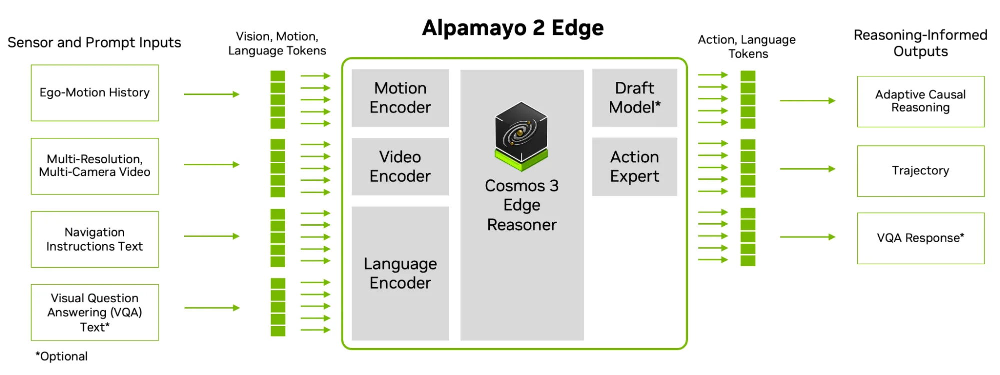
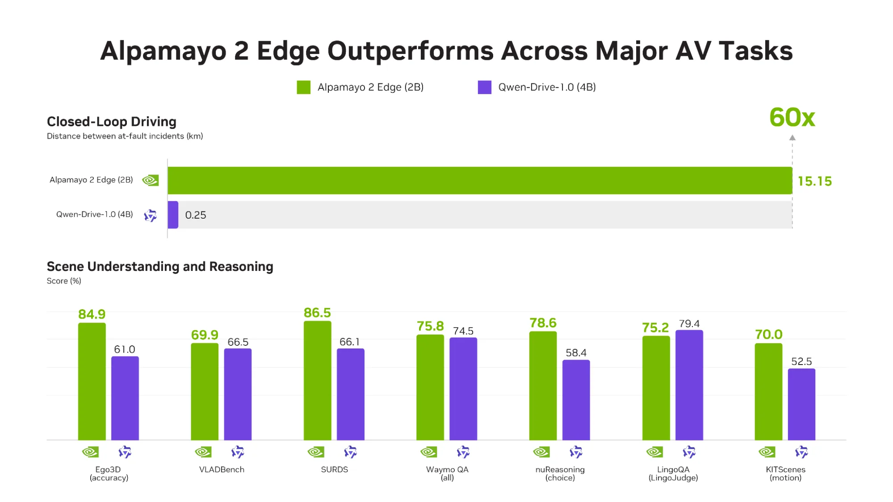
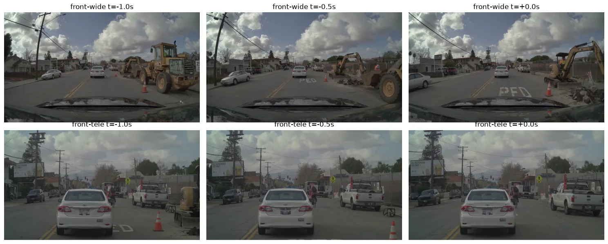
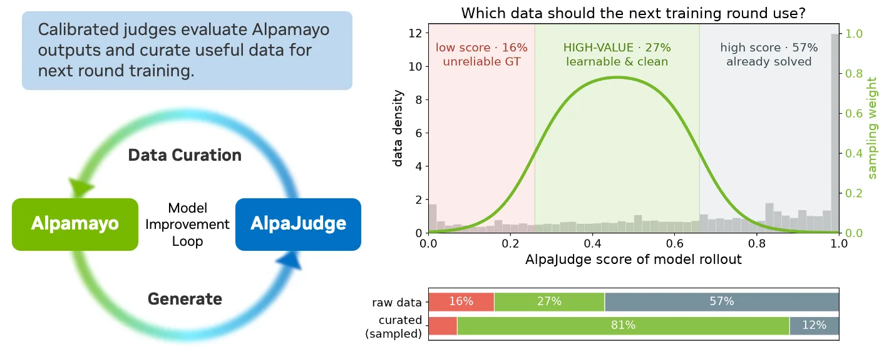
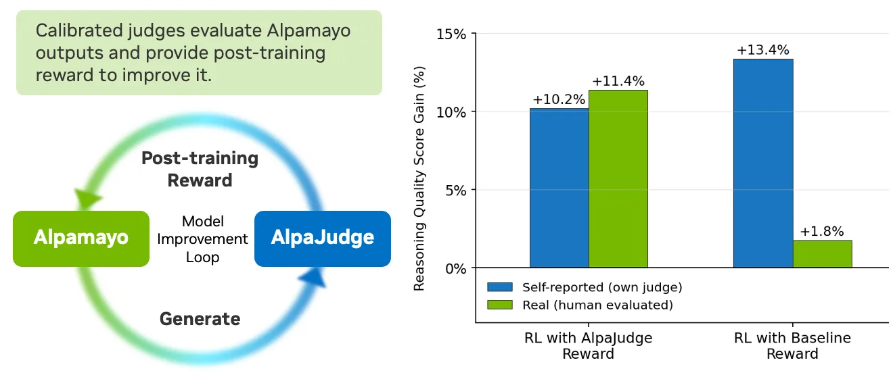

# NVIDIA Alpamayo 2 Edge · AlpaJudge — 차량 안에서 돌아가는 추론 모델과, 그 추론을 채점하는 모델

> **작성일**: 2026-11-12 (2판 — 용어 풀이 추가, Edge와 AlpaJudge 분리, Super 대비 비교표, 1차 자료 교차 확인) · 기사 게재일 2026-11-10  
> **대상 자료**: NVIDIA Technical Blog, *Running AV Reasoning Models Within Onboard Compute and Latency Limits* (Marco Pavone, Boris Ivanovic) [1]  
> **출처 표기 원칙**: 모든 사실 문장과 표 행에 `[번호]`를 달고, 말미 출처 목록에 URL을 수록했다. 등급은 📄 기사 본문 · 🔍 기사가 링크한 1차 자료를 직접 열어 확인 · 🔗 URL만 기록(미열람). 기사 안의 파트너 인용 수치(PORT·Niulinx·Embedl)는 각 사의 자체 평가이며 NVIDIA가 독립 검증한 것은 아니므로 **"파트너 자체 평가"로 따로 표기**한다. 기사에 없는 설명(용어 풀이, Super와의 비교, 하네스 코드 구성)은 모델 카드·GitHub README에서 가져왔고, 작성자의 해석은 문장 안에 "해석"이라고 밝혔다.  
> **그림**: 기사 원본 도식 5장을 `images/`에 저장해 수록했다(저작권은 NVIDIA에 있으며 인용 목적). 그림 설명은 기사 캡션을 번역하고, 그림을 어떻게 읽는지 덧붙였다.

---

## 1. 핵심 요약

**두 가지를 발표했다. 하나는 차에 싣는 "작은 주행 모델", 다른 하나는 그 모델의 "설명을 채점하는 모델"이다.**

- **Alpamayo 2 Edge** — 2B 파라미터짜리 주행 VLA(vision-language-action, 카메라 영상과 글을 읽고 차의 행동을 내놓는 모델). 서라운드 카메라 영상, 차량의 최근 움직임, 내비게이션 지시를 입력받아 "왜 이렇게 운전하는지" 설명(Chain-of-Causation, CoC)과 향후 6.4초 궤적을 함께 출력한다. 차량용 칩 NVIDIA DRIVE AGX Thor에서 실시간으로 돌리는 것이 목표다 [1][2].
- **AlpaJudge** — Alpamayo 같은 모델이 내놓은 "주행 설명 문장"이 타당한지 0~1 점수로 채점하는 별도의 판정 모델. 사람이 매긴 점수에 맞춰 보정(calibration)했다. 점수는 ① 모델 평가, ② 학습 데이터 고르기, ③ 강화학습 보상의 세 곳에 쓰인다 [1][6].

**왜 만들었나**: 큰 추론 모델은 똑똑하지만 차 안의 컴퓨터에 넣기엔 크고 느리다. 줄이면 설명 품질이 떨어질 수 있다. 그래서 "줄이는 기술"(Edge)과 "줄여도 설명이 멀쩡한지 재는 자"(AlpaJudge)를 함께 내놓았다 [1].

**핵심 숫자**

| 지표 | 값 | 뜻 | 출처 |
|---|---|---|---|
| Edge 모델 크기 | 백본 2.45B + 액션 전문가 0.2B | Alpamayo 2 Super(32B + 2.3B)의 약 1/14 | [2][4] |
| Thor에서 한 번 판단하는 데 걸리는 시간 | 160~190 ms (기사) / 180~250 ms (레시피 문서) | 카메라 픽셀이 들어가서 궤적이 나올 때까지. 설명을 길게 쓸수록 오래 걸린다 | [1][11] |
| 폐루프 RL 효과 | 주행 성능 +48.9% | 시뮬레이터에서 직접 운전해 보며 배우는 단계의 효과 | [1] |
| 과실 사고 간 거리 | 15.15 km vs 0.25 km | 시뮬레이터에서 자기 과실 사고 한 번 날 때까지 달린 거리. **클수록 좋다**. 비교 대상 Qwen-Drive-1.0(4B)의 약 60배 | [1][2] |
| AlpaJudge 보상으로 RL | 설명 품질 +10.2%(판정 모델 기준) / +11.4%(사람 평가) | 두 숫자가 비슷하다는 것이 핵심(5.5절) | [1] |
| 데이터 고르기 | 중간 점수대 비중 27% → 81% | 배울 게 많은 데이터만 추려 다음 학습에 씀 | [1] |

---

## 2. 시사점

1. **"필요할 때만 생각한다"가 차량용 추론 모델의 새 설계 원칙이 됐다.** Edge는 평범한 상황이면 설명을 쓰지 않고 `<NOMINAL>`("정상") 토큰 하나만 내보낸다. 글자를 안 만들면 그만큼 계산이 준다 [1][3]. 양자화 같은 사후 최적화보다 앞선, 모델 설계 수준의 지연 절감이다. 지연이 160~190 ms라는 **범위**로 제시된 이유도 여기 있다. 설명을 길게 쓰는 어려운 장면일수록 느려지므로, 안전 설계는 "가장 긴 설명" 기준으로 시간 예산을 잡아야 한다(해석).
2. **큰 모델은 선생님, 작은 모델은 학생이라는 역할 분담이 굳어졌다.** Alpamayo 2 Super(34B)는 데이터에 설명 라벨을 자동으로 달아 주는 선생님이고, Edge(2B)는 그 라벨로 배워 차에 타는 학생이다 [1][5][10]. Niulinx는 학생인 Edge가 센서 구성이 다른 자사 차량에서 Super보다 궤적 오차가 작았다고 밝혔다(파트너 자체 평가) [1]. "작은 모델은 반드시 성능이 낮다"는 전제가 항상 맞지는 않는다는 신호다.
3. **"설명을 채점하는 모델"이 개발 루프의 한가운데에 들어왔다.** 궤적 오차만 보면 "맞는 길로 갔지만 엉뚱한 이유를 댄" 경우를 못 잡는다. AlpaJudge는 그 틈을 메우고, 같은 점수를 평가·데이터 선별·RL 보상에 재사용한다 [1]. 앞으로는 판정 모델을 얼마나 사람 판단에 가깝게 만드느냐가 경쟁력이 된다(해석).
4. **보상 모델을 잘못 고르면 모델이 "점수만 잘 받는 법"을 배운다는 것을 숫자로 보여줬다.** 그림 5에서 기존 보상으로 학습한 모델은 자기 점수로는 +13.4% 좋아졌다고 했지만 사람이 보니 +1.8%에 그쳤다. AlpaJudge 보상은 +10.2% / +11.4%로 두 숫자가 일치했다 [1]. 자기 평가와 실제 평가가 벌어지는 현상이 "보상 해킹"이고, 사람에 맞춰 보정한 판정 모델이 그것을 막는다는 것이 이 그림의 메시지다.
5. **학습 데이터는 "중간 난이도"가 가장 값지다는 실무 원칙을 제시했다.** 점수가 아주 낮은 데이터는 정답 라벨 자체가 틀렸을 수 있고, 아주 높은 데이터는 이미 잘하는 쉬운 문제라 배울 게 없다. 중간 구간을 27%에서 81%로 늘려 다음 학습에 썼다 [1]. 자체 데이터를 가진 팀이 바로 따라 할 수 있다.
6. **코드와 가중치가 거의 다 공개됐지만, 한 조각은 빠져 있다.** Edge 가중치(OpenMDW-1.1), 추론 코드, Thor 배포 레시피, AlpaJudge 가중치·코드가 모두 공개다 [2][6][7][11]. 다만 Thor에서 속도를 내는 데 쓰는 DFlash2 드래프트 모델 가중치는 "모델 릴리스에 포함되지 않는다"고 레시피 문서가 밝힌다. 없으면 한 글자씩 생성하는 느린 방식으로 돌아간다 [11].
7. **NVIDIA 생태계 한 묶음이다.** 모델(Alpamayo), 시뮬레이터(AlpaSim·AlpaGym·NuRec), 판정 모델(AlpaJudge), 배포 스택(TensorRT Edge-LLM·DRIVE OS), 데이터셋(PhysicalAI-AV)이 서로 맞물려 제공된다 [1][10]. 파트너들이 "며칠 안에" 실차·실시간 구동까지 갔다는 인용은 진입이 빠르다는 뜻이고 [1], 반대로 스택을 바꾸기는 어려워진다(해석).

---

## 3. 내용 정리 ① — 읽기 전에 알아둘 용어

처음 보는 사람을 위해, 이 글에 나오는 말을 쉬운 순서로 풀었다. 본문에서 다시 설명하지 않는다.

| 용어 | 쉬운 설명 |
|---|---|
| **VLA** (vision-language-action) | 카메라 영상(vision)과 글(language)을 읽고 행동(action, 여기서는 주행 궤적)을 내놓는 모델. 사람으로 치면 "보고, 읽고, 핸들을 돌리는" 일을 한 모델이 한다. |
| **CoC** (Chain-of-Causation, 인과 사슬) | 모델이 궤적과 함께 내놓는 "왜 이렇게 운전하는지" 설명문. 예: "교차로에서 감속 후 우회전, 도로가 비어 있으므로." [11] 일반 LLM의 Chain-of-Thought와 비슷하지만 주행 결정의 원인을 장면 속 사물과 연결하도록 형식을 맞춘 것이다 [2]. |
| **추론 트레이스** (reasoning trace) | 모델이 답을 내기 전에 써 내려가는 생각의 기록. 이 글에서는 CoC 문장이 곧 추론 트레이스다. |
| **온보드 / 엣지** | 차 안에 실린 컴퓨터에서 직접 돌리는 것. 반대말은 데이터센터(클라우드). |
| **지연** (latency) | 입력이 들어가서 결과가 나오기까지 걸리는 시간. 자율주행은 보통 100 ms 단위를 다툰다. |
| **디스틸레이션** (distillation, 증류) | 큰 모델(선생님)의 출력을 작은 모델(학생)이 따라 배우게 하는 학습법. 여기서는 Super가 만든 설명문을 Edge가 받아쓰며 배운다 [1]. |
| **오토라벨** (auto-label) | 사람 대신 모델이 데이터에 붙인 정답 라벨. Super가 주행 영상에 CoC 설명을 자동으로 달아 주는 것이 "CoC 오토라벨"이다 [5]. |
| **오픈루프 / 폐루프 평가** | 오픈루프: 녹화된 영상을 보여주고 모델의 예측을 정답과 비교. 모델의 행동이 다음 장면에 영향을 주지 않는다. 폐루프: 시뮬레이터 안에서 모델이 실제로 운전하고, 그 결과로 바뀐 장면을 다시 입력받는다. 실제 주행에 가깝다 [5]. |
| **minADE** | 오픈루프 지표. 모델이 낸 여러 궤적 후보 중 가장 좋은 것과 실제 궤적의 평균 거리(m). **작을수록 좋다**. minADE_6은 후보 6개 중 최선 기준이다 [2]. |
| **과실 사고 간 거리** | 폐루프 지표. 시뮬레이터에서 "자기 과실 충돌 또는 도로 이탈"이 한 번 생길 때까지 달린 평균 거리(km). **클수록 좋다** [2]. |
| **RL** (강화학습) · **GRPO** | 정답을 베끼는 대신 "행동의 결과에 점수(보상)를 매겨" 배우는 방식. GRPO는 같은 입력에 여러 답을 뽑아 서로 비교해 보상을 정하는 RL 알고리즘의 하나다 [1]. |
| **보상 모델 · 보상 해킹** | 보상 모델: RL에서 점수를 매겨 주는 모델. 보상 해킹: 학습 중인 모델이 "진짜 잘하는 법" 대신 "점수 잘 받는 꼼수"를 배우는 현상. 예: 그럴듯한 문장만 길게 써서 점수를 받고 운전은 틀리는 경우 [1]. |
| **루브릭** (rubric) | 채점 기준표. 학교에서 "근거 제시 2점, 논리 3점"처럼 항목별로 점수를 매기는 그 표다. AlpaJudge-RF는 루브릭 항목 5개로 설명문을 채점한다 [6]. |
| **데이터 큐레이션** (curation) | 모아 둔 데이터 중 학습에 쓸 것을 고르고 비중을 조절하는 일. 박물관 큐레이터가 전시품을 고르는 것과 같은 뜻이다. |
| **양자화** (quantization) · **FP8 / BF16** | 모델 숫자를 더 적은 비트로 저장해 메모리와 계산을 줄이는 것. BF16은 16비트, FP8은 8비트. FP8로 줄이면 빨라지지만 정확도 손실을 점검해야 한다 [11]. |
| **speculative decoding** (추측 디코딩) | 글자를 한 번에 하나씩 만드는 LLM의 느린 생성을 빠르게 하는 기법. 작은 "초안 모델"(drafter)이 여러 글자를 먼저 써 놓고, 큰 모델이 한 번에 검사해서 맞으면 그대로 쓴다. 결과는 큰 모델이 혼자 쓴 것과 같고 속도만 빨라진다 [8][11]. |
| **TensorRT · 엔진** | NVIDIA GPU용 추론 최적화 도구. 학습용 PyTorch 모델을 특정 GPU에 맞춘 실행 파일("엔진")로 바꾼다. TensorRT Edge-LLM은 차량·로봇용 칩을 위한 LLM 전용 버전이다 [11]. |
| **하네스** (harness) | 여기서는 "엔진들을 순서대로 불러 한 번의 추론을 끝까지 실행하고 시간을 재는 파이썬 실행 스크립트"를 뜻한다. 시험대·고정 장치라는 원뜻에서 온 말이다 [11]. |

---

## 4. 내용 정리 ② — Alpamayo 2 Edge (차에 싣는 주행 모델)

### 4.1 한 줄 정의와 위치

Alpamayo 2 Edge는 NVIDIA Alpamayo 모델 가족(1 Nano, 1.5 Nano, 2 Super, 2 Edge) 중 가장 작은 2B 모델로, 차량 탑재용이다. 가족 안에서 Super는 "오토라벨·디스틸레이션의 선생님", Edge는 "차량 컴퓨트에 맞춘 출발점"으로 역할이 나뉜다 [10]. Hugging Face 공개일은 2026-11-10이고 가중치는 OpenMDW-1.1, 코드는 Apache 2.0 라이선스다 [2][3].

### 4.2 Alpamayo 2 Super와 무엇이 다른가

같은 회사의 큰 형(Super)과 나란히 놓으면 Edge의 설계 의도가 보인다. 두 모델의 오픈루프·폐루프 수치는 **평가 조건이 달라 직접 비교할 수 없으므로** 표에서 따로 표시했다.

| 항목 | Alpamayo 2 Super | Alpamayo 2 Edge | 출처 |
|---|---|---|---|
| 공개일 | 2026-08-04 | 2026-11-10 | [4][2] |
| 역할 | 개발용 기반 모델: 오토라벨 선생님, 학습 데이터 생성, 평가 | 차량 탑재용 학생 모델, 파인튜닝 출발점 | [5][10] |
| 크기 | 백본 32B + 액션 전문가 2.3B (약 34B) | 백본 2.45B(언어 1.96B + 비전 0.41B + 연결부 0.08B) + 액션 전문가 0.2B | [4][2] |
| 백본 | Cosmos 3 Super Reasoner | Cosmos 3 Edge (Nemotron 기반) | [4][2] |
| 카메라 입력 | 최대 7대, 카메라당 4프레임 | 6대, 총 22프레임(전방 광각·망원 5장씩, 나머지 4대 3장씩) | [5][2] |
| 출력 | 궤적, CoC, 메타액션, VQA + 2D 바운딩 박스, 구조화 오토라벨 | 궤적, CoC, VQA | [4][2] |
| 적응형 추론(`<NOMINAL>`) | 기사·모델 카드에 언급 없음 | 있음 | [1][3] |
| 추론 가속 | — | DFlash2 speculative decoding, TensorRT Edge-LLM FP8 레시피 | [1][11] |
| 실행 메모리 | 내비 CFG 샘플링 시 70 GB 이상 GPU 2장 | H100 측정 12.06 GiB, 권장 16 GB 이상 | [5][2] |
| LingoQA (같은 벤치마크, 비교 가능) | 79.2 | 75.2 | [5][2] |
| 오픈루프 (조건 다름) | minADE_6 @6.4 s = 0.911 m, 어려운 1,434 샘플 | minADE_6 @5 s = 0.52 m, 1,392 샘플 | [4][2] |
| 폐루프 (지표 다름) | AlpaSim Score 1.50 ± 0.13, 913 장면 | 과실 사고 간 거리 15.15 ± 0.04 km, 875 장면 × 3회 | [4][2] |
| 라이선스 | 가중치 OpenMDW-1.1, 코드 Apache 2.0 | 동일 | [4][2] |

읽는 법: Edge는 Super의 기능 중 메타액션·2D 접지·오토라벨을 덜어내고, 궤적과 설명에 집중한 뒤, 추론을 생략하는 기능과 배포 레시피를 더했다. LingoQA 4점 차이는 "14배 작은 모델이 설명 품질을 얼마나 지켰는가"를 보여주는 유일한 동일 조건 비교다. 기사가 비교 대상으로 쓴 Qwen-Drive-1.0은 4B 모델이라는 것 외에 기사에 설명이 없다 [1].

### 4.3 모델 구조



*그림 1. 왼쪽 네 가지 입력(에고 모션 히스토리, 멀티 해상도 멀티 카메라 영상, 내비게이션 텍스트, 선택적 VQA 질문)이 각각 모션·비디오·언어 인코더를 거쳐 토큰이 되고, 가운데 Cosmos 3 Edge Reasoner가 이를 읽는다. 오른쪽 드래프트 모델(선택)과 액션 전문가가 각각 설명 생성 가속과 궤적 생성을 맡아, 적응형 인과 추론 · 궤적 · VQA 응답을 내놓는다 [1].*

| 구성 요소 | 하는 일 | 출처 |
|---|---|---|
| 모션 인코더 | 지난 1.9초간 0.1초 간격 20개 차량 위치·자세를 토큰으로 바꿈 | [2][3] |
| 비디오 인코더 (SigLIP2, 0.41B) | 카메라 22프레임을 토큰으로 바꿈. 전방 카메라는 더 많은 픽셀, 측후방은 적은 픽셀(멀티 해상도) | [2][3] |
| 언어 인코더 | 내비게이션 지시("30 m 앞에서 우회전")와 질문을 토큰으로 | [2][3] |
| Cosmos 3 Edge Reasoner (1.96B) | 모든 토큰을 읽고 CoC 설명을 씀. 설명 끝의 내부 표현을 액션 전문가에 넘김 | [2] |
| 드래프트 모델 (DFlash2, 선택) | 설명을 빨리 쓰기 위한 초안 모델. 4.5절 | [1][11] |
| 액션 전문가 (0.2B, 디퓨전) | 설명과 장면 표현을 받아 0.1초 간격 64개 지점(6.4초) 궤적을 생성. 가속도·곡률을 예측하고 자전거 모델로 적분 | [2] |

출력 궤적 후보는 여러 개 뽑을 수 있고, 후보마다 설명을 따로 쓴다(기본 1개, 노트북 예제는 6개) [2][3].

### 4.4 적응형 추론과 `<NOMINAL>` 토큰

- **무엇인가**: 모델이 장면을 보고 "평범한 상황"이라고 판단하면 CoC 설명문 대신 `<NOMINAL>`이라는 특수 토큰 하나만 출력하고 바로 궤적으로 넘어간다. 설명을 쓰지 않으니 토큰 생성 시간과 연산이 줄어든다 [1].
- **왜 중요한가**: LLM의 지연은 대부분 글자를 한 개씩 만드는 시간이다. 레시피 문서 기준으로 Thor에서 설명 한 묶음(드래프터 1라운드)에 약 12 ms가 들고, 어려운 장면은 라운드가 7번까지 늘어난다 [11]. 평상시 설명을 생략하면 그 시간이 통째로 사라진다.
- **새로운 기법인가**: Alpamayo 가족 안에서는 Edge가 처음이다. Super의 모델 카드·블로그에는 이 기능이 없고, 공식 저장소도 Edge를 "적응형 추론"으로 구분한다 [3][4][5][10]. 발상 자체는 일반 LLM에서 "생각 모드를 켜고 끄는" 기능과 같다. 차이는 켜고 끄기를 사용자가 아니라 **모델이 장면을 보고 스스로** 정한다는 점이다(해석).
- **주의**: 기사는 "언제 NOMINAL을 내는지"의 기준이나 그 비율을 공개하지 않았다 [1].

### 4.5 어떻게 학습·최적화했나

기사는 아래 일곱 가지를 Edge의 "new features"라고 묶었다. 무엇에 대해 새롭다는 것인지 기사가 명시하지 않았는데, 문맥상 이전 Alpamayo 공개 모델(1.5 Nano, 2 Super) 대비로 읽힌다(해석) [1].

| 기법 | 쉬운 설명 | 출처 |
|---|---|---|
| 2B Nemotron 백본 | 차량 칩에 들어갈 크기로 처음부터 작은 백본을 골랐다 | [1][2] |
| 적응형 추론 | 4.4절 | [1] |
| 오프라인 디스틸레이션 | **Super가 주행 영상에 자동으로 달아 준 CoC 설명 라벨을 Edge가 정답 삼아 배웠다.** 사람이 수백만 개 설명을 쓸 수 없으니 큰 모델이 대신 쓴 것이다. Edge 학습 데이터에는 CoC 트레이스가 약 370만 개 들어 있고, 모델 카드는 이를 "합성 추론 트레이스"라고 부른다 [1][2]. Super의 오토라벨 품질은 전문가 라벨과 0.652 유사도(내부 8천 클립, 내부 판정 모델 기준)로 보고되어 있다 [5]. |
| 폐루프 RL (AlpaGym) | 시뮬레이터 안에서 직접 운전해 보고 결과(충돌, 이탈)로 보상을 받아 배운다. RL 없는 최고 체크포인트 대비 폐루프 주행 성능 +48.9% | [1] |
| 멀티 해상도 입력 | 중요한 전방 카메라는 고해상도, 나머지는 저해상도로 넣어 토큰 수를 아낀다 | [1][2] |
| DFlash2 speculative decoding | 아래 상세 | [1][8] |
| TensorRT·TensorRT-Edge-LLM 레시피 | 4.7절 | [1][11] |

**DFlash2가 무엇인가**

- DFlash는 z-lab(Chen, Liang, Liu, 2026, arXiv 2602.06036)이 만든 speculative decoding용 초안 모델이다. 특징은 "블록 디퓨전": 초안 글자를 한 개씩이 아니라 한 블록(여러 글자)을 **동시에** 생성한다. DFlash 2는 2026년 8월에 Inco AI가 내놓은 후속판이다 [8][9].
- 동작: 작은 DFlash2 드래프터가 설명문 16토큰짜리 블록을 먼저 쓰고, Edge 본 모델이 그 블록을 한 번에 검사해 맞는 부분까지 채택한다. 그래서 결과는 본 모델이 혼자 쓴 것과 같다. 레시피 문서는 "모든 테스트 클립에서 그리디 디코딩과 같은 설명문을 재현했다"고 적었다 [11].
- 효과: Thor에서 한 글자씩 쓰면 약 7 ms/토큰, DFlash2 라운드는 12 ms에 여러 토큰을 처리한다 [11].
- 제공 여부: **DFlash2 드래프터 가중치는 Edge 모델 릴리스에 포함되지 않는다.** 없으면 레시피는 초안 단계를 건너뛰고 그리디 디코딩으로 돌아간다 [11]. Alpamayo 1.5용 DFlash2 드래프터를 직접 학습하는 레시피는 공개되어 있다 [10].

### 4.6 성능



*그림 2. 위: 폐루프 주행에서 과실 사고 간 거리(km, 클수록 좋음). 아래: 장면 이해·추론 벤치마크 7종 점수(%). 초록이 Alpamayo 2 Edge(2B), 보라가 Qwen-Drive-1.0(4B) [1].*

**읽는 법**: 위 막대는 "자기 과실 사고 한 번 나기까지 몇 km를 달렸나"다. Edge 15.15 km, Qwen 0.25 km로 약 60배 차이다. 모델 카드 기준으로 이 수치는 PhysicalAI-AV-NuRec 875개 장면을 각 3회 주행한 평균이고, 과실 사고는 "도로 이탈 또는 자기 과실 충돌"로 정의된다 [2]. 아래 막대 7쌍 중 LingoQA 한 항목만 Qwen이 앞선다(79.4 vs 75.2). 기사 캡션의 "거의 모든 항목에서 우세"는 이 예외를 뜻한다 [1].

| 지표 | Alpamayo 2 Edge (2B) | Qwen-Drive-1.0 (4B) | 출처 |
|---|---|---|---|
| 폐루프: 과실 사고 간 거리 (↑) | 15.15 km | 0.25 km | [1][2] |
| 오픈루프: minADE (↓) | 0.53 m | 1.68 m | [1] 그림 2 대체 텍스트 |
| Ego3D (accuracy) | 84.9 | 61.0 | [1] 그림 2 |
| VLADBench | 69.9 | 66.5 | [1] 그림 2 |
| SURDS | 86.5 | 66.1 | [1] 그림 2 |
| Waymo QA (all) | 75.8 | 74.5 | [1] 그림 2 |
| nuReasoning (choice) | 78.6 | 58.4 | [1] 그림 2 |
| LingoQA (LingoJudge) | 75.2 | **79.4** | [1] 그림 2 |
| KITScenes (motion) | 70.0 | 52.5 | [1] 그림 2 |

**파트너 코멘트** — 모두 각 사의 자체 평가이며 기사에 인용된 그대로다 [1].

| 파트너 (발언자) | 내용 |
|---|---|
| PORT (Matas Simonavicius, CTO) | 조기 접근 며칠 안에 자사 런던 주행 기록의 NuRec 재구성에서 폐루프 구동. 초기 시뮬레이션에서 Alpamayo 1.5 대비 차선 유지 성공 2배 이상, 차선 이탈 복구 약 40% 더 많음, 같은 GPU에서 수작업 튠한 Alpamayo 1.5 서버보다 계획 속도 약 2배 |
| Niulinx (Luca Crotti, 공동창업자) | 센서 구성이 크게 달라도 제로샷에서 Alpamayo 2 Super 대비 minADE 13.6% 감소, 3초 횡방향 RMSE 46.1% 감소. 자체 데이터 파인튜닝으로 Edge 기준 대비 minADE 추가 44.2% 감소. 며칠 안에 실차 첫 테스트(영상 1: 교통 경찰 수신호에 정차, 횡단보도 보행자 양보) |
| Embedl (Hans Salomonsson, CEO) | 48시간 안에 AGX Thor에서 10 Hz 실시간 계획 구동(영상 2: PyTorch 구동 vs Embedl 최적화 구동 비교) |

### 4.7 DRIVE AGX Thor 배포: 레시피, 하네스, 제공 범위

**기본 형태**: Hugging Face에서 받는 가중치는 BF16 PyTorch 모델이라 지원되는 NVIDIA GPU 어디서나 바로 돌릴 수 있다(권장 메모리 16 GB 이상). Thor에서 실시간으로 돌리려면 별도 최적화가 필요하다 [1][2][3].

**레시피란**: Alpamayo Developer Hub(GitHub `NVlabs/alpamayo-recipes`)의 `recipes/alpamayo2edge_edgellm/` 폴더에 있는, 순서대로 따라 하면 Thor용 엔진이 만들어지는 문서+스크립트 묶음이다. 코드는 Apache 2.0으로 공개되어 있다 [10][11].

| 단계 | 어디서 | 하는 일 | 출처 |
|---|---|---|---|
| 1. 스테이징 | x86 호스트 PC | Edge 체크포인트와(있다면) DFlash2 드래프터 다운로드, 가중치 배치를 내보내기 도구가 읽는 형태로 변환 | [11] |
| 2. FP8 캘리브레이션 | 호스트 | 실제 카메라 프레임을 흘려 보내 FP8로 줄일 때의 스케일 값을 정함. 비전 인코더 앞부분은 FP16 유지 | [11] |
| 3. ONNX 내보내기 | 호스트 | 언어 모델·비전·액션 전문가·드래프터를 각각 ONNX 그래프로 변환. 출력 어휘를 CoC에 실제 쓰이는 2,211개 토큰으로 축소 | [11] |
| 4. 엔진 빌드 | Thor 보드 | TensorRT Edge-LLM 플러그인으로 엔진 생성(언어·비전 약 15분, 액션 약 10분, 드래프터 약 5분) | [11] |
| 5. 파이썬 하네스 실행 | Thor 보드 | `thor/run.py`가 엔진들을 순서대로 호출해 한 클립을 끝까지 추론하고, 설명문·궤적(`output.json`)과 단계별 시간(`profile.json`)을 기록 | [1][11] |
| 6. 품질 검사 | 호스트 | 같은 입력·같은 난수로 돌린 BF16 PyTorch 결과와 궤적을 비교 | [1][11] |

**파이썬 하네스가 하는 일** (기사의 `python -m alpamayo2edge_edgellm.runtime.run` 명령이 이것이다) [1][11]:
- 모든 궤적 후보가 공유하는 프리필(prefill, 입력 토큰을 한 번에 읽는 단계)을 한 번만 실행.
- 카메라 프레임 인코딩 결과를 이미지별로 캐시. `--rolling` 옵션은 "매 틱마다 새로 들어온 프레임만" 인코딩 시간에 포함해, 실제 스트리밍 환경을 흉내 낸다.
- DFlash2 드래프트 엔진으로 speculative decoding.
- 액션 전문가가 언어 모델의 K/V 캐시를 복사 없이 그대로 읽음.
- 기준 환경: DRIVE AGX Thor-X, DRIVE OS 7.2.7.0, CUDA 13.4, TensorRT 11.3.1.9 [1][11].

**실행 명령(기사 원문)** [1]:

```bash
python -m alpamayo2edge_edgellm.runtime.run \
  --engines "$WORK/engines" \
  --model "$MODEL" \
  --reference "$INPUTS" \
  --dflash2 \
  --rolling \
  --warmup 1 \
  --repeat 5 \
  --output "$WORK/results.json"
```

**지연 수치 두 가지** — 기사는 160~190 ms, 레시피 문서는 "공개 예제 클립 약 220 ms, 내부 검증 10클립에서 180~250 ms"라고 적었다. 레시피 문서는 자기 수치를 "벤치마크가 아닌 참고치이며 보드·OS·클립에 따라 움직인다"고 못 박았다 [1][11]. 레시피 문서의 단계별 시간은 다음과 같다(FP8, 후보 6개, Euler 5스텝) [11].

| 단계 | 시간 |
|---|---|
| 비전 인코더 (새 프레임 6장) | 약 20 ms |
| 프리필 (약 3,300 토큰) | 약 75 ms |
| CoC 생성, 드래프터 1라운드(초안+검증) | 약 12 ms × 1~7라운드 |
| 액션 전문가 (5스텝 × 6후보) | 약 70 ms |

FP8로 줄였을 때의 정확도 손실은 내부 10클립 기준 minADE_6 1.547 m(FP8) vs 1.570 m(FP16)로 거의 없었다 [11].

---

## 5. 내용 정리 ③ — AlpaJudge (주행 설명을 채점하는 모델)

### 5.1 한 줄 정의

**AlpaJudge는 모델이다.** 정확히는 "자율주행 모델이 쓴 주행 설명문이 타당한지 채점하도록 학습된 판정 모델 가족"이고, 체크포인트 두 개(RB, RF)가 Hugging Face `nvidia/alpajudge`에 공개되어 있다. 가중치는 OpenMDW-1.1, 코드는 Apache 2.0이다 [6][7].

**무엇을 채점하나**: Alpamayo(또는 다른 모델)가 출력한 CoC 설명문, 그리고 오토라벨처럼 사람이 아닌 모델이 쓴 설명 라벨. 궤적 자체를 채점하는 것이 아니다. 공식 설명은 "인과적 주행 설명을 채점해 추론 품질을 평가하고, 약한 라벨을 거르고, 학습 데이터 수동 검토를 줄인다"다 [6].

### 5.2 왜 필요한가

궤적 지표(minADE, 과실 사고 간 거리)는 "차가 어디로 갔나"만 본다. "맞는 길로 갔지만 이유가 엉터리"인 경우, 즉 설명이 장면 속 실제 원인을 짚지 못하거나 결정과 안 맞는 경우를 잡지 못한다. 모델을 작게 줄일 때 이런 품질 저하가 생기기 쉬워서, 기사는 설명 품질을 **숫자로 재는 자**가 필요하다고 본다 [1].

### 5.3 두 가지 변형: 무엇을 주면 무엇을 돌려주나

| | AlpaJudge-RB (reference-based, 참조 기반) | AlpaJudge-RF (reference-free, 참조 없음) | 출처 |
|---|---|---|---|
| 입력 | 질문 + **정답 설명(참조)** + 채점할 설명. 이미지 없음 | 전방 광각 3프레임 + 전방 망원 3프레임(−1.0, −0.5, 0.0초) + 차량의 메타액션(과거·미래) + 채점할 설명 | [6][7] |
| 출력 | 정렬 확률 1개 (0~1): "참조 설명과 얼마나 같은 말을 하나" | 루브릭 항목 5개 확률 + 합산 점수 3개 | [6][7] |
| 하는 일 | 정답과의 일치도 측정. 장면을 직접 보지 않는다 | 영상과 차량 행동을 직접 보고 설명이 맞는지 판단 | [6] |
| 쓰임 | 정답 라벨이 있는 데이터 채점, RL 보상 | 정답 라벨이 없는 실제 주행 로그 채점 | [1] |
| 필요 자원 | 텍스트 모델 | GPU 권장, 가중치 약 5 GB | [6] |

**RF의 루브릭 5개와 점수 계산** [6]:

| 항목 | 묻는 것 |
|---|---|
| p_match (행동 일치) | 설명이 말하는 행동이 차량의 실제 행동과 같은가 |
| p_safe (행동 안전) | 그 행동이 안전한가 |
| p_grounded (근거 접지) | 설명이 언급한 사물·상황이 실제 영상에 있는가 |
| p_complete (근거 완전) | 중요한 원인을 빠뜨리지 않았는가 |
| p_causal (인과 일관) | 원인 → 행동의 연결이 논리적인가 |

- action = p_match × (1 + p_safe) / 2
- component = 평균(p_grounded, p_complete, p_causal)
- **overall = 0.6 × action + 0.4 × component**

읽는 법: "행동이 맞는가"에 60%, "설명이 장면에 근거하는가"에 40%를 준다. 행동이 틀리면(p_match ≈ 0) 설명이 아무리 그럴듯해도 action 점수가 0에 가까워진다. 예제 노트북의 공사 구간 샘플은 RB 0.999, RF overall 0.842가 나오지만, 공식 문서는 이 값이 "추론 경로가 동작하는지 확인용이지 벤치마크나 권장 기준점이 아니다"라고 밝힌다 [1][6].

### 5.4 믿을 수 있는 모델인가

- **"사람 기준으로 보정했다"의 의미**: 사람이 매긴 점수에 가깝게 나오도록 학습·조정했다는 뜻이다. 기사가 제시한 근거는 그림 5 하나다. AlpaJudge 보상으로 학습한 모델의 품질 향상을 AlpaJudge 자신이 +10.2%, 사람이 +11.4%로 평가해 두 숫자가 거의 같았다 [1].
- **공개되지 않은 것**: 사람 평가자와의 일치율, 학습 데이터, 학습 방법은 기사와 공개 저장소에 없다. 저장소는 "학습 코드와 데이터 파이프라인은 포함하지 않는다"고 명시한다 [6].
- **공식 한계** [6]: RB는 참조와의 일치만 재므로 참조 자체가 틀리면 같이 틀린다. RF는 프레임 동기화와 메타액션 형식이 정확해야 하고, 영상 디코더나 메타액션 추출기는 패키지에 없다.
- 종합하면 "NVIDIA가 자체 개발 루프에 쓰는 판정 모델을 공개한 것"이며, 외부 검증 수치는 아직 없다. 자기 데이터에 쓸 때는 일부를 사람이 채점해 일치율을 먼저 확인하는 것이 안전하다(해석).

### 5.5 세 가지 쓰임새

**쓰임 1: 모델이 쓴 설명 채점하기**

1. AlpaJudge 저장소에서 환경을 설치하고 예제 노트북을 연다(`uv sync --locked --dev`, `hf auth login`, `uv run jupyter lab examples/alpajudge_pai.ipynb`) [1][6].
2. 노트북은 PhysicalAI-AV 클립 `030c760c-…`의 5.1초 시점을 쓰고, 고정된 공사 구간 샘플로 RB와 RF를 한 번씩 돌린다. 예제 설명문과 메타액션은 수동 작성이라 다른 시점을 쓰려면 함께 바꿔야 한다 [1][6].
3. Edge를 평가하려면 같은 클립에 Edge 추론을 돌려 `output.json`의 `text.cot`에 든 설명문을 꺼내, 노트북의 수동 설명 자리에 넣는다. 정답 설명이 있으면 RB에 answer로, Edge 설명을 student로 넘긴다 [1].
4. 출력에 클립 ID·시각·카메라·행동 맥락을 남겨 낮은 점수를 장면까지 추적한다. 설명 점수는 충돌·이탈·궤적 지표와 **함께** 보고한다 [1].



*그림 3. 노트북에 쓰인 클립의 여러 시점 카메라 프레임 [1].*

**쓰임 2: 다음 학습에 쓸 데이터 고르기(큐레이션)**



*그림 4. 왼쪽: Alpamayo가 생성 → AlpaJudge가 채점 → 데이터 선별 → 다시 학습하는 루프. 오른쪽 위: 모델 출력에 매긴 AlpaJudge 점수의 분포(회색 막대)와 샘플링 가중치(초록 곡선). 오른쪽 아래: 선별 전후 비중 [1].*

**그림 4 읽는 법**: 가로축이 AlpaJudge 점수(0~1)다. 왼쪽 빨간 구간(점수 약 0.25 이하, 16%)은 "정답 라벨이 못 미더운" 데이터, 오른쪽 회색 구간(약 0.65 이상, 57%)은 "이미 잘 푸는" 데이터, 가운데 초록 구간(27%)이 "배울 수 있고 깨끗한" 데이터다. 초록 곡선이 가운데에서 높다는 것은 그 구간을 많이 뽑는다는 뜻이다. 그 결과 아래 막대처럼 중간 구간 비중이 27%에서 81%로 올라가고 양 끝은 줄어든다 [1].

주의점 [1]:
- 점수가 아주 낮다고 바로 버리면 안 된다. 라벨 오류일 수도 있지만 "진짜 어려운 희귀 상황"일 수도 있어서, 일괄 삭제하면 모델이 꼭 배워야 할 실패 사례가 사라진다. 사람이 검토한다.
- 적용 절차: 클립마다 후보 설명 생성 → 고정된 AlpaJudge 체크포인트로 채점 → 점수·클립 ID·시나리오 정보 기록 → 저점·안전 중요 사례 수동 검토 → 개발용 데이터에서 기준점 정하기 → 장면 유형별로 고르게 섞기 → 평가용 데이터는 건드리지 않기 → 다시 학습해 같은 기준 데이터로 비교.

**쓰임 3: 강화학습의 보상으로 쓰기**



*그림 5. 왼쪽: Alpamayo가 생성 → AlpaJudge가 채점해 보상 → 다시 학습하는 루프. 오른쪽: 두 가지 보상으로 RL을 했을 때 설명 품질이 얼마나 좋아졌는지. 파란 막대는 "학습에 쓴 판정 모델 자신이 매긴 향상", 초록 막대는 "사람이 평가한 실제 향상". Alpamayo 2 Super 기반 RL 이전 모델에서 측정 [1].*

**그림 5 읽는 법**: 막대 묶음이 둘이다. 왼쪽 "AlpaJudge 보상"은 자기 점수 +10.2%, 사람 평가 +11.4%로 **두 막대가 비슷하다**. 오른쪽 "기존 보상"은 자기 점수 +13.4%인데 사람 평가는 +1.8%로 **크게 벌어진다**. 벌어진다는 것은 모델이 "판정 모델이 좋아할 글"만 배우고 실제 설명은 거의 나아지지 않았다는 뜻, 즉 보상 해킹이다. 파란 막대가 높다고 좋은 게 아니라 **파란색과 초록색이 가까울수록 믿을 수 있는 보상**이라고 읽어야 한다 [1].

구현 방법 [1]:
- 공개 Alpamayo RL 레시피(GRPO)는 궤적 오차·승차감 점수에 "플러그형 설명 채점기"를 더해 하나의 보상으로 합친다. 각 샘플에 정답 설명이 있으면 AlpaJudge-RB를 그 채점기로 꽂을 수 있다.
- 코드로는 `BaseReasoningGrader.score(predictions, references)` 인터페이스를 `score_reference_based` 호출로 구현한 어댑터를 `GRADER_REGISTRY`에 등록한다.
- **보상 해킹 방지 설계**: 궤적 게이트(궤적이 일정 품질을 넘어야 설명 점수가 반영됨)를 유지하고, 궤적 점수와 설명 점수를 따로 기록한다. 설명만 그럴듯하게 써서 총점을 올리는 길을 막기 위해서다.

---

## 6. 미확인·유의 사항

- 파트너 3사(PORT·Niulinx·Embedl)의 수치는 기사에 인용된 자체 평가이며 평가 조건이 공개되지 않았다 [1].
- 지연 수치가 기사(160~190 ms)와 레시피 문서(180~250 ms)에서 다르다. 레시피 문서는 자기 수치를 참고치라고 밝혔고, 측정 클립과 설정이 다를 수 있다 [1][11].
- Edge와 Super의 오픈루프·폐루프 수치는 샘플 수·예측 시간·지표가 달라 직접 비교할 수 없다. 같은 조건 비교는 LingoQA뿐이다 [2][4][5].
- `<NOMINAL>`을 내는 판단 기준과 평상시 비율, AlpaJudge의 사람 평가 일치율과 학습 방법은 공개되지 않았다 [1][6].
- 기사가 비교 대상으로 쓴 Qwen-Drive-1.0(4B)은 기사에 설명이 없고 이번 작성에서도 조사하지 않았다(출처 미확인).
- 장면 이해·추론 벤치마크 7종의 개별 점수는 기사 본문에 없고 그림 2 이미지 속 숫자를 옮긴 것이다. Edge 모델 카드의 표와 소수점 반올림 수준에서 일치한다 [1][2].
- AlpaGym 저장소, RL 레시피 README, Cosmos 페이지, 개발자 포럼은 URL만 기록하고 열어 보지 않았다.

## 출처

1. 📄 NVIDIA Technical Blog — Running AV Reasoning Models Within Onboard Compute and Latency Limits (Marco Pavone, Boris Ivanovic) — 2026-11-10 — https://developer.nvidia.com/blog/running-av-reasoning-models-within-onboard-compute-and-latency-limits/
2. 🔍 Hugging Face — nvidia/Alpamayo2-Edge 모델 카드 (파라미터 구성·입출력·벤치마크·메모리·라이선스) — 2026-11-10 공개 — https://huggingface.co/nvidia/Alpamayo2-Edge
3. 🔍 GitHub NVlabs/alpamayo2-edge — README (추론 코드, 입력 프로필, 가속 옵션) — https://github.com/NVlabs/alpamayo2-edge
4. 🔍 Hugging Face — nvidia/Alpamayo2-Super 모델 카드 (34B 구성·입출력·평가) — 2026-08-04 공개 — https://huggingface.co/nvidia/Alpamayo2-Super
5. 🔍 NVIDIA Technical Blog — Generate Trajectories, Reasoning Traces, and Auto-Labels with NVIDIA Alpamayo 2 Super — https://developer.nvidia.com/blog/generate-trajectories-reasoning-traces-and-auto-labels-with-nvidia-alpamayo-2-super/
6. 🔍 GitHub NVlabs/alpajudge — README (RB·RF 입력 계약, 점수 공식, 한계) — https://github.com/NVlabs/alpajudge
7. 🔍 Hugging Face — nvidia/alpajudge 모델 카드 (체크포인트 2종, 라이선스) — https://huggingface.co/nvidia/alpajudge
8. 🔍 GitHub z-lab/dflash — README (DFlash·DFlash 2 개요, 지원 모델) — https://github.com/z-lab/dflash
9. 🔗 arXiv 2602.06036 — DFlash: Block Diffusion for Flash Speculative Decoding (Chen, Liang, Liu) — 2026 — https://arxiv.org/abs/2602.06036
10. 🔍 GitHub NVlabs/alpamayo-recipes — README (Alpamayo Developer Hub, 모델 가족·레시피 목록) — https://github.com/NVlabs/alpamayo-recipes
11. 🔍 GitHub NVlabs/alpamayo-recipes — recipes/alpamayo2edge_edgellm/README.md (Thor 배포 레시피, 단계별 지연, 하네스 구성) — https://github.com/NVlabs/alpamayo-recipes/blob/main/recipes/alpamayo2edge_edgellm/README.md
12. 🔗 GitHub NVlabs/alpagym — AlpaGym 폐루프 RL 프레임워크 — https://github.com/NVlabs/alpagym
13. 🔗 GitHub NVlabs/alpamayo-recipes — recipes/alpamayo1_x_rl/README.md (GRPO RL 레시피) — https://github.com/NVlabs/alpamayo-recipes/blob/main/recipes/alpamayo1_x_rl/README.md
14. 🔗 NVIDIA Developer Forums — Alpamayo 포럼 — https://forums.developer.nvidia.com/c/autonomous-vehicles/alpamayo/766
15. 🔗 NVIDIA — Cosmos 소개 페이지 — https://www.nvidia.com/en-us/ai/cosmos/
